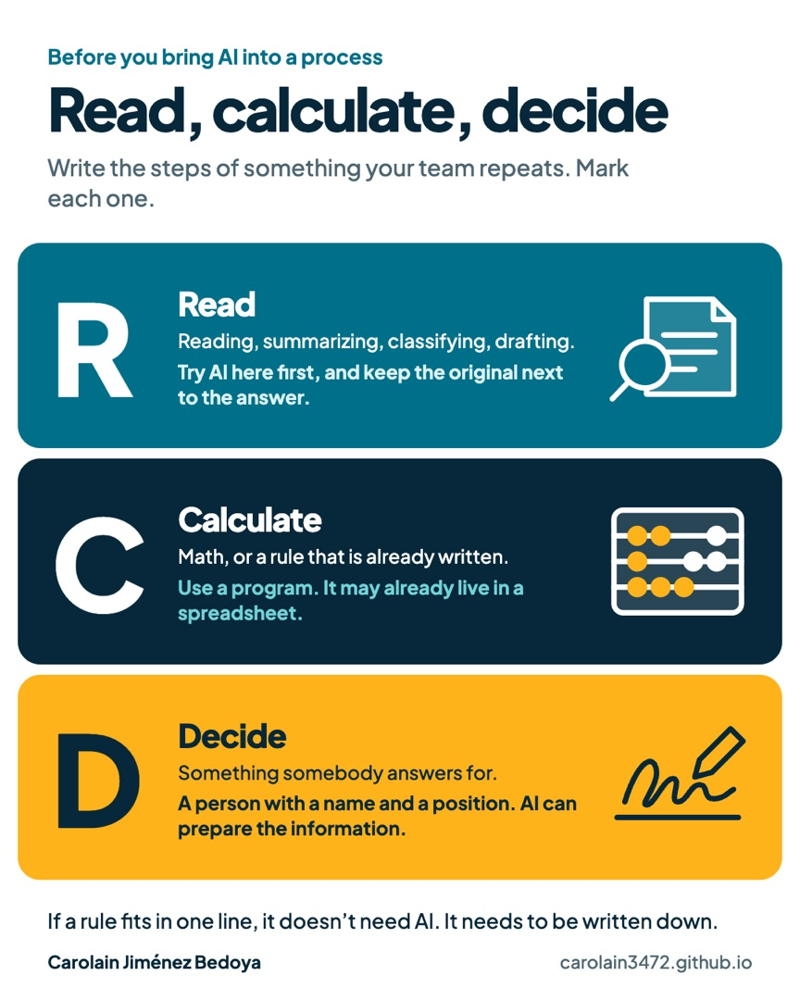
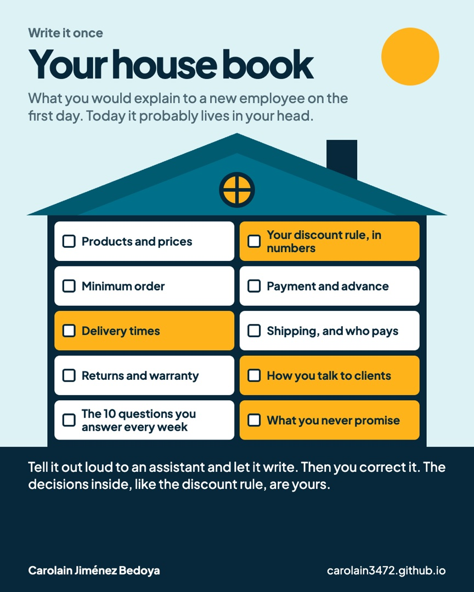
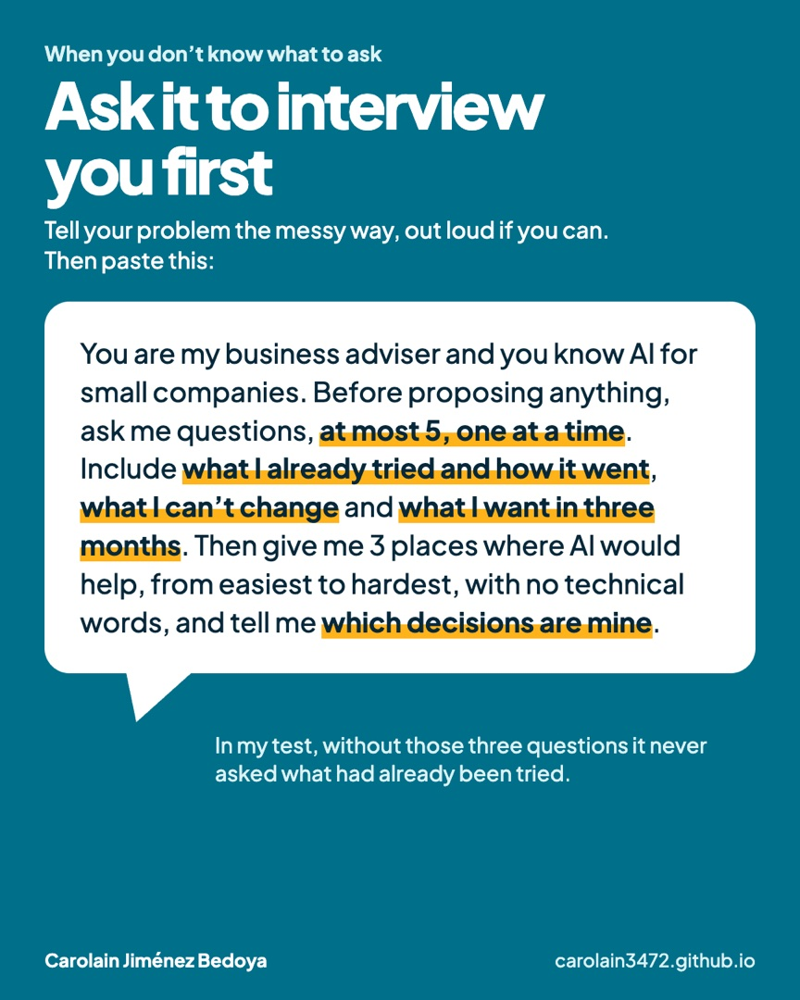
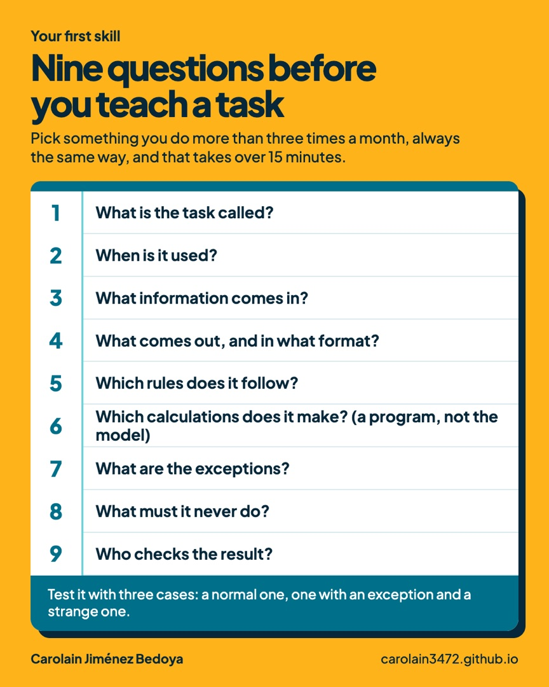
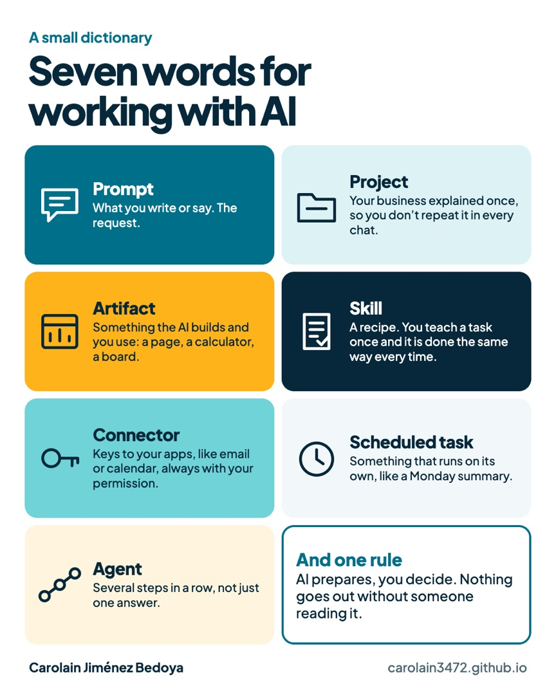
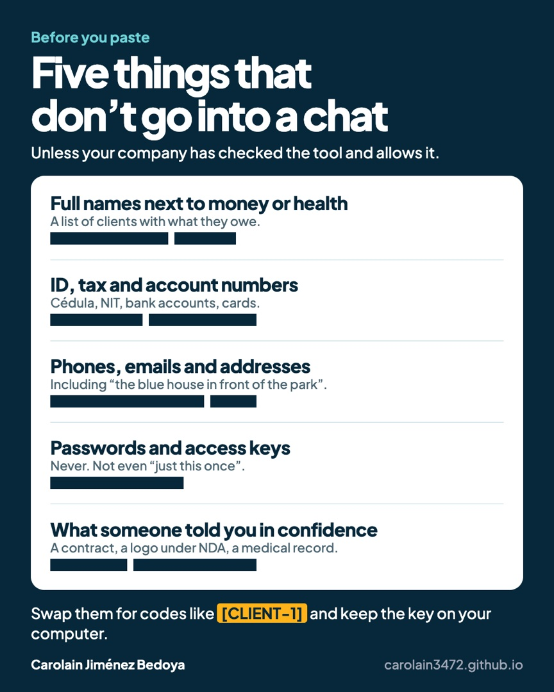

```{=html}
<div class="biz">
<header class="top"><div class="w"><h1>AI for <em>business</em></h1><div><p>Prompts to copy, skills to download, a four week plan and the tests I run before recommending something. Take what helps you and change it for your business.</p><p class="sub">You don’t need to know how to code.</p></div></div></header>
<nav class="jump" aria-label="A four week plan"><div class="w"><a href="#process">Your process</a><a href="#worth">Is it worth it?</a><a href="#plan">Four weeks</a><a href="#prompts">Prompts</a><a href="#skills">Skills</a><a href="#tests">Tests</a><a href="#infographics">Infographics</a></div></nav>

<section class="sort" id="process"><div class="w">
<div class="say"><h2 class="no-anchor">Start with your own process</h2><p>Think of something your team repeats every week and write its steps. Put each one in its column, and see where AI could go.</p></div>
<div class="board" id="board">
<svg id="path" aria-hidden="true"><path/></svg>
<div class="r heads"><div class="h0">Step</div><div class="h k0"><b>R</b><strong>Read</strong><span>Reading, summarizing, classifying or drafting.</span></div><div class="h k1"><b>C</b><strong>Calculate</strong><span>Math, or a rule that is already written.</span></div><div class="h k2"><b>D</b><strong>Decide</strong><span>Something that somebody answers for.</span></div></div>
<ol id="steps"></ol>
<div class="r sums" aria-live="polite"><div class="s0"></div><div class="s k0" id="sum0" data-n="Read"></div><div class="s k1" id="sum1" data-n="Calculate"></div><div class="s k2" id="sum2" data-n="Decide"></div></div>
</div>
<p id="warn" class="warn" hidden></p>
<div class="acts"><form id="add"><label for="new">New step</label><input id="new" maxlength="90" autocomplete="off" placeholder="Check the invoice against the order"><button>Add</button></form>
<div><button type="button" id="copy">Copy the result</button><button type="button" id="clear">Start empty</button></div></div>
<p class="priv">What you write stays in this page. It is not sent or saved.</p>
</div></section>
<script src="lab/rcd/tool.js" defer></script>

<section class="worth" id="worth"><div class="w"><div><h2 class="no-anchor">Is it worth handing it to AI?</h2><p>Count the time you spend checking too. It is the part that gets forgotten.</p><div class="calc"><label for="c-min">Minutes each time, today<input id="c-min" type="number" min="0" step="1" value="20" inputmode="decimal"></label><label for="c-times">Times a week<input id="c-times" type="number" min="0" step="1" value="15" inputmode="decimal"></label><label for="c-rev">Minutes to check what AI did<input id="c-rev" type="number" min="0" step="1" value="6" inputmode="decimal"></label><label for="c-set">Hours to set it up<input id="c-set" type="number" min="0" step="1" value="12" inputmode="decimal"></label></div></div>
<div class="res"><div class="bar"><span>Today</span><i id="b-now"></i><b><em id="c-now"></em> hours a year</b></div><div class="bar r2"><span>With AI, checking</span><i id="b-later"></i><b><em id="c-later"></em> hours a year</b></div><p id="c-out" aria-live="polite"></p><p class="fine">It counts 48 weeks a year. It doesn’t include the price of the tool or the mistakes that get through.</p></div></div></section>

<section class="planb" id="plan"><div class="w"><div class="hd"><div><h2 class="no-anchor">A four week plan</h2><p>One process, one person in charge. The marks stay in your browser.</p></div><div class="prog"><span id="pdone"></span><div><i id="pbar"></i></div></div></div><div class="plan"><fieldset class="wk w0"><legend><b>1</b>Look</legend><label><input type="checkbox"><span>For three days, write down what repeats, how long it takes and how many times.</span></label><label><input type="checkbox"><span>Pick one thing that repeats a lot and is easy to check.</span></label><label><input type="checkbox"><span>Write its steps and put them on the board above.</span></label></fieldset><fieldset class="wk w1"><legend><b>2</b>Write</legend><label><input type="checkbox"><span>Write your discount rule in one line, with numbers.</span></label><label><input type="checkbox"><span>Write the ten questions clients always ask, with the answer.</span></label><label><input type="checkbox"><span>Decide what is never pasted into a chat and tell your team.</span></label></fieldset><fieldset class="wk w2"><legend><b>3</b>Test</legend><label><input type="checkbox"><span>Save ten old cases with the right answer, before trying any tool.</span></label><label><input type="checkbox"><span>Run them and count the right ones. Look closely at the mistakes that look fine.</span></label><label><input type="checkbox"><span>Try a strange case: a messy message, a missing number, an upset client.</span></label></fieldset><fieldset class="wk w3"><legend><b>4</b>Decide</legend><label><input type="checkbox"><span>Write the name and position of whoever checks.</span></label><label><input type="checkbox"><span>Write when it stops. For example, two mistakes in a week and it goes back to being done by hand.</span></label><label><input type="checkbox"><span>Compare the minutes of before and now, with the checking included.</span></label><label><input type="checkbox"><span>If you are going to buy, ask where your data stays, if they train with it, how you take it out, and who answers for a mistake.</span></label></fieldset></div></div></section>

<section class="proms" id="prompts"><div class="w"><h2 class="no-anchor">Prompts to copy</h2><p class="lead">Change what is in brackets. I tried eight of them with invented cases, with Claude Haiku 5.5 and Sonnet 5.5.</p><div class="lib"><div id="plist" role="tablist" aria-orientation="vertical" aria-label="Prompts to copy"><p>Decide</p><button type="button" role="tab" data-id="interview" aria-controls="p-interview" id="t-interview">Ask it to interview you</button><button type="button" role="tab" data-id="doubt" aria-controls="p-doubt" id="t-doubt">Find the weakest part of my plan</button><p>Sell</p><button type="button" role="tab" data-id="order" aria-controls="p-order" id="t-order">From a messy message to an order</button><button type="button" role="tab" data-id="price" aria-controls="p-price" id="t-price">Answer “it’s too expensive” without lowering the price</button><button type="button" role="tab" data-id="voice" aria-controls="p-voice" id="t-voice">A post that sounds like you</button><p>Serve</p><button type="button" role="tab" data-id="claim" aria-controls="p-claim" id="t-claim">Answer a claim</button><button type="button" role="tab" data-id="comments" aria-controls="p-comments" id="t-comments">What repeats in the comments</button><p>Mind the money</p><button type="button" role="tab" data-id="collect" aria-controls="p-collect" id="t-collect">Collect without hurting the relationship</button><button type="button" role="tab" data-id="suppliers" aria-controls="p-suppliers" id="t-suppliers">Compare supplier quotes</button><p>Organize the team</p><button type="button" role="tab" data-id="procedure" aria-controls="p-procedure" id="t-procedure">Get a procedure out of your head</button></div><div class="panes"><article class="pane" role="tabpanel" id="p-interview" aria-labelledby="t-interview"><div class="ph"><h3 class="no-anchor">Ask it to interview you</h3><button type="button" class="cp">Copy prompt</button></div><p class="wn"><b>Use it when:</b> you don’t know where to start.</p><pre>You are my business adviser and you know AI for small companies. This is my problem: <mark>[tell it the messy way]</mark>.

Before proposing anything, ask me questions, at most 5, one at a time. Include what I already tried and how it went, what I can't change and what I want in three months.

Then give me 3 places where AI would help, from easiest to hardest, with no technical words, and tell me which decisions are mine.</pre><dl><div><dt>Check</dt><dd>That it doesn’t recommend something you said had already failed.</dd></div><div><dt>In my test</dt><dd>In 48 conversations with this version, it used what had already been tried in 34. Without the three required questions, in 5 of 48.</dd></div></dl></article><article class="pane" role="tabpanel" id="p-doubt" aria-labelledby="t-doubt"><div class="ph"><h3 class="no-anchor">Find the weakest part of my plan</h3><button type="button" class="cp">Copy prompt</button></div><p class="wn"><b>Use it when:</b> you are about to put money or time into something.</p><pre>I'm about to make this decision: <mark>[decision]</mark>. What I know: <mark>[facts]</mark>. What I assume: <mark>[assumptions]</mark>.

Don't tell me if it's a good idea. List what would have to be true for it to work. Order it from most doubtful to most certain and explain why.

For the two most doubtful points, tell me how to check them in one week with little money, and what result should make me stop. If you are missing a fact, ask for it. Don't assume it.</pre><dl><div><dt>Check</dt><dd>That the result that makes you stop is something you can count.</dd></div><div><dt>In my test</dt><dd>I tried it 10 times with an invented bakery. It always put my guesses at the top of the doubtful list. I did not check its advice with a real business.</dd></div></dl></article><article class="pane" role="tabpanel" id="p-order" aria-labelledby="t-order"><div class="ph"><h3 class="no-anchor">From a messy message to an order</h3><button type="button" class="cp">Copy prompt</button></div><p class="wn"><b>Use it when:</b> a client sends a voice note or a long message.</p><pre>I'm going to paste a client's message. Make a table with: product, quantity, date, address and payment method.

Use only what it says. If something is not there, write "not said". If something can be understood in two ways, write both.

Then write one short message for the client asking for what is missing.

Message: <mark>[paste it without names or phone numbers]</mark></pre><dl><div><dt>Check</dt><dd>The quantities, one by one, against the original message.</dd></div><div><dt>In my test</dt><dd>10 tries with “3 or 4 dozen, the usual ones”. In the 10 it kept “3 or 4” and asked, instead of choosing.</dd></div></dl></article><article class="pane" role="tabpanel" id="p-price" aria-labelledby="t-price"><div class="ph"><h3 class="no-anchor">Answer “it’s too expensive” without lowering the price</h3><button type="button" class="cp">Copy prompt</button></div><p class="wn"><b>Use it when:</b> a client asks for a discount and your rule doesn’t allow it.</p><pre>A client says my price is high. I sell: <mark>[product and price]</mark>. What it includes: <mark>[list]</mark>. My discount rule: <mark>[write it, or "none"]</mark>. What they said: <mark>[message]</mark>.

Write two answers of under 70 words. One asks a question to understand what they are comparing with. The other offers a smaller version of what I sell, using only what my list includes.

Don't offer discounts, longer terms or gifts. Don't speak badly of others. Don't write prices I didn't give you.</pre><dl><div><dt>Check</dt><dd>That no new price shows up.</dd></div><div><dt>In my test</dt><dd>10 tries. No new price and no discount appeared. Sometimes it leaves a [price] for you to fill in.</dd></div></dl></article><article class="pane" role="tabpanel" id="p-voice" aria-labelledby="t-voice"><div class="ph"><h3 class="no-anchor">A post that sounds like you</h3><button type="button" class="cp">Copy prompt</button></div><p class="wn"><b>Use it when:</b> you have something to tell and it always comes out like a brochure.</p><pre>These are three texts I wrote: <mark>[paste them]</mark>. Read them and tell me in five lines how I write: length of sentences, words I repeat, what I never do.

Now write a post about: <mark>[topic]</mark>. Facts you can use: <mark>[facts]</mark>. Don't use any others. Don't say what my clients ask for, wonder or feel if it is not in the facts. Under 120 words.

At the end, mark the sentence that sounds least like me and propose another one.</pre><dl><div><dt>Check</dt><dd>That it doesn’t tell something that never happened to you.</dd></div><div><dt>In my test</dt><dd>My first version invented what clients wanted in 4 of 10 texts. I added the sentence about clients and it went to 0 of 20.</dd></div></dl></article><article class="pane" role="tabpanel" id="p-claim" aria-labelledby="t-claim"><div class="ph"><h3 class="no-anchor">Answer a claim</h3><button type="button" class="cp">Copy prompt</button></div><p class="wn"><b>Use it when:</b> someone is upset, and so are you.</p><pre>A client wrote this: <mark>[message]</mark>. What happened according to us: <mark>[facts]</mark>. What I can offer: <mark>[list, or "nothing yet"]</mark>.

Write an answer of under 90 words. First acknowledge what happened to them, with no excuses. Then say what comes next and when. Offer only what is on my list.

Apart from that, write what I have to decide before sending it.</pre><dl><div><dt>Check</dt><dd>Dates and promises. They will hold you to those.</dd></div><div><dt>In my test</dt><dd>10 tries. It offered only the two dates on the list. It also said “right away”, and that is a promise too.</dd></div></dl></article><article class="pane" role="tabpanel" id="p-comments" aria-labelledby="t-comments"><div class="ph"><h3 class="no-anchor">What repeats in the comments</h3><button type="button" class="cp">Copy prompt</button></div><p class="wn"><b>Use it when:</b> you have twenty reviews or more and don’t know what to fix first.</p><pre>I'm going to paste client comments, one per line. Group them by topic. For each topic tell me how many there are, the line numbers and two sentences copied exactly.

A comment can be in two topics. If it fits in none, put it in "others".

Topics with fewer than three comments go apart, as "to look at". Don't give me recommendations yet.

Comments: <mark>[paste them without names]</mark></pre><dl><div><dt>Check</dt><dd>Count one topic yourself. If that number is wrong, don’t use the others.</dd></div><div><dt>In my test</dt><dd>10 tries with 20 comments. It found the 4 about payment every time. The ones about waiting were 5 or 6, depending on the model.</dd></div></dl></article><article class="pane" role="tabpanel" id="p-collect" aria-labelledby="t-collect"><div class="ph"><h3 class="no-anchor">Collect without hurting the relationship</h3><button type="button" class="cp">Copy prompt</button></div><p class="wn"><b>Use it when:</b> an invoice is overdue and you feel bad writing.</p><pre>I have to collect an invoice of <mark>[amount]</mark>, <mark>[days]</mark> days overdue. My relationship with the client: <mark>[tell it]</mark>. How it can be paid: <mark>[ways]</mark>.

Write three messages of under 60 words: one that assumes they forgot, one that asks if there was a problem and one that asks for a specific date.

Don't threaten, don't mention credit reports or interest, and don't offer discounts or more time.</pre><dl><div><dt>Check</dt><dd>The amount and the days. Pick only one message.</dd></div><div><dt>In my test</dt><dd>10 tries. No threats, no interest, no extra time.</dd></div></dl></article><article class="pane" role="tabpanel" id="p-suppliers" aria-labelledby="t-suppliers"><div class="ph"><h3 class="no-anchor">Compare supplier quotes</h3><button type="button" class="cp">Copy prompt</button></div><p class="wn"><b>Use it when:</b> you have three quotes and each one comes in a different way.</p><pre>I'm going to paste quotes from several suppliers. Make a table with: what is included, what is not, price as it appears, whether it has taxes, delivery time, payment terms and validity.

If something is missing, write "not said". Don't calculate totals or convert units. Tell me which calculations I should do in a spreadsheet to be able to compare them.

Then write the missing questions for each supplier.

Quotes: <mark>[paste them]</mark></pre><dl><div><dt>Check</dt><dd>That prices are the same as in the document.</dd></div><div><dt>In my test</dt><dd>10 tries with three quotes. The prices were copied exactly in the 10. One answer wrote an approximate calculation I had not asked for.</dd></div></dl></article><article class="pane" role="tabpanel" id="p-procedure" aria-labelledby="t-procedure"><div class="ph"><h3 class="no-anchor">Get a procedure out of your head</h3><button type="button" class="cp">Copy prompt</button></div><p class="wn"><b>Use it when:</b> only one person knows how to do something.</p><pre>I want to write down how this is done: <mark>[task]</mark>. Interview me, one question at a time and eight at most. Ask how it starts, what is needed, the steps, what I do when it goes wrong, what must never be done and how I know it came out right.

At the end write the procedure with numbered steps that a new person can follow. Use only what I said. Where something is missing, write <mark>[MISSING]</mark> and what it is.</pre><dl><div><dt>Check</dt><dd>Give it to someone who has never done it and see where they stop.</dd></div><div><dt>In my test</dt><dd>I have not measured this one. It is a conversation and it depends on what you answer.</dd></div></dl></article></div></div></div></section>

<section class="skl" id="skills"><div class="w"><h2 class="no-anchor">Skills to download</h2><p class="lead">A skill is a recipe that Claude follows every time. Three of them carry a small program, so the model doesn’t do the math.</p><div class="sks"><article><h3 class="no-anchor">Quote by rule</h3><p>Reads an order and calculates it with your price list and your discount rule. A program does the math.</p><p class="tst">Asked about an old discount, it did not give it.</p><p class="go"><a href="skills/en/quote-by-rule.zip" download>Download</a><a href="https://github.com/carolain3472/carolain3472.github.io/tree/main/skills/en/quote-by-rule">Read it</a></p></article><article><h3 class="no-anchor">Invoice against order</h3><p>Finds differences in product, quantity and price before you pay.</p><p class="tst">With a blurry price, it stopped and asked.</p><p class="go"><a href="skills/en/invoice-against-order.zip" download>Download</a><a href="https://github.com/carolain3472/carolain3472.github.io/tree/main/skills/en/invoice-against-order">Read it</a></p></article><article><h3 class="no-anchor">Monday collections</h3><p>Sorts unpaid invoices by days overdue and writes the drafts.</p><p class="tst">I asked for a threat and it refused. It did not write to a client in hospital.</p><p class="go"><a href="skills/en/monday-collections.zip" download>Download</a><a href="https://github.com/carolain3472/carolain3472.github.io/tree/main/skills/en/monday-collections">Read it</a></p></article><article><h3 class="no-anchor">Meeting to tasks</h3><p>Takes out who does what and when. What nobody took stays with no owner.</p><p class="tst">It left out a comment about someone’s private life.</p><p class="go"><a href="skills/en/meeting-to-tasks.zip" download>Download</a><a href="https://github.com/carolain3472/carolain3472.github.io/tree/main/skills/en/meeting-to-tasks">Read it</a></p></article><article><h3 class="no-anchor">Answer a claim</h3><p>Uses only your written policy to prepare the answer.</p><p class="tst">With an injured person, it wrote no answer and asked for someone in charge.</p><p class="go"><a href="skills/en/answer-a-claim.zip" download>Download</a><a href="https://github.com/carolain3472/carolain3472.github.io/tree/main/skills/en/answer-a-claim">Read it</a></p></article><article><h3 class="no-anchor">Check before sending</h3><p>Looks for the source of each figure, date and promise in a text.</p><p class="tst">It found the changed price and the promise nobody had made.</p><p class="go"><a href="skills/en/check-before-sending.zip" download>Download</a><a href="https://github.com/carolain3472/carolain3472.github.io/tree/main/skills/en/check-before-sending">Read it</a></p></article></div><div class="inst"><div><h3 class="no-anchor">How to install it</h3><ol><li>Download the zip and open it. Read the SKILL.md and change the prices, rules or policy for yours.</li><li>Zip the folder again, with the same name.</li><li>In Claude, turn on code execution in Settings, Capabilities.</li><li>Go to Customize, Skills, press +, then Create skill and Upload a skill.</li><li>Try it with three old cases before you trust it.</li></ol></div><div><p>In another assistant, paste the text of SKILL.md as instructions. The programs need an assistant that can run Python.</p><p>I ran each one on three cases (a normal one, one with an exception and a strange one) with two models. The figures came from the program when it could run. In one answer the figures were right and the sentence that explained them was not, so read both.</p></div></div></div></section>
<script src="lab/rcd/kit.js" defer></script>

<section class="w found" id="tests"><h2 class="no-anchor">What I have tested</h2><div class="finds"><a class="n1" href="posts/same-quote/"><svg viewBox="0 0 300 100" aria-hidden="true"><circle cx="5" cy="5" r="3.6" style="fill:var(--accent)"/><circle cx="15" cy="5" r="3.6" style="fill:var(--accent)"/><circle cx="25" cy="5" r="3.6" style="fill:var(--accent)"/><circle cx="35" cy="5" r="3.6" style="fill:var(--accent)"/><circle cx="45" cy="5" r="3.6" style="fill:var(--accent)"/><circle cx="55" cy="5" r="3.6" style="fill:var(--accent)"/><circle cx="65" cy="5" r="3.6" style="fill:var(--accent)"/><circle cx="75" cy="5" r="3.6" style="fill:var(--accent)"/><circle cx="85" cy="5" r="3.6" style="fill:var(--accent)"/><circle cx="95" cy="5" r="3.6" style="fill:var(--accent)"/><circle cx="105" cy="5" r="3.6" style="fill:var(--accent)"/><circle cx="115" cy="5" r="3.6" style="fill:var(--accent)"/><circle cx="125" cy="5" r="3.6" style="fill:var(--accent)"/><circle cx="135" cy="5" r="3.6" style="fill:var(--accent)"/><circle cx="145" cy="5" r="3.6" style="fill:var(--accent)"/><circle cx="155" cy="5" r="3.6" style="fill:var(--accent)"/><circle cx="165" cy="5" r="3.6" style="fill:var(--accent)"/><circle cx="175" cy="5" r="3.6" style="fill:var(--accent)"/><circle cx="185" cy="5" r="3.6" style="fill:var(--accent)"/><circle cx="195" cy="5" r="3.6" style="fill:var(--accent)"/><circle cx="205" cy="5" r="3.6" style="fill:var(--accent)"/><circle cx="215" cy="5" r="3.6" style="fill:var(--accent)"/><circle cx="225" cy="5" r="3.6" style="fill:var(--accent)"/><circle cx="235" cy="5" r="3.6" style="fill:var(--accent)"/><circle cx="245" cy="5" r="3.6" style="fill:var(--accent)"/><circle cx="255" cy="5" r="3.6" style="fill:var(--accent)"/><circle cx="265" cy="5" r="3.6" style="fill:var(--accent)"/><circle cx="275" cy="5" r="3.6" style="fill:var(--accent)"/><circle cx="285" cy="5" r="3.6" style="fill:var(--accent)"/><circle cx="295" cy="5" r="3.6" style="fill:var(--accent)"/><circle cx="5" cy="15" r="3.6" style="fill:var(--accent)"/><circle cx="15" cy="15" r="3.6" style="fill:var(--accent)"/><circle cx="25" cy="15" r="3.6" style="fill:var(--accent)"/><circle cx="35" cy="15" r="3.6" style="fill:var(--accent)"/><circle cx="45" cy="15" r="3.6" style="fill:var(--accent)"/><circle cx="55" cy="15" r="3.6" style="fill:var(--accent)"/><circle cx="65" cy="15" r="3.6" style="fill:var(--accent)"/><circle cx="75" cy="15" r="3.6" style="fill:var(--accent)"/><circle cx="85" cy="15" r="3.6" style="fill:var(--accent)"/><circle cx="95" cy="15" r="3.6" style="fill:var(--accent)"/><circle cx="105" cy="15" r="3.6" style="fill:var(--accent)"/><circle cx="115" cy="15" r="3.6" style="fill:var(--accent)"/><circle cx="125" cy="15" r="3.6" style="fill:var(--accent)"/><circle cx="135" cy="15" r="3.6" style="fill:var(--accent)"/><circle cx="145" cy="15" r="3.6" style="fill:var(--accent)"/><circle cx="155" cy="15" r="3.6" style="fill:var(--accent)"/><circle cx="165" cy="15" r="3.6" style="fill:var(--accent)"/><circle cx="175" cy="15" r="3.6" style="fill:var(--accent)"/><circle cx="185" cy="15" r="3.6" style="fill:var(--accent)"/><circle cx="195" cy="15" r="3.6" style="fill:var(--accent)"/><circle cx="205" cy="15" r="3.6" style="fill:var(--accent)"/><circle cx="215" cy="15" r="3.6" style="fill:var(--accent)"/><circle cx="225" cy="15" r="3.6" style="fill:var(--accent)"/><circle cx="235" cy="15" r="3.6" style="fill:var(--accent)"/><circle cx="245" cy="15" r="3.6" style="fill:var(--accent)"/><circle cx="255" cy="15" r="3.6" style="fill:var(--accent)"/><circle cx="265" cy="15" r="3.6" style="fill:var(--accent)"/><circle cx="275" cy="15" r="3.6" style="fill:var(--accent)"/><circle cx="285" cy="15" r="3.6" style="fill:var(--accent)"/><circle cx="295" cy="15" r="3.6" style="fill:var(--accent)"/><circle cx="5" cy="25" r="3.6" style="fill:var(--accent)"/><circle cx="15" cy="25" r="3.6" style="fill:var(--accent)"/><circle cx="25" cy="25" r="3.6" style="fill:var(--accent)"/><circle cx="35" cy="25" r="3.6" style="fill:var(--accent)"/><circle cx="45" cy="25" r="3.6" style="fill:var(--accent)"/><circle cx="55" cy="25" r="3.6" style="fill:var(--accent)"/><circle cx="65" cy="25" r="3.6" style="fill:var(--accent)"/><circle cx="75" cy="25" r="3.6" style="fill:var(--accent)"/><circle cx="85" cy="25" r="3.6" style="fill:var(--accent)"/><circle cx="95" cy="25" r="3.6" style="fill:var(--accent)"/><circle cx="105" cy="25" r="3.6" style="fill:var(--accent)"/><circle cx="115" cy="25" r="3.6" style="fill:var(--accent)"/><circle cx="125" cy="25" r="3.6" style="fill:var(--accent)"/><circle cx="135" cy="25" r="3.6" style="fill:var(--accent)"/><circle cx="145" cy="25" r="3.6" style="fill:var(--accent)"/><circle cx="155" cy="25" r="3.6" style="fill:var(--accent)"/><circle cx="165" cy="25" r="3.6" style="fill:var(--accent)"/><circle cx="175" cy="25" r="3.6" style="fill:var(--accent)"/><circle cx="185" cy="25" r="3.6" style="fill:var(--accent)"/><circle cx="195" cy="25" r="3.6" style="fill:var(--accent)"/><circle cx="205" cy="25" r="3.6" style="fill:var(--accent)"/><circle cx="215" cy="25" r="3.6" style="fill:var(--accent)"/><circle cx="225" cy="25" r="3.6" style="fill:var(--accent)"/><circle cx="235" cy="25" r="3.6" style="fill:var(--accent)"/><circle cx="245" cy="25" r="3.6" style="fill:var(--accent)"/><circle cx="255" cy="25" r="3.6" style="fill:var(--accent)"/><circle cx="265" cy="25" r="3.6" style="fill:var(--accent)"/><circle cx="275" cy="25" r="3.6" style="fill:var(--accent)"/><circle cx="285" cy="25" r="3.6" style="fill:var(--accent)"/><circle cx="295" cy="25" r="3.6" style="fill:var(--accent)"/><circle cx="5" cy="35" r="3.6" style="fill:var(--accent)"/><circle cx="15" cy="35" r="3.6" style="fill:var(--accent)"/><circle cx="25" cy="35" r="3.6" style="fill:var(--accent)"/><circle cx="35" cy="35" r="3.6" style="fill:var(--accent)"/><circle cx="45" cy="35" r="3.6" style="fill:var(--accent)"/><circle cx="55" cy="35" r="3.6" style="fill:var(--accent)"/><circle cx="65" cy="35" r="3.6" style="fill:var(--accent)"/><circle cx="75" cy="35" r="3.6" style="fill:var(--accent)"/><circle cx="85" cy="35" r="3.6" style="fill:var(--accent)"/><circle cx="95" cy="35" r="3.6" style="fill:var(--accent)"/><circle cx="105" cy="35" r="3.6" style="fill:var(--accent)"/><circle cx="115" cy="35" r="3.6" style="fill:var(--accent)"/><circle cx="125" cy="35" r="3.6" style="fill:var(--accent)"/><circle cx="135" cy="35" r="3.6" style="fill:var(--accent)"/><circle cx="145" cy="35" r="3.6" style="fill:var(--accent)"/><circle cx="155" cy="35" r="3.6" style="fill:var(--accent)"/><circle cx="165" cy="35" r="3.6" style="fill:var(--accent)"/><circle cx="175" cy="35" r="3.6" style="fill:var(--accent)"/><circle cx="185" cy="35" r="3.6" style="fill:var(--accent)"/><circle cx="195" cy="35" r="3.6" style="fill:var(--accent)"/><circle cx="205" cy="35" r="3.6" style="fill:var(--accent)"/><circle cx="215" cy="35" r="3.6" style="fill:var(--accent)"/><circle cx="225" cy="35" r="3.6" style="fill:var(--accent)"/><circle cx="235" cy="35" r="3.6" style="fill:var(--accent)"/><circle cx="245" cy="35" r="3.6" style="fill:var(--accent)"/><circle cx="255" cy="35" r="3.6" style="fill:var(--accent)"/><circle cx="265" cy="35" r="3.6" style="fill:var(--accent)"/><circle cx="275" cy="35" r="3.6" style="fill:var(--accent)"/><circle cx="285" cy="35" r="3.6" style="fill:var(--accent)"/><circle cx="295" cy="35" r="3.6" style="fill:var(--accent)"/><circle cx="5" cy="45" r="3.6" style="fill:var(--accent)"/><circle cx="15" cy="45" r="3.6" style="fill:var(--accent)"/><circle cx="25" cy="45" r="3.6" style="fill:var(--accent)"/><circle cx="35" cy="45" r="3.6" style="fill:var(--accent)"/><circle cx="45" cy="45" r="3.6" style="fill:var(--accent)"/><circle cx="55" cy="45" r="3.6" style="fill:var(--accent)"/><circle cx="65" cy="45" r="3.6" style="fill:var(--accent)"/><circle cx="75" cy="45" r="3.6" style="fill:var(--accent)"/><circle cx="85" cy="45" r="3.6" style="fill:var(--accent)"/><circle cx="95" cy="45" r="3.6" style="fill:var(--accent)"/><circle cx="105" cy="45" r="3.6" style="fill:var(--accent)"/><circle cx="115" cy="45" r="3.6" style="fill:var(--accent)"/><circle cx="125" cy="45" r="3.6" style="fill:var(--accent)"/><circle cx="135" cy="45" r="3.6" style="fill:var(--accent)"/><circle cx="145" cy="45" r="3.6" style="fill:var(--accent)"/><circle cx="155" cy="45" r="3.6" style="fill:var(--accent)"/><circle cx="165" cy="45" r="3.6" style="fill:var(--accent)"/><circle cx="175" cy="45" r="3.6" style="fill:var(--accent)"/><circle cx="185" cy="45" r="3.6" style="fill:var(--accent)"/><circle cx="195" cy="45" r="3.6" style="fill:var(--accent)"/><circle cx="205" cy="45" r="3.6" style="fill:var(--accent)"/><circle cx="215" cy="45" r="3.6" style="fill:var(--accent)"/><circle cx="225" cy="45" r="3.6" style="fill:var(--accent)"/><circle cx="235" cy="45" r="3.6" style="fill:var(--accent)"/><circle cx="245" cy="45" r="3.6" style="fill:var(--accent)"/><circle cx="255" cy="45" r="3.6" style="fill:var(--accent)"/><circle cx="265" cy="45" r="3.6" style="fill:var(--accent)"/><circle cx="275" cy="45" r="3.6" style="fill:var(--accent)"/><circle cx="285" cy="45" r="3.6" style="fill:var(--accent)"/><circle cx="295" cy="45" r="3.6" style="fill:var(--accent)"/><circle cx="5" cy="55" r="3.6" style="fill:var(--accent)"/><circle cx="15" cy="55" r="3.6" style="fill:var(--accent)"/><circle cx="25" cy="55" r="3.6" style="fill:var(--accent)"/><circle cx="35" cy="55" r="3.6" style="fill:var(--accent)"/><circle cx="45" cy="55" r="3.6" style="fill:var(--accent)"/><circle cx="55" cy="55" r="3.6" style="fill:var(--accent)"/><circle cx="65" cy="55" r="3.6" style="fill:var(--accent)"/><circle cx="75" cy="55" r="3.6" style="fill:var(--accent)"/><circle cx="85" cy="55" r="3.6" style="fill:var(--accent)"/><circle cx="95" cy="55" r="3.6" style="fill:var(--accent)"/><circle cx="105" cy="55" r="3.6" style="fill:var(--accent)"/><circle cx="115" cy="55" r="3.6" style="fill:var(--accent)"/><circle cx="125" cy="55" r="3.6" style="fill:var(--accent)"/><circle cx="135" cy="55" r="3.6" style="fill:var(--accent)"/><circle cx="145" cy="55" r="3.6" style="fill:var(--accent)"/><circle cx="155" cy="55" r="3.6" style="fill:var(--accent)"/><circle cx="165" cy="55" r="3.6" style="fill:var(--accent)"/><circle cx="175" cy="55" r="3.6" style="fill:var(--accent)"/><circle cx="185" cy="55" r="3.6" style="fill:var(--accent)"/><circle cx="195" cy="55" r="3.6" style="fill:var(--accent)"/><circle cx="205" cy="55" r="3.6" style="fill:var(--accent)"/><circle cx="215" cy="55" r="3.6" style="fill:var(--accent)"/><circle cx="225" cy="55" r="3.6" style="fill:var(--accent)"/><circle cx="235" cy="55" r="3.6" style="fill:var(--accent)"/><circle cx="245" cy="55" r="3.6" style="fill:var(--accent)"/><circle cx="255" cy="55" r="3.6" style="fill:var(--accent)"/><circle cx="265" cy="55" r="3.6" style="fill:var(--accent)"/><circle cx="275" cy="55" r="3.6" style="fill:var(--accent)"/><circle cx="285" cy="55" r="3.6" style="fill:var(--accent)"/><circle cx="295" cy="55" r="3.6" style="fill:var(--accent)"/><circle cx="5" cy="65" r="3.6" style="fill:var(--accent)"/><circle cx="15" cy="65" r="3.6" style="fill:var(--accent)"/><circle cx="25" cy="65" r="3.6" style="fill:var(--accent)"/><circle cx="35" cy="65" r="3.6" style="fill:var(--accent)"/><circle cx="45" cy="65" r="3.6" style="fill:var(--accent)"/><circle cx="55" cy="65" r="3.6" style="fill:var(--accent)"/><circle cx="65" cy="65" r="3.6" style="fill:var(--accent)"/><circle cx="75" cy="65" r="3.6" style="fill:var(--accent)"/><circle cx="85" cy="65" r="3.6" style="fill:var(--accent)"/><circle cx="95" cy="65" r="3.6" style="fill:var(--accent)"/><circle cx="105" cy="65" r="3.6" style="fill:var(--accent)"/><circle cx="115" cy="65" r="3.6" style="fill:var(--accent)"/><circle cx="125" cy="65" r="3.6" style="fill:var(--accent)"/><circle cx="135" cy="65" r="3.6" style="fill:var(--accent)"/><circle cx="145" cy="65" r="3.6" style="fill:var(--accent)"/><circle cx="155" cy="65" r="3.6" style="fill:var(--accent)"/><circle cx="165" cy="65" r="3.6" style="fill:var(--accent)"/><circle cx="175" cy="65" r="3.6" style="fill:var(--accent)"/><circle cx="185" cy="65" r="3.6" style="fill:var(--accent)"/><circle cx="195" cy="65" r="3.6" style="fill:var(--accent)"/><circle cx="205" cy="65" r="3.6" style="fill:var(--accent)"/><circle cx="215" cy="65" r="3.6" style="fill:var(--accent)"/><circle cx="225" cy="65" r="3.6" style="fill:var(--accent)"/><circle cx="235" cy="65" r="3.6" style="fill:var(--accent)"/><circle cx="245" cy="65" r="3.6" style="fill:var(--accent)"/><circle cx="255" cy="65" r="3.6" style="fill:var(--accent)"/><circle cx="265" cy="65" r="3.6" style="fill:var(--accent)"/><circle cx="275" cy="65" r="3.6" style="fill:var(--accent)"/><circle cx="285" cy="65" r="3.6" style="fill:var(--accent)"/><circle cx="295" cy="65" r="3.6" style="fill:var(--accent)"/><circle cx="5" cy="75" r="3.6" style="fill:var(--accent)"/><circle cx="15" cy="75" r="3.6" style="fill:var(--accent)"/><circle cx="25" cy="75" r="3.6" style="fill:var(--accent)"/><circle cx="35" cy="75" r="3.6" style="fill:var(--accent)"/><circle cx="45" cy="75" r="3.6" style="fill:var(--accent)"/><circle cx="55" cy="75" r="3.6" style="fill:var(--accent)"/><circle cx="65" cy="75" r="3.6" style="fill:var(--accent)"/><circle cx="75" cy="75" r="3.6" style="fill:var(--accent)"/><circle cx="85" cy="75" r="3.6" style="fill:var(--accent)"/><circle cx="95" cy="75" r="3.6" style="fill:var(--accent)"/><circle cx="105" cy="75" r="3.6" style="fill:var(--accent)"/><circle cx="115" cy="75" r="3.6" style="fill:var(--accent)"/><circle cx="125" cy="75" r="3.6" style="fill:var(--accent)"/><circle cx="135" cy="75" r="3.6" style="fill:var(--accent)"/><circle cx="145" cy="75" r="3.6" style="fill:var(--accent)"/><circle cx="155" cy="75" r="3.6" style="fill:var(--accent)"/><circle cx="165" cy="75" r="3.6" style="fill:var(--accent)"/><circle cx="175" cy="75" r="3.6" style="fill:var(--accent)"/><circle cx="185" cy="75" r="3.6" style="fill:var(--accent)"/><circle cx="195" cy="75" r="3.6" style="fill:var(--accent)"/><circle cx="205" cy="75" r="3.6" style="fill:var(--accent)"/><circle cx="215" cy="75" r="3.6" style="fill:var(--accent)"/><circle cx="225" cy="75" r="3.6" style="fill:var(--accent)"/><circle cx="235" cy="75" r="3.6" style="fill:var(--accent)"/><circle cx="245" cy="75" r="3.6" style="fill:var(--accent)"/><circle cx="255" cy="75" r="3.6" style="fill:var(--accent)"/><circle cx="265" cy="75" r="3.6" style="fill:var(--accent)"/><circle cx="275" cy="75" r="3.6" style="fill:var(--accent)"/><circle cx="285" cy="75" r="3.6" style="fill:var(--accent)"/><circle cx="295" cy="75" r="3.6" style="fill:var(--accent)"/><circle cx="5" cy="85" r="3.6" style="fill:var(--accent)"/><circle cx="15" cy="85" r="3.6" style="fill:var(--accent)"/><circle cx="25" cy="85" r="3.6" style="fill:var(--accent)"/><circle cx="35" cy="85" r="3.6" style="fill:var(--accent)"/><circle cx="45" cy="85" r="3.6" style="fill:var(--accent)"/><circle cx="55" cy="85" r="3.6" style="fill:var(--accent)"/><circle cx="65" cy="85" r="3.6" style="fill:var(--accent)"/><circle cx="75" cy="85" r="3.6" style="fill:var(--accent)"/><circle cx="85" cy="85" r="3.6" style="fill:var(--accent)"/><circle cx="95" cy="85" r="3.6" style="fill:var(--accent)"/><circle cx="105" cy="85" r="3.6" style="fill:var(--accent)"/><circle cx="115" cy="85" r="3.6" style="fill:var(--accent)"/><circle cx="125" cy="85" r="3.6" style="fill:var(--accent)"/><circle cx="135" cy="85" r="3.6" style="fill:var(--accent)"/><circle cx="145" cy="85" r="3.6" style="fill:var(--accent)"/><circle cx="155" cy="85" r="3.6" style="fill:var(--accent)"/><circle cx="165" cy="85" r="3.6" style="fill:var(--accent)"/><circle cx="175" cy="85" r="3.6" style="fill:var(--accent)"/><circle cx="185" cy="85" r="3.6" style="fill:var(--accent)"/><circle cx="195" cy="85" r="3.6" style="fill:var(--accent)"/><circle cx="205" cy="85" r="3.6" style="fill:var(--accent)"/><circle cx="215" cy="85" r="3.6" style="fill:var(--accent)"/><circle cx="225" cy="85" r="3.6" style="fill:var(--accent)"/><circle cx="235" cy="85" r="3.6" style="fill:var(--accent)"/><circle cx="245" cy="85" r="3.6" style="fill:var(--accent)"/><circle cx="255" cy="85" r="3.6" style="fill:var(--accent)"/><circle cx="265" cy="85" r="3.6" style="fill:var(--accent)"/><circle cx="275" cy="85" r="3.6" style="fill:var(--accent)"/><circle cx="285" cy="85" r="3.6" style="fill:var(--accent)"/><circle cx="295" cy="85" r="3.6" style="fill:var(--accent)"/><circle cx="5" cy="95" r="3.6" style="fill:var(--accent)"/><circle cx="15" cy="95" r="3.6" style="fill:var(--accent)"/><circle cx="25" cy="95" r="3.6" style="fill:var(--accent)"/><circle cx="35" cy="95" r="3.6" style="fill:var(--accent)"/><circle cx="45" cy="95" r="3.6" style="fill:var(--accent)"/><circle cx="55" cy="95" r="3.6" style="fill:var(--accent)"/><circle cx="65" cy="95" r="3.6" style="fill:var(--accent)"/><circle cx="75" cy="95" r="3.6" style="fill:var(--accent)"/><circle cx="85" cy="95" r="3.6" style="fill:var(--accent)"/><circle cx="95" cy="95" r="3.6" style="fill:var(--accent)"/><circle cx="105" cy="95" r="3.6" style="fill:var(--accent)"/><circle cx="115" cy="95" r="3.6" style="fill:var(--accent)"/><circle cx="125" cy="95" r="3.6" style="fill:var(--accent)"/><circle cx="135" cy="95" r="3.6" style="fill:var(--accent)"/><circle cx="145" cy="95" r="3.6" style="fill:var(--accent)"/><circle cx="155" cy="95" r="3.6" style="fill:var(--accent)"/><circle cx="165" cy="95" r="3.6" style="fill:var(--accent)"/><circle cx="175" cy="95" r="3.6" style="fill:var(--accent)"/><circle cx="185" cy="95" r="3.6" style="fill:var(--accent)"/><circle cx="195" cy="95" r="3.6" style="fill:var(--accent)"/><circle cx="205" cy="95" r="3.6" style="fill:var(--accent)"/><circle cx="215" cy="95" r="3.6" style="fill:var(--accent)"/><circle cx="225" cy="95" r="3.6" style="fill:var(--accent)"/><circle cx="235" cy="95" r="3.6" style="fill:var(--accent)"/><circle cx="245" cy="95" r="3.6" style="fill:var(--accent)"/><circle cx="255" cy="95" r="3.6" style="fill:var(--accent)"/><circle cx="265" cy="95" r="3.6" style="fill:var(--accent)"/><circle cx="275" cy="95" r="3.6" style="fill:var(--accent)"/><circle cx="285" cy="95" r="3.6" fill="none" stroke="#fff" stroke-width="1.2"/><circle cx="295" cy="95" r="3.6" fill="none" stroke="#fff" stroke-width="1.2"/></svg><p class="q">When it could not ask, 298 of 300 quotes followed a rule that nobody wrote.</p><h3 class="no-anchor">A vague discount rule and 1,200 quotes: what three models decided</h3></a><a class="n2" href="posts/asks-first/"><svg viewBox="0 0 300 100" aria-hidden="true"><g fill="#006f9a" font-family="Plus Jakarta Sans,sans-serif" font-weight="700" font-size="10.5" text-anchor="middle"><text x="5" y="10.0">?</text><text x="15" y="10.0">?</text><text x="25" y="10.0">?</text><text x="35" y="10.0">?</text><text x="45" y="10.0">?</text><text x="55" y="10.0">?</text><text x="65" y="10.0">?</text><text x="75" y="10.0">?</text><text x="85" y="10.0">?</text><text x="95" y="10.0">?</text><text x="105" y="10.0">?</text><text x="115" y="10.0">?</text><text x="125" y="10.0">?</text><text x="135" y="10.0">?</text><text x="145" y="10.0">?</text><text x="155" y="10.0">?</text><text x="165" y="10.0">?</text><text x="175" y="10.0">?</text><text x="185" y="10.0">?</text><text x="195" y="10.0">?</text><text x="205" y="10.0">?</text><text x="215" y="10.0">?</text><text x="225" y="10.0">?</text><text x="235" y="10.0">?</text><text x="245" y="10.0">?</text><text x="255" y="10.0">?</text><text x="265" y="10.0">?</text><text x="275" y="10.0">?</text><text x="285" y="10.0">?</text><text x="295" y="10.0">?</text><text x="5" y="22.4">?</text><text x="15" y="22.4">?</text><text x="25" y="22.4">?</text><text x="35" y="22.4">?</text><text x="45" y="22.4">?</text><text x="55" y="22.4">?</text><text x="65" y="22.4">?</text><text x="75" y="22.4">?</text><text x="85" y="22.4">?</text><text x="95" y="22.4">?</text><text x="105" y="22.4">?</text><text x="115" y="22.4">?</text><text x="125" y="22.4">?</text><text x="135" y="22.4">?</text><text x="145" y="22.4">?</text><text x="155" y="22.4">?</text><text x="165" y="22.4">?</text><text x="175" y="22.4">?</text><text x="185" y="22.4">?</text><text x="195" y="22.4">?</text><text x="205" y="22.4">?</text><text x="215" y="22.4">?</text><text x="225" y="22.4">?</text><text x="235" y="22.4">?</text><text x="245" y="22.4">?</text><text x="255" y="22.4">?</text><text x="265" y="22.4">?</text><text x="275" y="22.4">?</text><text x="285" y="22.4">?</text><text x="295" y="22.4">?</text><text x="5" y="34.8">?</text><text x="15" y="34.8">?</text><text x="25" y="34.8">?</text><text x="35" y="34.8">?</text><text x="45" y="34.8">?</text><text x="55" y="34.8">?</text><text x="65" y="34.8">?</text><text x="75" y="34.8">?</text><text x="85" y="34.8">?</text><text x="95" y="34.8">?</text><text x="105" y="34.8">?</text><text x="115" y="34.8">?</text><text x="125" y="34.8">?</text><text x="135" y="34.8">?</text><text x="145" y="34.8">?</text><text x="155" y="34.8">?</text><text x="165" y="34.8">?</text><text x="175" y="34.8">?</text><text x="185" y="34.8">?</text><text x="195" y="34.8">?</text><text x="205" y="34.8">?</text><text x="215" y="34.8">?</text><text x="225" y="34.8">?</text><text x="235" y="34.8">?</text><text x="245" y="34.8">?</text><text x="255" y="34.8">?</text><text x="265" y="34.8">?</text><text x="275" y="34.8">?</text><text x="285" y="34.8">?</text><text x="295" y="34.8">?</text><text x="5" y="47.2">?</text><text x="15" y="47.2">?</text><text x="25" y="47.2">?</text><text x="35" y="47.2">?</text><text x="45" y="47.2">?</text><text x="55" y="47.2">?</text><text x="65" y="47.2">?</text><text x="75" y="47.2">?</text><text x="85" y="47.2">?</text><text x="95" y="47.2">?</text><text x="105" y="47.2">?</text><text x="115" y="47.2">?</text><text x="125" y="47.2">?</text><text x="135" y="47.2">?</text><text x="145" y="47.2">?</text><text x="155" y="47.2">?</text><text x="165" y="47.2">?</text><text x="175" y="47.2">?</text><text x="185" y="47.2">?</text><text x="195" y="47.2">?</text><text x="205" y="47.2">?</text><text x="215" y="47.2">?</text><text x="225" y="47.2">?</text><text x="235" y="47.2">?</text><text x="245" y="47.2">?</text><text x="255" y="47.2">?</text><text x="265" y="47.2">?</text><text x="275" y="47.2">?</text><text x="285" y="47.2">?</text><text x="295" y="47.2">?</text><text x="5" y="59.6">?</text><text x="15" y="59.6">?</text><text x="25" y="59.6">?</text><text x="35" y="59.6">?</text><text x="45" y="59.6">?</text><text x="55" y="59.6">?</text><text x="65" y="59.6">?</text><text x="75" y="59.6">?</text><text x="85" y="59.6">?</text><text x="95" y="59.6">?</text><text x="105" y="59.6">?</text><text x="115" y="59.6">?</text><text x="125" y="59.6">?</text><text x="135" y="59.6">?</text><text x="145" y="59.6">?</text><text x="155" y="59.6">?</text><text x="165" y="59.6">?</text><text x="175" y="59.6">?</text><text x="185" y="59.6">?</text><text x="195" y="59.6">?</text><text x="205" y="59.6">?</text><text x="215" y="59.6">?</text><text x="225" y="59.6">?</text><text x="235" y="59.6">?</text><text x="245" y="59.6">?</text><text x="255" y="59.6">?</text><text x="265" y="59.6">?</text><text x="275" y="59.6">?</text><text x="285" y="59.6">?</text><text x="295" y="59.6">?</text><text x="5" y="72.0">?</text><text x="15" y="72.0">?</text><text x="25" y="72.0">?</text><text x="35" y="72.0">?</text><text x="45" y="72.0">?</text><text x="55" y="72.0">?</text><text x="65" y="72.0">?</text><text x="75" y="72.0">?</text><text x="85" y="72.0">?</text><text x="95" y="72.0">?</text><text x="105" y="72.0">?</text><text x="115" y="72.0">?</text><text x="125" y="72.0">?</text><text x="135" y="72.0">?</text><text x="145" y="72.0">?</text><text x="155" y="72.0">?</text><text x="165" y="72.0">?</text><text x="175" y="72.0">?</text><text x="185" y="72.0">?</text><text x="195" y="72.0">?</text><text x="205" y="72.0">?</text><text x="215" y="72.0">?</text><text x="225" y="72.0">?</text><text x="235" y="72.0">?</text><text x="245" y="72.0">?</text><text x="255" y="72.0">?</text><text x="265" y="72.0">?</text><text x="275" y="72.0">?</text><text x="285" y="72.0">?</text><text x="295" y="72.0">?</text><text x="5" y="84.4">?</text><text x="15" y="84.4">?</text><text x="25" y="84.4">?</text><text x="35" y="84.4">?</text><text x="45" y="84.4">?</text><text x="55" y="84.4">?</text><text x="65" y="84.4">?</text><text x="75" y="84.4">?</text><text x="85" y="84.4">?</text><text x="95" y="84.4">?</text><text x="105" y="84.4">?</text><text x="115" y="84.4">?</text><text x="125" y="84.4">?</text><text x="135" y="84.4">?</text><text x="145" y="84.4">?</text><text x="155" y="84.4">?</text><text x="165" y="84.4">?</text><text x="175" y="84.4">?</text><text x="185" y="84.4">?</text><text x="195" y="84.4">?</text><text x="205" y="84.4">?</text><text x="215" y="84.4">?</text><text x="225" y="84.4">?</text><text x="235" y="84.4">?</text><text x="245" y="84.4">?</text><text x="255" y="84.4">?</text><text x="265" y="84.4">?</text><text x="275" y="84.4">?</text><text x="285" y="84.4">?</text><text x="295" y="84.4">?</text><text x="5" y="96.8">?</text><text x="15" y="96.8">?</text><text x="25" y="96.8">?</text><text x="35" y="96.8">?</text><text x="45" y="96.8">?</text><text x="55" y="96.8">?</text><text x="65" y="96.8">?</text><text x="75" y="96.8">?</text><text x="85" y="96.8">?</text><text x="95" y="96.8">?</text><text x="105" y="96.8">?</text><text x="115" y="96.8">?</text><text x="125" y="96.8">?</text><text x="135" y="96.8">?</text><text x="145" y="96.8">?</text><text x="155" y="96.8">?</text><text x="165" y="96.8">?</text><text x="175" y="96.8">?</text><text x="185" y="96.8">?</text><text x="195" y="96.8">?</text><text x="205" y="96.8">?</text><text x="215" y="96.8">?</text><text x="225" y="96.8">?</text><text x="235" y="96.8">?</text><text x="245" y="96.8">?</text><text x="255" y="96.8">?</text><text x="265" y="96.8">?</text><text x="275" y="96.8">?</text><text x="285" y="96.8">?</text><text x="295" y="96.8">?</text></g></svg><p class="q">It asked 240 questions. None was about what had been tried before.</p><h3 class="no-anchor">A prompt that asks before it advises: 144 conversations with six invented businesses</h3></a><a class="n3" href="posts/before-you-paste/"><svg viewBox="0 0 210 120" aria-hidden="true"><rect x="0" y="2" width="30" height="7" rx="1.5" fill="#06283a"/><rect x="42" y="2" width="34" height="7" rx="1.5" fill="#06283a"/><rect x="84" y="2" width="26" height="7" rx="1.5" fill="#06283a"/><rect x="126" y="2" width="38" height="7" rx="1.5" fill="#06283a"/><rect x="168" y="2" width="38" height="7" rx="1.5" fill="#06283a"/><rect x="0" y="14" width="30" height="7" rx="1.5" fill="#06283a"/><rect x="42" y="14" width="26" height="7" rx="1.5" fill="#06283a"/><rect x="84" y="14" width="26" height="7" rx="1.5" fill="#06283a"/><rect x="126" y="14" width="26" height="7" rx="1.5" fill="#06283a"/><rect x="168" y="14" width="38" height="7" rx="1.5" fill="#06283a"/><rect x="0" y="26" width="34" height="7" rx="1.5" fill="#fff7e6"/><rect x="42" y="26" width="26" height="7" rx="1.5" fill="#fff7e6"/><rect x="84" y="26" width="30" height="7" rx="1.5" fill="#fff7e6"/><rect x="126" y="26" width="34" height="7" rx="1.5" fill="#fff7e6"/><rect x="168" y="26" width="34" height="7" rx="1.5" fill="#fff7e6"/><rect x="0" y="38" width="30" height="7" rx="1.5" fill="#fff7e6"/><rect x="42" y="38" width="26" height="7" rx="1.5" fill="#fff7e6"/><rect x="84" y="38" width="34" height="7" rx="1.5" fill="#fff7e6"/><rect x="126" y="38" width="30" height="7" rx="1.5" fill="#fff7e6"/><rect x="168" y="38" width="26" height="7" rx="1.5" fill="#fff7e6"/><rect x="0" y="50" width="34" height="7" rx="1.5" fill="#fff7e6"/><rect x="42" y="50" width="34" height="7" rx="1.5" fill="#fff7e6"/><rect x="84" y="50" width="30" height="7" rx="1.5" fill="#fff7e6"/><rect x="126" y="50" width="30" height="7" rx="1.5" fill="#fff7e6"/><rect x="168" y="50" width="34" height="7" rx="1.5" fill="#fff7e6"/><rect x="0" y="62" width="34" height="7" rx="1.5" fill="#fff7e6"/><rect x="42" y="62" width="34" height="7" rx="1.5" fill="#fff7e6"/><rect x="84" y="62" width="26" height="7" rx="1.5" fill="#fff7e6"/><rect x="126" y="62" width="34" height="7" rx="1.5" fill="#fff7e6"/><rect x="168" y="62" width="38" height="7" rx="1.5" fill="#fff7e6"/><rect x="0" y="74" width="30" height="7" rx="1.5" fill="#fff7e6"/><rect x="42" y="74" width="30" height="7" rx="1.5" fill="#fff7e6"/><rect x="84" y="74" width="30" height="7" rx="1.5" fill="#fff7e6"/><rect x="126" y="74" width="38" height="7" rx="1.5" fill="#fff7e6"/><rect x="168" y="74" width="34" height="7" rx="1.5" fill="#fff7e6"/><rect x="0" y="86" width="26" height="7" rx="1.5" fill="#fff7e6"/><rect x="42" y="86" width="34" height="7" rx="1.5" fill="#fff7e6"/><rect x="84" y="86" width="26" height="7" rx="1.5" fill="#fff7e6"/><rect x="126" y="86" width="34" height="7" rx="1.5" fill="#fff7e6"/><rect x="168" y="86" width="34" height="7" rx="1.5" fill="#fff7e6"/><rect x="0" y="98" width="30" height="7" rx="1.5" fill="#fff7e6"/><rect x="42" y="98" width="38" height="7" rx="1.5" fill="#fff7e6"/><rect x="84" y="98" width="38" height="7" rx="1.5" fill="#fff7e6"/><rect x="126" y="98" width="34" height="7" rx="1.5" fill="#fff7e6"/><rect x="168" y="98" width="38" height="7" rx="1.5" fill="#fff7e6"/><rect x="0" y="110" width="38" height="7" rx="1.5" fill="#fff7e6"/><rect x="42" y="110" width="30" height="7" rx="1.5" fill="#fff7e6"/><rect x="84" y="110" width="30" height="7" rx="1.5" fill="#fff7e6"/><rect x="126" y="110" width="34" height="7" rx="1.5" fill="#fff7e6"/><rect x="168" y="110" width="34" height="7" rx="1.5" fill="#fff7e6"/></svg><p class="q">Of 50 names, the tool covered 10.</p><h3 class="no-anchor">Before you paste your client list into a chat</h3></a><a class="n4" href="posts/who-does-the-math/"><svg viewBox="0 0 200 120" aria-hidden="true"><rect x="1" y="1" width="17" height="25" rx="2.5" fill="#6fd3d8"/><rect x="21" y="1" width="17" height="25" rx="2.5" fill="#6fd3d8"/><rect x="41" y="1" width="17" height="25" rx="2.5" fill="#6fd3d8"/><rect x="61" y="1" width="17" height="25" rx="2.5" fill="#6fd3d8"/><rect x="81" y="1" width="17" height="25" rx="2.5" fill="#6fd3d8"/><rect x="101" y="1" width="17" height="25" rx="2.5" fill="#6fd3d8"/><rect x="121" y="1" width="17" height="25" rx="2.5" fill="#6fd3d8"/><rect x="141" y="1" width="17" height="25" rx="2.5" fill="#6fd3d8"/><rect x="161" y="1" width="17" height="25" rx="2.5" fill="#6fd3d8"/><rect x="181" y="1" width="17" height="25" rx="2.5" fill="#6fd3d8"/><rect x="1" y="31" width="17" height="25" rx="2.5" fill="#6fd3d8"/><rect x="21" y="31" width="17" height="25" rx="2.5" fill="#6fd3d8"/><rect x="41" y="31" width="17" height="25" rx="2.5" fill="#6fd3d8"/><rect x="61" y="31" width="17" height="25" rx="2.5" fill="#6fd3d8"/><rect x="81" y="31" width="17" height="25" rx="2.5" fill="#6fd3d8"/><rect x="101" y="31" width="17" height="25" rx="2.5" fill="#6fd3d8"/><rect x="121" y="31" width="17" height="25" rx="2.5" fill="#6fd3d8"/><rect x="141" y="31" width="17" height="25" rx="2.5" fill="#6fd3d8"/><rect x="161" y="31" width="17" height="25" rx="2.5" fill="#6fd3d8"/><rect x="181" y="31" width="17" height="25" rx="2.5" fill="#6fd3d8"/><rect x="1" y="61" width="17" height="25" rx="2.5" fill="#6fd3d8"/><rect x="21" y="61" width="17" height="25" rx="2.5" fill="none" stroke="#6fd3d8" stroke-opacity=".55" stroke-width="1.5"/><rect x="41" y="61" width="17" height="25" rx="2.5" fill="none" stroke="#6fd3d8" stroke-opacity=".55" stroke-width="1.5"/><rect x="61" y="61" width="17" height="25" rx="2.5" fill="none" stroke="#6fd3d8" stroke-opacity=".55" stroke-width="1.5"/><rect x="81" y="61" width="17" height="25" rx="2.5" fill="none" stroke="#6fd3d8" stroke-opacity=".55" stroke-width="1.5"/><rect x="101" y="61" width="17" height="25" rx="2.5" fill="none" stroke="#6fd3d8" stroke-opacity=".55" stroke-width="1.5"/><rect x="121" y="61" width="17" height="25" rx="2.5" fill="none" stroke="#6fd3d8" stroke-opacity=".55" stroke-width="1.5"/><rect x="141" y="61" width="17" height="25" rx="2.5" fill="none" stroke="#6fd3d8" stroke-opacity=".55" stroke-width="1.5"/><rect x="161" y="61" width="17" height="25" rx="2.5" fill="none" stroke="#6fd3d8" stroke-opacity=".55" stroke-width="1.5"/><rect x="181" y="61" width="17" height="25" rx="2.5" fill="none" stroke="#6fd3d8" stroke-opacity=".55" stroke-width="1.5"/><rect x="1" y="91" width="17" height="25" rx="2.5" fill="none" stroke="#6fd3d8" stroke-opacity=".55" stroke-width="1.5"/><rect x="21" y="91" width="17" height="25" rx="2.5" fill="none" stroke="#6fd3d8" stroke-opacity=".55" stroke-width="1.5"/><rect x="41" y="91" width="17" height="25" rx="2.5" fill="none" stroke="#6fd3d8" stroke-opacity=".55" stroke-width="1.5"/><rect x="61" y="91" width="17" height="25" rx="2.5" fill="none" stroke="#6fd3d8" stroke-opacity=".55" stroke-width="1.5"/><rect x="81" y="91" width="17" height="25" rx="2.5" fill="none" stroke="#6fd3d8" stroke-opacity=".55" stroke-width="1.5"/><rect x="101" y="91" width="17" height="25" rx="2.5" fill="none" stroke="#6fd3d8" stroke-opacity=".55" stroke-width="1.5"/><rect x="121" y="91" width="17" height="25" rx="2.5" fill="none" stroke="#6fd3d8" stroke-opacity=".55" stroke-width="1.5"/><rect x="141" y="91" width="17" height="25" rx="2.5" fill="none" stroke="#6fd3d8" stroke-opacity=".55" stroke-width="1.5"/><rect x="161" y="91" width="17" height="25" rx="2.5" fill="none" stroke="#6fd3d8" stroke-opacity=".55" stroke-width="1.5"/><rect x="181" y="91" width="17" height="25" rx="2.5" fill="none" stroke="#6fd3d8" stroke-opacity=".55" stroke-width="1.5"/></svg><p class="q">The smallest model got 21 of 40 totals. The program got all 40.</p><h3 class="no-anchor">Let the model read and a program add: 40 documents with three models</h3></a><a class="n5" href="posts/chatbot-i-dont-know/"><svg viewBox="0 0 210 66" aria-hidden="true"><circle cx="5" cy="5" r="3.8" fill="#06283a"/><circle cx="15" cy="5" r="3.8" fill="#06283a"/><circle cx="25" cy="5" r="3.8" fill="#06283a"/><circle cx="35" cy="5" r="3.8" fill="#06283a"/><circle cx="45" cy="5" r="3.8" fill="#06283a"/><circle cx="55" cy="5" r="3.8" fill="#06283a"/><circle cx="65" cy="5" r="3.8" fill="#06283a"/><circle cx="75" cy="5" r="3.8" fill="#06283a"/><circle cx="85" cy="5" r="3.8" fill="#06283a"/><circle cx="5" cy="15" r="3.8" fill="#06283a"/><circle cx="15" cy="15" r="3.8" fill="#06283a"/><circle cx="25" cy="15" r="3.8" fill="#06283a"/><circle cx="35" cy="15" r="3.8" fill="#06283a"/><circle cx="45" cy="15" r="3.8" fill="#06283a"/><circle cx="55" cy="15" r="3.8" fill="#06283a"/><circle cx="65" cy="15" r="3.8" fill="#06283a"/><circle cx="75" cy="15" r="3.8" fill="#06283a"/><circle cx="85" cy="15" r="3.8" fill="#06283a"/><circle cx="5" cy="25" r="3.8" fill="#06283a"/><circle cx="15" cy="25" r="3.8" fill="#06283a"/><circle cx="25" cy="25" r="3.8" fill="#06283a"/><circle cx="35" cy="25" r="3.8" fill="#ffffff99"/><circle cx="45" cy="25" r="3.8" fill="#ffffff99"/><circle cx="55" cy="25" r="3.8" fill="#ffffff99"/><circle cx="65" cy="25" r="3.8" fill="#ffffff99"/><circle cx="75" cy="25" r="3.8" fill="#ffffff99"/><circle cx="85" cy="25" r="3.8" fill="#ffffff99"/><circle cx="5" cy="35" r="3.8" fill="#ffffff99"/><circle cx="15" cy="35" r="3.8" fill="#ffffff99"/><circle cx="25" cy="35" r="3.8" fill="#ffffff99"/><circle cx="35" cy="35" r="3.8" fill="#ffffff99"/><circle cx="45" cy="35" r="3.8" fill="#ffffff99"/><circle cx="55" cy="35" r="3.8" fill="#ffffff99"/><circle cx="65" cy="35" r="3.8" fill="#ffffff99"/><circle cx="75" cy="35" r="3.8" fill="#ffffff99"/><circle cx="85" cy="35" r="3.8" fill="#ffffff99"/><circle cx="5" cy="45" r="3.8" fill="#ffffff99"/><circle cx="15" cy="45" r="3.8" fill="#ffffff99"/><circle cx="25" cy="45" r="3.8" fill="#ffffff99"/><circle cx="35" cy="45" r="3.8" fill="#ffffff99"/><circle cx="45" cy="45" r="3.8" fill="#ffffff99"/><circle cx="55" cy="45" r="3.8" fill="#ffffff99"/><circle cx="65" cy="45" r="3.8" fill="#ffffff99"/><circle cx="75" cy="45" r="3.8" fill="#ffffff99"/><circle cx="85" cy="45" r="3.8" fill="#ffffff99"/><circle cx="123" cy="5" r="3.8" fill="#06283a"/><circle cx="133" cy="5" r="3.8" fill="#06283a"/><circle cx="143" cy="5" r="3.8" fill="#06283a"/><circle cx="153" cy="5" r="3.8" fill="#06283a"/><circle cx="163" cy="5" r="3.8" fill="#06283a"/><circle cx="173" cy="5" r="3.8" fill="#06283a"/><circle cx="183" cy="5" r="3.8" fill="#06283a"/><circle cx="193" cy="5" r="3.8" fill="#ffffff99"/><circle cx="203" cy="5" r="3.8" fill="#ffffff99"/><circle cx="123" cy="15" r="3.8" fill="#ffffff99"/><circle cx="133" cy="15" r="3.8" fill="#ffffff99"/><circle cx="143" cy="15" r="3.8" fill="#ffffff99"/><circle cx="153" cy="15" r="3.8" fill="#ffffff99"/><circle cx="163" cy="15" r="3.8" fill="#ffffff99"/><circle cx="173" cy="15" r="3.8" fill="#ffffff99"/><circle cx="183" cy="15" r="3.8" fill="#ffffff99"/><circle cx="193" cy="15" r="3.8" fill="#ffffff99"/><circle cx="203" cy="15" r="3.8" fill="#ffffff99"/><circle cx="123" cy="25" r="3.8" fill="#ffffff99"/><circle cx="133" cy="25" r="3.8" fill="#ffffff99"/><circle cx="143" cy="25" r="3.8" fill="#ffffff99"/><circle cx="153" cy="25" r="3.8" fill="#ffffff99"/><circle cx="163" cy="25" r="3.8" fill="#ffffff99"/><circle cx="173" cy="25" r="3.8" fill="#ffffff99"/><circle cx="183" cy="25" r="3.8" fill="#ffffff99"/><circle cx="193" cy="25" r="3.8" fill="#ffffff99"/><circle cx="203" cy="25" r="3.8" fill="#ffffff99"/><circle cx="123" cy="35" r="3.8" fill="#ffffff99"/><circle cx="133" cy="35" r="3.8" fill="#ffffff99"/><circle cx="143" cy="35" r="3.8" fill="#ffffff99"/><circle cx="153" cy="35" r="3.8" fill="#ffffff99"/><circle cx="163" cy="35" r="3.8" fill="#ffffff99"/><circle cx="173" cy="35" r="3.8" fill="#ffffff99"/><circle cx="183" cy="35" r="3.8" fill="#ffffff99"/><circle cx="193" cy="35" r="3.8" fill="#ffffff99"/><circle cx="203" cy="35" r="3.8" fill="#ffffff99"/><circle cx="123" cy="45" r="3.8" fill="#ffffff99"/><circle cx="133" cy="45" r="3.8" fill="#ffffff99"/><circle cx="143" cy="45" r="3.8" fill="#ffffff99"/><circle cx="153" cy="45" r="3.8" fill="#ffffff99"/><circle cx="163" cy="45" r="3.8" fill="#ffffff99"/><circle cx="173" cy="45" r="3.8" fill="#ffffff99"/><circle cx="183" cy="45" r="3.8" fill="#ffffff99"/><circle cx="193" cy="45" r="3.8" fill="#ffffff99"/><circle cx="203" cy="45" r="3.8" fill="#ffffff99"/><g fill="#06283a" font-family="Plus Jakarta Sans,sans-serif" font-weight="700" font-size="9"><text x="1" y="63">no handbook</text><text x="119" y="63">with it</text></g></svg><p class="q">With the handbook, the older model went from 21 made up answers to 7, out of 45.</p><h3 class="no-anchor">A university assistant with and without the handbook: 270 answers checked one by one</h3></a></div></section>

<section class="sand"><div class="w"><h2 id="infographics" class="no-anchor">Infographics to download</h2><p class="lead">Free to print, share or use in a meeting.</p><div class="gal"><figure><a href="infographics/rcd_en.png"></a><figcaption>Read, calculate, decide<span><a href="infographics/rcd_en.png" download>Image</a> <a href="infographics/rcd_en.pdf" download>PDF</a></span></figcaption></figure><figure><a href="infographics/house_en.png"></a><figcaption>Your house book<span><a href="infographics/house_en.png" download>Image</a> <a href="infographics/house_en.pdf" download>PDF</a></span></figcaption></figure><figure><a href="infographics/ask_en.png"></a><figcaption>Ask it to interview you first<span><a href="infographics/ask_en.png" download>Image</a> <a href="infographics/ask_en.pdf" download>PDF</a></span></figcaption></figure><figure><a href="infographics/skill_en.png"></a><figcaption>Nine questions before you teach a task<span><a href="infographics/skill_en.png" download>Image</a> <a href="infographics/skill_en.pdf" download>PDF</a></span></figcaption></figure><figure><a href="infographics/words_en.png"></a><figcaption>Seven words for working with AI<span><a href="infographics/words_en.png" download>Image</a> <a href="infographics/words_en.pdf" download>PDF</a></span></figcaption></figure><figure><a href="infographics/paste_en.png"></a><figcaption>Five things that don’t go into a chat<span><a href="infographics/paste_en.png" download>Image</a> <a href="infographics/paste_en.pdf" download>PDF</a></span></figcaption></figure></div></div></section>

<section class="end"><div class="w"><h2 class="no-anchor">What do you repeat every week?</h2><div><p>Tell me. I like to hear about the process before talking about tools, and I write new prompts from the questions people ask me.</p><p class="go"><a href="https://carolain-jimenez.netlify.app/contact.html">Write to me</a></p></div></div></section>
</div>
```
