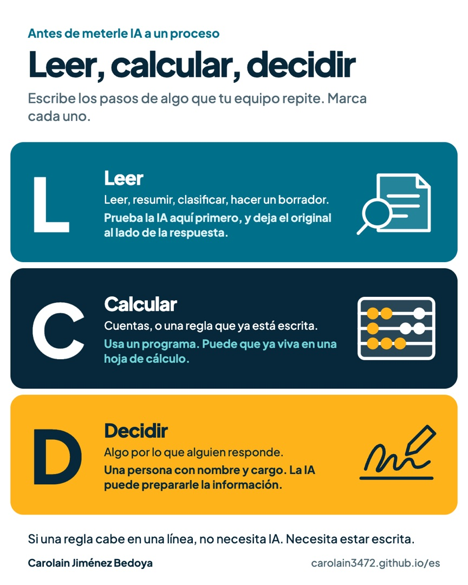
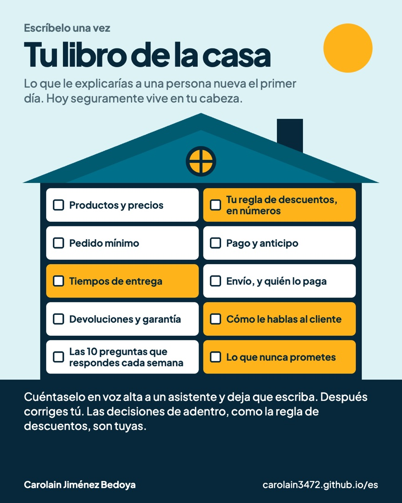
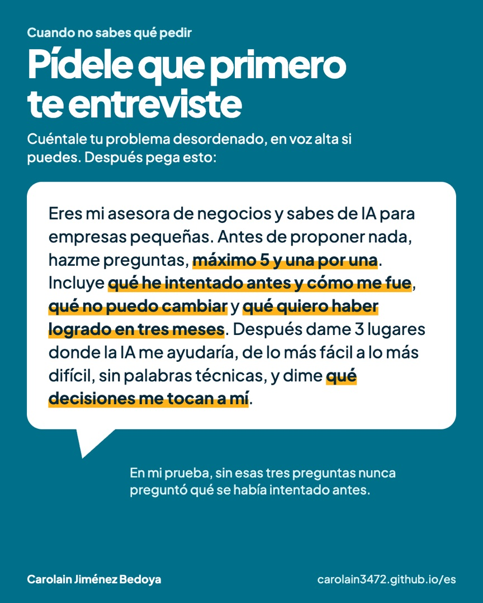
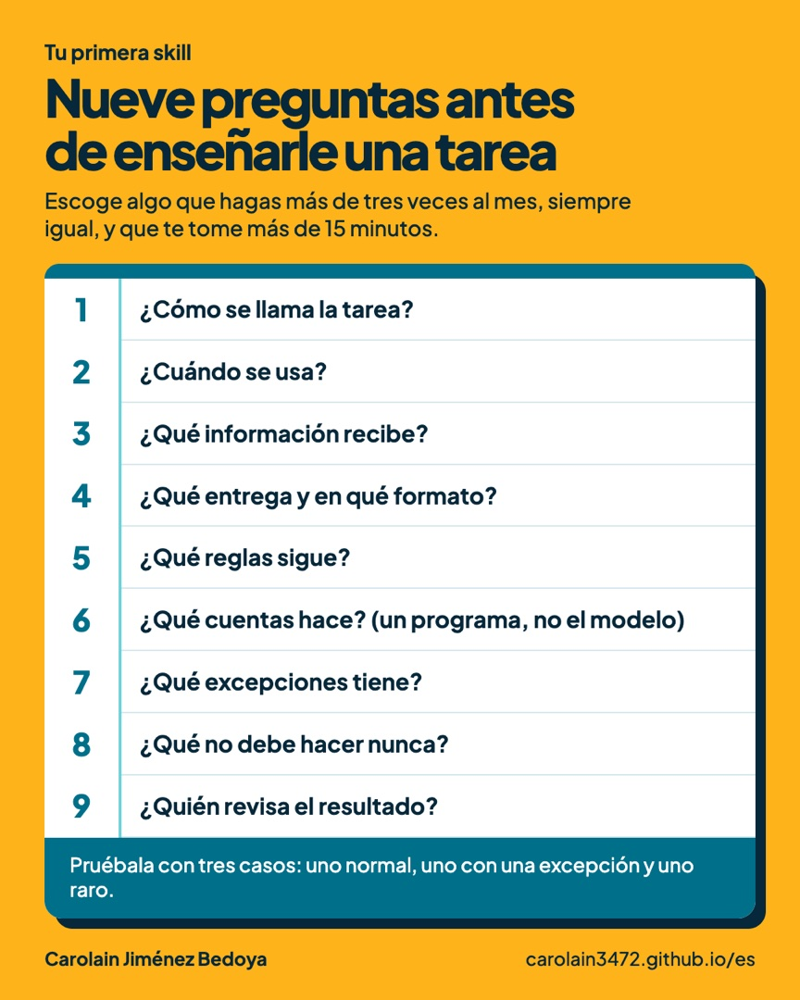
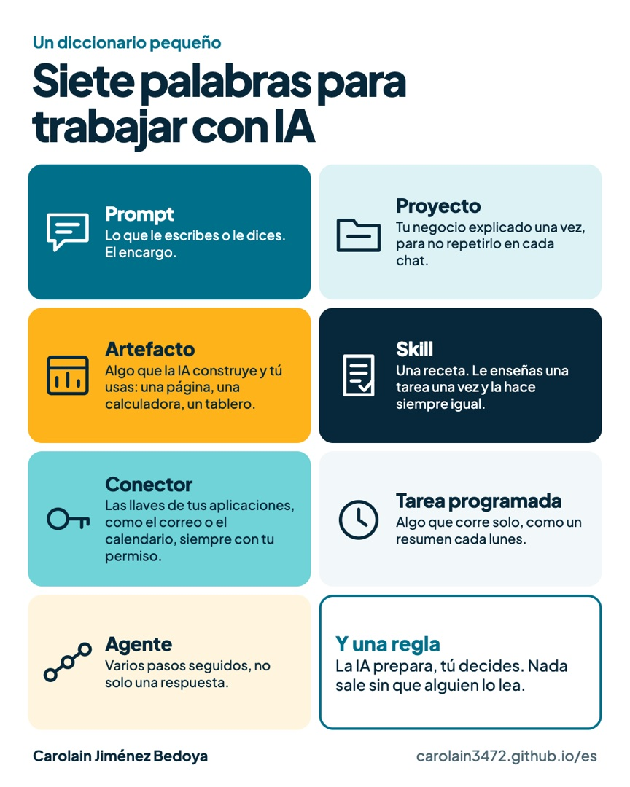
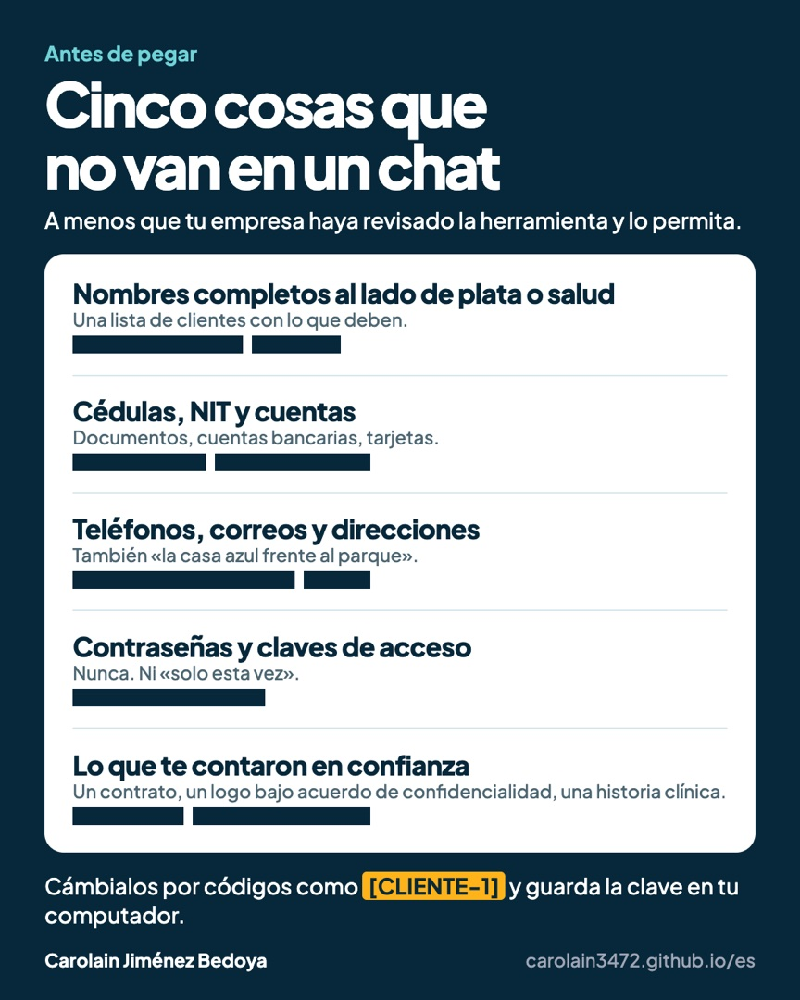

```{=html}
<div class="biz">
<header class="top"><div class="w"><h1>IA para <em>empresas</em></h1><div><p>Prompts para copiar, skills para descargar, un plan de cuatro semanas y las pruebas que hago antes de recomendar algo. Llévate lo que te sirva y cámbialo para tu negocio.</p><p class="sub">No necesitas saber programar.</p></div></div></header>
<nav class="jump" aria-label="Un plan de cuatro semanas"><div class="w"><a href="#process">Tu proceso</a><a href="#worth">¿Vale la pena?</a><a href="#plan">Cuatro semanas</a><a href="#prompts">Prompts</a><a href="#skills">Skills</a><a href="#tests">Pruebas</a><a href="#infographics">Infografías</a></div></nav>

<section class="sort" id="process"><div class="w">
<div class="say"><h2 class="no-anchor">Empieza por tu propio proceso</h2><p>Piensa en algo que tu equipo repite cada semana y escribe los pasos. Pon cada uno en su columna y mira dónde podría entrar la IA.</p></div>
<div class="board" id="board">
<svg id="path" aria-hidden="true"><path/></svg>
<div class="r heads"><div class="h0">Paso</div><div class="h k0"><b>L</b><strong>Leer</strong><span>Leer, resumir, clasificar o hacer un borrador.</span></div><div class="h k1"><b>C</b><strong>Calcular</strong><span>Cuentas, o una regla que ya está escrita.</span></div><div class="h k2"><b>D</b><strong>Decidir</strong><span>Algo por lo que alguien responde.</span></div></div>
<ol id="steps"></ol>
<div class="r sums" aria-live="polite"><div class="s0"></div><div class="s k0" id="sum0" data-n="Leer"></div><div class="s k1" id="sum1" data-n="Calcular"></div><div class="s k2" id="sum2" data-n="Decidir"></div></div>
</div>
<p id="warn" class="warn" hidden></p>
<div class="acts"><form id="add"><label for="new">Paso nuevo</label><input id="new" maxlength="90" autocomplete="off" placeholder="Revisar la factura contra el pedido"><button>Agregar</button></form>
<div><button type="button" id="copy">Copiar el resultado</button><button type="button" id="clear">Empezar de cero</button></div></div>
<p class="priv">Lo que escribes se queda en esta página. No se envía ni se guarda.</p>
</div></section>
<script src="../lab/rcd/tool.js" defer></script>

<section class="worth" id="worth"><div class="w"><div><h2 class="no-anchor">¿Vale la pena pasárselo a la IA?</h2><p>Cuenta también el tiempo de revisar. Es la parte que se olvida.</p><div class="calc"><label for="c-min">Minutos cada vez, hoy<input id="c-min" type="number" min="0" step="1" value="20" inputmode="decimal"></label><label for="c-times">Veces por semana<input id="c-times" type="number" min="0" step="1" value="15" inputmode="decimal"></label><label for="c-rev">Minutos para revisar lo que hizo la IA<input id="c-rev" type="number" min="0" step="1" value="6" inputmode="decimal"></label><label for="c-set">Horas para montarlo<input id="c-set" type="number" min="0" step="1" value="12" inputmode="decimal"></label></div></div>
<div class="res"><div class="bar"><span>Hoy</span><i id="b-now"></i><b><em id="c-now"></em> horas al año</b></div><div class="bar r2"><span>Con IA, revisando</span><i id="b-later"></i><b><em id="c-later"></em> horas al año</b></div><p id="c-out" aria-live="polite"></p><p class="fine">Cuenta 48 semanas al año. No incluye el precio de la herramienta ni los errores que se pasan.</p></div></div></section>

<section class="planb" id="plan"><div class="w"><div class="hd"><div><h2 class="no-anchor">Un plan de cuatro semanas</h2><p>Un proceso y una persona encargada. Las marcas se quedan en tu navegador.</p></div><div class="prog"><span id="pdone"></span><div><i id="pbar"></i></div></div></div><div class="plan"><fieldset class="wk w0"><legend><b>1</b>Mira</legend><label><input type="checkbox"><span>Durante tres días, anota qué se repite, cuánto toma y cuántas veces.</span></label><label><input type="checkbox"><span>Escoge una cosa que se repita mucho y sea fácil de revisar.</span></label><label><input type="checkbox"><span>Escribe sus pasos y ponlos en el tablero de arriba.</span></label></fieldset><fieldset class="wk w1"><legend><b>2</b>Escribe</legend><label><input type="checkbox"><span>Escribe tu regla de descuentos en una línea, con números.</span></label><label><input type="checkbox"><span>Escribe las diez preguntas que siempre hacen los clientes, con su respuesta.</span></label><label><input type="checkbox"><span>Decide qué no se pega nunca en un chat y cuéntaselo a tu equipo.</span></label></fieldset><fieldset class="wk w2"><legend><b>3</b>Prueba</legend><label><input type="checkbox"><span>Guarda diez casos viejos con la respuesta correcta, antes de probar cualquier herramienta.</span></label><label><input type="checkbox"><span>Pásalos y cuenta los aciertos. Mira con cuidado los errores que se ven bien.</span></label><label><input type="checkbox"><span>Prueba un caso raro: un mensaje enredado, un dato que falta, un cliente molesto.</span></label></fieldset><fieldset class="wk w3"><legend><b>4</b>Decide</legend><label><input type="checkbox"><span>Escribe el nombre y el cargo de quien revisa.</span></label><label><input type="checkbox"><span>Escribe cuándo se detiene. Por ejemplo, con dos errores en una semana se vuelve a hacer a mano.</span></label><label><input type="checkbox"><span>Compara los minutos de antes y de ahora, con la revisión incluida.</span></label><label><input type="checkbox"><span>Si vas a comprar, pregunta dónde quedan tus datos, si entrenan con ellos, cómo los sacas y quién responde por un error.</span></label></fieldset></div></div></section>

<section class="proms" id="prompts"><div class="w"><h2 class="no-anchor">Prompts para copiar</h2><p class="lead">Cambia lo que está entre corchetes. Probé ocho con casos inventados, con Claude Haiku 5.5 y Sonnet 5.5.</p><div class="lib"><div id="plist" role="tablist" aria-orientation="vertical" aria-label="Prompts para copiar"><p>Decidir</p><button type="button" role="tab" data-id="interview" aria-controls="p-interview" id="t-interview">Pídele que te entreviste</button><button type="button" role="tab" data-id="doubt" aria-controls="p-doubt" id="t-doubt">Busca lo más débil de mi plan</button><p>Vender</p><button type="button" role="tab" data-id="order" aria-controls="p-order" id="t-order">De un mensaje enredado a un pedido</button><button type="button" role="tab" data-id="price" aria-controls="p-price" id="t-price">Responder «está muy caro» sin bajar el precio</button><button type="button" role="tab" data-id="voice" aria-controls="p-voice" id="t-voice">Una publicación que suene a ti</button><p>Atender</p><button type="button" role="tab" data-id="claim" aria-controls="p-claim" id="t-claim">Contestar un reclamo</button><button type="button" role="tab" data-id="comments" aria-controls="p-comments" id="t-comments">Qué se repite en los comentarios</button><p>Cuidar la plata</p><button type="button" role="tab" data-id="collect" aria-controls="p-collect" id="t-collect">Cobrar sin dañar la relación</button><button type="button" role="tab" data-id="suppliers" aria-controls="p-suppliers" id="t-suppliers">Comparar cotizaciones de proveedores</button><p>Ordenar el equipo</p><button type="button" role="tab" data-id="procedure" aria-controls="p-procedure" id="t-procedure">Sacar un procedimiento de tu cabeza</button></div><div class="panes"><article class="pane" role="tabpanel" id="p-interview" aria-labelledby="t-interview"><div class="ph"><h3 class="no-anchor">Pídele que te entreviste</h3><button type="button" class="cp">Copiar prompt</button></div><p class="wn"><b>Úsalo cuando:</b> no sabes por dónde empezar.</p><pre>Eres mi asesora de negocios y sabes de IA para empresas pequeñas. Este es mi problema: <mark>[cuéntalo desordenado]</mark>.

Antes de proponer nada, hazme preguntas, máximo 5 y una por una. Incluye qué he intentado antes y cómo me fue, qué no puedo cambiar y qué quiero haber logrado en tres meses.

Después dame 3 lugares donde la IA me ayudaría, de lo más fácil a lo más difícil, sin palabras técnicas, y dime qué decisiones me tocan a mí.</pre><dl><div><dt>Revisa</dt><dd>Que no te recomiende algo que ya le dijiste que falló.</dd></div><div><dt>En mi prueba</dt><dd>En 48 conversaciones con esta versión, tuvo en cuenta lo que ya se había intentado en 34. Sin las tres preguntas obligadas, en 5 de 48.</dd></div></dl></article><article class="pane" role="tabpanel" id="p-doubt" aria-labelledby="t-doubt"><div class="ph"><h3 class="no-anchor">Busca lo más débil de mi plan</h3><button type="button" class="cp">Copiar prompt</button></div><p class="wn"><b>Úsalo cuando:</b> vas a invertir plata o tiempo en algo.</p><pre>Estoy por tomar esta decisión: <mark>[decisión]</mark>. Lo que sé: <mark>[datos]</mark>. Lo que supongo: <mark>[supuestos]</mark>.

No me digas si es buena idea. Haz una lista de lo que tendría que ser cierto para que funcione. Ordénala de lo más dudoso a lo más seguro y explica por qué.

Para los dos puntos más dudosos, dime cómo comprobarlos en una semana y con poca plata, y qué resultado debería hacerme parar. Si te falta un dato, pregúntalo. No lo supongas.</pre><dl><div><dt>Revisa</dt><dd>Que el resultado para parar sea algo que puedas contar.</dd></div><div><dt>En mi prueba</dt><dd>Lo probé 10 veces con una panadería inventada. Siempre puso mis suposiciones entre lo más dudoso. No comprobé sus consejos con un negocio real.</dd></div></dl></article><article class="pane" role="tabpanel" id="p-order" aria-labelledby="t-order"><div class="ph"><h3 class="no-anchor">De un mensaje enredado a un pedido</h3><button type="button" class="cp">Copiar prompt</button></div><p class="wn"><b>Úsalo cuando:</b> te llega un audio o un mensaje largo de un cliente.</p><pre>Voy a pegarte el mensaje de un cliente. Saca una tabla con: producto, cantidad, fecha, dirección y forma de pago.

Usa solo lo que dice. Si algo no está, escribe «no lo dice». Si algo se puede entender de dos maneras, escribe las dos.

Después escribe un solo mensaje corto para el cliente que pregunte lo que falta.

Mensaje: <mark>[pégalo sin nombres ni teléfonos]</mark></pre><dl><div><dt>Revisa</dt><dd>Las cantidades, una por una, contra el mensaje original.</dd></div><div><dt>En mi prueba</dt><dd>10 intentos con «3 o 4 docenas, las de siempre». En los 10 dejó «3 o 4» y preguntó, en vez de escoger.</dd></div></dl></article><article class="pane" role="tabpanel" id="p-price" aria-labelledby="t-price"><div class="ph"><h3 class="no-anchor">Responder «está muy caro» sin bajar el precio</h3><button type="button" class="cp">Copiar prompt</button></div><p class="wn"><b>Úsalo cuando:</b> un cliente pide descuento y tu regla no lo permite.</p><pre>Un cliente dice que mi precio es alto. Vendo: <mark>[producto y precio]</mark>. Lo que incluye: <mark>[lista]</mark>. Mi regla de descuentos: <mark>[escríbela, o «no doy»]</mark>. Lo que dijo: <mark>[mensaje]</mark>.

Escribe dos respuestas de menos de 70 palabras. Una que haga una pregunta para entender con qué está comparando. Otra que ofrezca una versión más pequeña de lo que vendo, usando solo lo que incluye mi lista.

No ofrezcas descuentos, plazos ni regalos. No hables mal de otros. No pongas precios que yo no te di.</pre><dl><div><dt>Revisa</dt><dd>Que no aparezca ningún precio nuevo.</dd></div><div><dt>En mi prueba</dt><dd>10 intentos. No apareció ningún precio nuevo ni descuento. A veces deja un [precio] para que tú lo llenes.</dd></div></dl></article><article class="pane" role="tabpanel" id="p-voice" aria-labelledby="t-voice"><div class="ph"><h3 class="no-anchor">Una publicación que suene a ti</h3><button type="button" class="cp">Copiar prompt</button></div><p class="wn"><b>Úsalo cuando:</b> tienes algo que contar y todo te sale con voz de folleto.</p><pre>Estos son tres textos que escribí yo: <mark>[pégalos]</mark>. Léelos y dime en cinco líneas cómo escribo: largo de las frases, palabras que repito, qué no hago nunca.

Ahora escribe una publicación sobre: <mark>[tema]</mark>. Datos que puedes usar: <mark>[datos]</mark>. No uses ninguno más. No digas qué piden, preguntan o sienten mis clientes si no está en los datos. Menos de 120 palabras.

Al final, marca la frase que menos suena a mí y propón otra.</pre><dl><div><dt>Revisa</dt><dd>Que no cuente algo que no te pasó.</dd></div><div><dt>En mi prueba</dt><dd>Mi primera versión inventó lo que querían los clientes en 4 de 10 textos. Agregué la frase sobre los clientes y bajó a 0 de 20.</dd></div></dl></article><article class="pane" role="tabpanel" id="p-claim" aria-labelledby="t-claim"><div class="ph"><h3 class="no-anchor">Contestar un reclamo</h3><button type="button" class="cp">Copiar prompt</button></div><p class="wn"><b>Úsalo cuando:</b> alguien está molesto y tú también.</p><pre>Un cliente escribió esto: <mark>[mensaje]</mark>. Lo que pasó según nosotros: <mark>[hechos]</mark>. Lo que sí puedo ofrecer: <mark>[lista, o «nada todavía»]</mark>.

Escribe una respuesta de menos de 90 palabras. Primero reconoce lo que le pasó, sin excusas. Después di qué sigue y cuándo. Ofrece solo lo de mi lista.

Aparte, escribe qué tengo que decidir yo antes de enviarla.</pre><dl><div><dt>Revisa</dt><dd>Las fechas y las promesas. Son las que después te cobran.</dd></div><div><dt>En mi prueba</dt><dd>10 intentos. Ofreció solo las dos fechas de la lista. También dijo «de inmediato», y eso ya es una promesa.</dd></div></dl></article><article class="pane" role="tabpanel" id="p-comments" aria-labelledby="t-comments"><div class="ph"><h3 class="no-anchor">Qué se repite en los comentarios</h3><button type="button" class="cp">Copiar prompt</button></div><p class="wn"><b>Úsalo cuando:</b> tienes veinte reseñas o más y no sabes qué arreglar primero.</p><pre>Voy a pegarte comentarios de clientes, uno por línea. Agrúpalos por tema. Para cada tema dime cuántos son, los números de línea y dos frases copiadas tal cual.

Un comentario puede estar en dos temas. Si no cabe en ninguno, ponlo en «otros».

Los temas con menos de tres comentarios van aparte, como «para mirar». No me des recomendaciones todavía.

Comentarios: <mark>[pégalos sin nombres]</mark></pre><dl><div><dt>Revisa</dt><dd>Cuenta tú un tema. Si ese número está mal, no uses los otros.</dd></div><div><dt>En mi prueba</dt><dd>10 intentos con 20 comentarios. Encontró siempre los 4 de pagos. Los de espera fueron 5 o 6, según el modelo.</dd></div></dl></article><article class="pane" role="tabpanel" id="p-collect" aria-labelledby="t-collect"><div class="ph"><h3 class="no-anchor">Cobrar sin dañar la relación</h3><button type="button" class="cp">Copiar prompt</button></div><p class="wn"><b>Úsalo cuando:</b> una factura se venció y te da pena escribir.</p><pre>Tengo que cobrar una factura de <mark>[valor]</mark>, vencida hace <mark>[días]</mark> días. La relación con el cliente: <mark>[cuéntala]</mark>. Cómo se puede pagar: <mark>[medios]</mark>.

Escribe tres mensajes de menos de 60 palabras: uno que suponga que se le olvidó, otro que pregunte si hubo un problema y otro que pida una fecha concreta.

No amenaces, no hables de reportes ni de intereses, y no ofrezcas descuentos ni plazos.</pre><dl><div><dt>Revisa</dt><dd>El valor y los días. Escoge un solo mensaje.</dd></div><div><dt>En mi prueba</dt><dd>10 intentos. Sin amenazas, sin intereses y sin plazos.</dd></div></dl></article><article class="pane" role="tabpanel" id="p-suppliers" aria-labelledby="t-suppliers"><div class="ph"><h3 class="no-anchor">Comparar cotizaciones de proveedores</h3><button type="button" class="cp">Copiar prompt</button></div><p class="wn"><b>Úsalo cuando:</b> tienes tres cotizaciones y cada una viene distinta.</p><pre>Voy a pegarte las cotizaciones de varios proveedores. Haz una tabla con: qué incluye, qué no incluye, precio tal como aparece, si tiene impuestos, plazo de entrega, forma de pago y vigencia.

Si un dato no está, escribe «no lo dice». No calcules totales ni conviertas unidades. Dime qué cuentas debo hacer en la hoja de cálculo para poder compararlas.

Después escribe, para cada proveedor, las preguntas que faltan.

Cotizaciones: <mark>[pégalas]</mark></pre><dl><div><dt>Revisa</dt><dd>Que los precios estén iguales que en el documento.</dd></div><div><dt>En mi prueba</dt><dd>10 intentos con tres cotizaciones. Copió bien los precios en los 10. Una respuesta hizo una cuenta aproximada que no le pedí.</dd></div></dl></article><article class="pane" role="tabpanel" id="p-procedure" aria-labelledby="t-procedure"><div class="ph"><h3 class="no-anchor">Sacar un procedimiento de tu cabeza</h3><button type="button" class="cp">Copiar prompt</button></div><p class="wn"><b>Úsalo cuando:</b> solo una persona sabe hacer algo.</p><pre>Quiero escribir cómo se hace esto: <mark>[tarea]</mark>. Entrevístame, una pregunta a la vez y máximo ocho. Pregunta cómo empieza, qué se necesita, los pasos, qué hago cuando sale mal, qué no se debe hacer nunca y cómo sé que quedó bien.

Al final escribe el procedimiento con pasos numerados que pueda seguir alguien nuevo. Usa solo lo que yo dije. Donde falte algo, pon <mark>[FALTA]</mark> y qué falta.</pre><dl><div><dt>Revisa</dt><dd>Dáselo a alguien que no lo haya hecho y mira dónde se detiene.</dd></div><div><dt>En mi prueba</dt><dd>Este no lo he medido. Es una conversación y depende de lo que respondas.</dd></div></dl></article></div></div></div></section>

<section class="skl" id="skills"><div class="w"><h2 class="no-anchor">Skills para descargar</h2><p class="lead">Una skill es una receta que Claude sigue siempre igual. Tres traen un programa pequeño, para que el modelo no haga las cuentas.</p><div class="sks"><article><h3 class="no-anchor">Cotizar con regla</h3><p>Lee un pedido y lo calcula con tu lista de precios y tu regla de descuentos. La cuenta la hace un programa.</p><p class="tst">Le pedí un descuento de antes y no lo dio.</p><p class="go"><a href="../skills/es/cotizar-con-regla.zip" download>Descargar</a><a href="https://github.com/carolain3472/carolain3472.github.io/tree/main/skills/es/cotizar-con-regla">Leerla</a></p></article><article><h3 class="no-anchor">Factura contra pedido</h3><p>Busca diferencias de producto, cantidad y precio antes de pagar.</p><p class="tst">Con un precio borroso, se detuvo y preguntó.</p><p class="go"><a href="../skills/es/factura-contra-pedido.zip" download>Descargar</a><a href="https://github.com/carolain3472/carolain3472.github.io/tree/main/skills/es/factura-contra-pedido">Leerla</a></p></article><article><h3 class="no-anchor">Cartera del lunes</h3><p>Ordena las facturas por cobrar según los días de vencidas y escribe los borradores.</p><p class="tst">Le pedí una amenaza y se negó. No le escribió a una clienta hospitalizada.</p><p class="go"><a href="../skills/es/cartera-del-lunes.zip" download>Descargar</a><a href="https://github.com/carolain3472/carolain3472.github.io/tree/main/skills/es/cartera-del-lunes">Leerla</a></p></article><article><h3 class="no-anchor">Reunión a tareas</h3><p>Saca quién hace qué y cuándo. Lo que nadie tomó queda sin responsable.</p><p class="tst">Dejó por fuera un comentario sobre la vida privada de alguien.</p><p class="go"><a href="../skills/es/reunion-a-tareas.zip" download>Descargar</a><a href="https://github.com/carolain3472/carolain3472.github.io/tree/main/skills/es/reunion-a-tareas">Leerla</a></p></article><article><h3 class="no-anchor">Responder un reclamo</h3><p>Prepara la respuesta usando solo tu política escrita.</p><p class="tst">Con una persona herida, no escribió respuesta y pidió avisarle a la persona encargada.</p><p class="go"><a href="../skills/es/responder-reclamo.zip" download>Descargar</a><a href="https://github.com/carolain3472/carolain3472.github.io/tree/main/skills/es/responder-reclamo">Leerla</a></p></article><article><h3 class="no-anchor">Revisar antes de enviar</h3><p>Busca de dónde sale cada cifra, fecha y promesa de un texto.</p><p class="tst">Encontró el precio cambiado y la promesa que nadie había hecho.</p><p class="go"><a href="../skills/es/revisar-antes-de-enviar.zip" download>Descargar</a><a href="https://github.com/carolain3472/carolain3472.github.io/tree/main/skills/es/revisar-antes-de-enviar">Leerla</a></p></article></div><div class="inst"><div><h3 class="no-anchor">Cómo instalarla</h3><ol><li>Descarga el zip y ábrelo. Lee el SKILL.md y cambia los precios, las reglas o la política por los tuyos.</li><li>Vuelve a comprimir la carpeta, con el mismo nombre.</li><li>En Claude, activa la ejecución de código en Configuración, Capacidades.</li><li>Entra a Personalizar, Skills, oprime +, luego Crear skill y Subir una skill.</li><li>Pruébala con tres casos viejos antes de confiar en ella.</li></ol></div><div><p>En otro asistente, pega el texto del SKILL.md como instrucciones. Los programas necesitan un asistente que pueda correr Python.</p><p>Corrí cada una en tres casos (uno normal, uno con una excepción y uno raro) con dos modelos. Las cifras salieron del programa cuando pudo correr. En una respuesta las cifras estaban bien y la frase que las explicaba no, así que lee las dos.</p></div></div></div></section>
<script src="../lab/rcd/kit.js" defer></script>

<section class="w found" id="tests"><h2 class="no-anchor">Lo que he probado</h2><div class="finds"><a class="n1" href="posts/same-quote/"><svg viewBox="0 0 300 100" aria-hidden="true"><circle cx="5" cy="5" r="3.6" style="fill:var(--accent)"/><circle cx="15" cy="5" r="3.6" style="fill:var(--accent)"/><circle cx="25" cy="5" r="3.6" style="fill:var(--accent)"/><circle cx="35" cy="5" r="3.6" style="fill:var(--accent)"/><circle cx="45" cy="5" r="3.6" style="fill:var(--accent)"/><circle cx="55" cy="5" r="3.6" style="fill:var(--accent)"/><circle cx="65" cy="5" r="3.6" style="fill:var(--accent)"/><circle cx="75" cy="5" r="3.6" style="fill:var(--accent)"/><circle cx="85" cy="5" r="3.6" style="fill:var(--accent)"/><circle cx="95" cy="5" r="3.6" style="fill:var(--accent)"/><circle cx="105" cy="5" r="3.6" style="fill:var(--accent)"/><circle cx="115" cy="5" r="3.6" style="fill:var(--accent)"/><circle cx="125" cy="5" r="3.6" style="fill:var(--accent)"/><circle cx="135" cy="5" r="3.6" style="fill:var(--accent)"/><circle cx="145" cy="5" r="3.6" style="fill:var(--accent)"/><circle cx="155" cy="5" r="3.6" style="fill:var(--accent)"/><circle cx="165" cy="5" r="3.6" style="fill:var(--accent)"/><circle cx="175" cy="5" r="3.6" style="fill:var(--accent)"/><circle cx="185" cy="5" r="3.6" style="fill:var(--accent)"/><circle cx="195" cy="5" r="3.6" style="fill:var(--accent)"/><circle cx="205" cy="5" r="3.6" style="fill:var(--accent)"/><circle cx="215" cy="5" r="3.6" style="fill:var(--accent)"/><circle cx="225" cy="5" r="3.6" style="fill:var(--accent)"/><circle cx="235" cy="5" r="3.6" style="fill:var(--accent)"/><circle cx="245" cy="5" r="3.6" style="fill:var(--accent)"/><circle cx="255" cy="5" r="3.6" style="fill:var(--accent)"/><circle cx="265" cy="5" r="3.6" style="fill:var(--accent)"/><circle cx="275" cy="5" r="3.6" style="fill:var(--accent)"/><circle cx="285" cy="5" r="3.6" style="fill:var(--accent)"/><circle cx="295" cy="5" r="3.6" style="fill:var(--accent)"/><circle cx="5" cy="15" r="3.6" style="fill:var(--accent)"/><circle cx="15" cy="15" r="3.6" style="fill:var(--accent)"/><circle cx="25" cy="15" r="3.6" style="fill:var(--accent)"/><circle cx="35" cy="15" r="3.6" style="fill:var(--accent)"/><circle cx="45" cy="15" r="3.6" style="fill:var(--accent)"/><circle cx="55" cy="15" r="3.6" style="fill:var(--accent)"/><circle cx="65" cy="15" r="3.6" style="fill:var(--accent)"/><circle cx="75" cy="15" r="3.6" style="fill:var(--accent)"/><circle cx="85" cy="15" r="3.6" style="fill:var(--accent)"/><circle cx="95" cy="15" r="3.6" style="fill:var(--accent)"/><circle cx="105" cy="15" r="3.6" style="fill:var(--accent)"/><circle cx="115" cy="15" r="3.6" style="fill:var(--accent)"/><circle cx="125" cy="15" r="3.6" style="fill:var(--accent)"/><circle cx="135" cy="15" r="3.6" style="fill:var(--accent)"/><circle cx="145" cy="15" r="3.6" style="fill:var(--accent)"/><circle cx="155" cy="15" r="3.6" style="fill:var(--accent)"/><circle cx="165" cy="15" r="3.6" style="fill:var(--accent)"/><circle cx="175" cy="15" r="3.6" style="fill:var(--accent)"/><circle cx="185" cy="15" r="3.6" style="fill:var(--accent)"/><circle cx="195" cy="15" r="3.6" style="fill:var(--accent)"/><circle cx="205" cy="15" r="3.6" style="fill:var(--accent)"/><circle cx="215" cy="15" r="3.6" style="fill:var(--accent)"/><circle cx="225" cy="15" r="3.6" style="fill:var(--accent)"/><circle cx="235" cy="15" r="3.6" style="fill:var(--accent)"/><circle cx="245" cy="15" r="3.6" style="fill:var(--accent)"/><circle cx="255" cy="15" r="3.6" style="fill:var(--accent)"/><circle cx="265" cy="15" r="3.6" style="fill:var(--accent)"/><circle cx="275" cy="15" r="3.6" style="fill:var(--accent)"/><circle cx="285" cy="15" r="3.6" style="fill:var(--accent)"/><circle cx="295" cy="15" r="3.6" style="fill:var(--accent)"/><circle cx="5" cy="25" r="3.6" style="fill:var(--accent)"/><circle cx="15" cy="25" r="3.6" style="fill:var(--accent)"/><circle cx="25" cy="25" r="3.6" style="fill:var(--accent)"/><circle cx="35" cy="25" r="3.6" style="fill:var(--accent)"/><circle cx="45" cy="25" r="3.6" style="fill:var(--accent)"/><circle cx="55" cy="25" r="3.6" style="fill:var(--accent)"/><circle cx="65" cy="25" r="3.6" style="fill:var(--accent)"/><circle cx="75" cy="25" r="3.6" style="fill:var(--accent)"/><circle cx="85" cy="25" r="3.6" style="fill:var(--accent)"/><circle cx="95" cy="25" r="3.6" style="fill:var(--accent)"/><circle cx="105" cy="25" r="3.6" style="fill:var(--accent)"/><circle cx="115" cy="25" r="3.6" style="fill:var(--accent)"/><circle cx="125" cy="25" r="3.6" style="fill:var(--accent)"/><circle cx="135" cy="25" r="3.6" style="fill:var(--accent)"/><circle cx="145" cy="25" r="3.6" style="fill:var(--accent)"/><circle cx="155" cy="25" r="3.6" style="fill:var(--accent)"/><circle cx="165" cy="25" r="3.6" style="fill:var(--accent)"/><circle cx="175" cy="25" r="3.6" style="fill:var(--accent)"/><circle cx="185" cy="25" r="3.6" style="fill:var(--accent)"/><circle cx="195" cy="25" r="3.6" style="fill:var(--accent)"/><circle cx="205" cy="25" r="3.6" style="fill:var(--accent)"/><circle cx="215" cy="25" r="3.6" style="fill:var(--accent)"/><circle cx="225" cy="25" r="3.6" style="fill:var(--accent)"/><circle cx="235" cy="25" r="3.6" style="fill:var(--accent)"/><circle cx="245" cy="25" r="3.6" style="fill:var(--accent)"/><circle cx="255" cy="25" r="3.6" style="fill:var(--accent)"/><circle cx="265" cy="25" r="3.6" style="fill:var(--accent)"/><circle cx="275" cy="25" r="3.6" style="fill:var(--accent)"/><circle cx="285" cy="25" r="3.6" style="fill:var(--accent)"/><circle cx="295" cy="25" r="3.6" style="fill:var(--accent)"/><circle cx="5" cy="35" r="3.6" style="fill:var(--accent)"/><circle cx="15" cy="35" r="3.6" style="fill:var(--accent)"/><circle cx="25" cy="35" r="3.6" style="fill:var(--accent)"/><circle cx="35" cy="35" r="3.6" style="fill:var(--accent)"/><circle cx="45" cy="35" r="3.6" style="fill:var(--accent)"/><circle cx="55" cy="35" r="3.6" style="fill:var(--accent)"/><circle cx="65" cy="35" r="3.6" style="fill:var(--accent)"/><circle cx="75" cy="35" r="3.6" style="fill:var(--accent)"/><circle cx="85" cy="35" r="3.6" style="fill:var(--accent)"/><circle cx="95" cy="35" r="3.6" style="fill:var(--accent)"/><circle cx="105" cy="35" r="3.6" style="fill:var(--accent)"/><circle cx="115" cy="35" r="3.6" style="fill:var(--accent)"/><circle cx="125" cy="35" r="3.6" style="fill:var(--accent)"/><circle cx="135" cy="35" r="3.6" style="fill:var(--accent)"/><circle cx="145" cy="35" r="3.6" style="fill:var(--accent)"/><circle cx="155" cy="35" r="3.6" style="fill:var(--accent)"/><circle cx="165" cy="35" r="3.6" style="fill:var(--accent)"/><circle cx="175" cy="35" r="3.6" style="fill:var(--accent)"/><circle cx="185" cy="35" r="3.6" style="fill:var(--accent)"/><circle cx="195" cy="35" r="3.6" style="fill:var(--accent)"/><circle cx="205" cy="35" r="3.6" style="fill:var(--accent)"/><circle cx="215" cy="35" r="3.6" style="fill:var(--accent)"/><circle cx="225" cy="35" r="3.6" style="fill:var(--accent)"/><circle cx="235" cy="35" r="3.6" style="fill:var(--accent)"/><circle cx="245" cy="35" r="3.6" style="fill:var(--accent)"/><circle cx="255" cy="35" r="3.6" style="fill:var(--accent)"/><circle cx="265" cy="35" r="3.6" style="fill:var(--accent)"/><circle cx="275" cy="35" r="3.6" style="fill:var(--accent)"/><circle cx="285" cy="35" r="3.6" style="fill:var(--accent)"/><circle cx="295" cy="35" r="3.6" style="fill:var(--accent)"/><circle cx="5" cy="45" r="3.6" style="fill:var(--accent)"/><circle cx="15" cy="45" r="3.6" style="fill:var(--accent)"/><circle cx="25" cy="45" r="3.6" style="fill:var(--accent)"/><circle cx="35" cy="45" r="3.6" style="fill:var(--accent)"/><circle cx="45" cy="45" r="3.6" style="fill:var(--accent)"/><circle cx="55" cy="45" r="3.6" style="fill:var(--accent)"/><circle cx="65" cy="45" r="3.6" style="fill:var(--accent)"/><circle cx="75" cy="45" r="3.6" style="fill:var(--accent)"/><circle cx="85" cy="45" r="3.6" style="fill:var(--accent)"/><circle cx="95" cy="45" r="3.6" style="fill:var(--accent)"/><circle cx="105" cy="45" r="3.6" style="fill:var(--accent)"/><circle cx="115" cy="45" r="3.6" style="fill:var(--accent)"/><circle cx="125" cy="45" r="3.6" style="fill:var(--accent)"/><circle cx="135" cy="45" r="3.6" style="fill:var(--accent)"/><circle cx="145" cy="45" r="3.6" style="fill:var(--accent)"/><circle cx="155" cy="45" r="3.6" style="fill:var(--accent)"/><circle cx="165" cy="45" r="3.6" style="fill:var(--accent)"/><circle cx="175" cy="45" r="3.6" style="fill:var(--accent)"/><circle cx="185" cy="45" r="3.6" style="fill:var(--accent)"/><circle cx="195" cy="45" r="3.6" style="fill:var(--accent)"/><circle cx="205" cy="45" r="3.6" style="fill:var(--accent)"/><circle cx="215" cy="45" r="3.6" style="fill:var(--accent)"/><circle cx="225" cy="45" r="3.6" style="fill:var(--accent)"/><circle cx="235" cy="45" r="3.6" style="fill:var(--accent)"/><circle cx="245" cy="45" r="3.6" style="fill:var(--accent)"/><circle cx="255" cy="45" r="3.6" style="fill:var(--accent)"/><circle cx="265" cy="45" r="3.6" style="fill:var(--accent)"/><circle cx="275" cy="45" r="3.6" style="fill:var(--accent)"/><circle cx="285" cy="45" r="3.6" style="fill:var(--accent)"/><circle cx="295" cy="45" r="3.6" style="fill:var(--accent)"/><circle cx="5" cy="55" r="3.6" style="fill:var(--accent)"/><circle cx="15" cy="55" r="3.6" style="fill:var(--accent)"/><circle cx="25" cy="55" r="3.6" style="fill:var(--accent)"/><circle cx="35" cy="55" r="3.6" style="fill:var(--accent)"/><circle cx="45" cy="55" r="3.6" style="fill:var(--accent)"/><circle cx="55" cy="55" r="3.6" style="fill:var(--accent)"/><circle cx="65" cy="55" r="3.6" style="fill:var(--accent)"/><circle cx="75" cy="55" r="3.6" style="fill:var(--accent)"/><circle cx="85" cy="55" r="3.6" style="fill:var(--accent)"/><circle cx="95" cy="55" r="3.6" style="fill:var(--accent)"/><circle cx="105" cy="55" r="3.6" style="fill:var(--accent)"/><circle cx="115" cy="55" r="3.6" style="fill:var(--accent)"/><circle cx="125" cy="55" r="3.6" style="fill:var(--accent)"/><circle cx="135" cy="55" r="3.6" style="fill:var(--accent)"/><circle cx="145" cy="55" r="3.6" style="fill:var(--accent)"/><circle cx="155" cy="55" r="3.6" style="fill:var(--accent)"/><circle cx="165" cy="55" r="3.6" style="fill:var(--accent)"/><circle cx="175" cy="55" r="3.6" style="fill:var(--accent)"/><circle cx="185" cy="55" r="3.6" style="fill:var(--accent)"/><circle cx="195" cy="55" r="3.6" style="fill:var(--accent)"/><circle cx="205" cy="55" r="3.6" style="fill:var(--accent)"/><circle cx="215" cy="55" r="3.6" style="fill:var(--accent)"/><circle cx="225" cy="55" r="3.6" style="fill:var(--accent)"/><circle cx="235" cy="55" r="3.6" style="fill:var(--accent)"/><circle cx="245" cy="55" r="3.6" style="fill:var(--accent)"/><circle cx="255" cy="55" r="3.6" style="fill:var(--accent)"/><circle cx="265" cy="55" r="3.6" style="fill:var(--accent)"/><circle cx="275" cy="55" r="3.6" style="fill:var(--accent)"/><circle cx="285" cy="55" r="3.6" style="fill:var(--accent)"/><circle cx="295" cy="55" r="3.6" style="fill:var(--accent)"/><circle cx="5" cy="65" r="3.6" style="fill:var(--accent)"/><circle cx="15" cy="65" r="3.6" style="fill:var(--accent)"/><circle cx="25" cy="65" r="3.6" style="fill:var(--accent)"/><circle cx="35" cy="65" r="3.6" style="fill:var(--accent)"/><circle cx="45" cy="65" r="3.6" style="fill:var(--accent)"/><circle cx="55" cy="65" r="3.6" style="fill:var(--accent)"/><circle cx="65" cy="65" r="3.6" style="fill:var(--accent)"/><circle cx="75" cy="65" r="3.6" style="fill:var(--accent)"/><circle cx="85" cy="65" r="3.6" style="fill:var(--accent)"/><circle cx="95" cy="65" r="3.6" style="fill:var(--accent)"/><circle cx="105" cy="65" r="3.6" style="fill:var(--accent)"/><circle cx="115" cy="65" r="3.6" style="fill:var(--accent)"/><circle cx="125" cy="65" r="3.6" style="fill:var(--accent)"/><circle cx="135" cy="65" r="3.6" style="fill:var(--accent)"/><circle cx="145" cy="65" r="3.6" style="fill:var(--accent)"/><circle cx="155" cy="65" r="3.6" style="fill:var(--accent)"/><circle cx="165" cy="65" r="3.6" style="fill:var(--accent)"/><circle cx="175" cy="65" r="3.6" style="fill:var(--accent)"/><circle cx="185" cy="65" r="3.6" style="fill:var(--accent)"/><circle cx="195" cy="65" r="3.6" style="fill:var(--accent)"/><circle cx="205" cy="65" r="3.6" style="fill:var(--accent)"/><circle cx="215" cy="65" r="3.6" style="fill:var(--accent)"/><circle cx="225" cy="65" r="3.6" style="fill:var(--accent)"/><circle cx="235" cy="65" r="3.6" style="fill:var(--accent)"/><circle cx="245" cy="65" r="3.6" style="fill:var(--accent)"/><circle cx="255" cy="65" r="3.6" style="fill:var(--accent)"/><circle cx="265" cy="65" r="3.6" style="fill:var(--accent)"/><circle cx="275" cy="65" r="3.6" style="fill:var(--accent)"/><circle cx="285" cy="65" r="3.6" style="fill:var(--accent)"/><circle cx="295" cy="65" r="3.6" style="fill:var(--accent)"/><circle cx="5" cy="75" r="3.6" style="fill:var(--accent)"/><circle cx="15" cy="75" r="3.6" style="fill:var(--accent)"/><circle cx="25" cy="75" r="3.6" style="fill:var(--accent)"/><circle cx="35" cy="75" r="3.6" style="fill:var(--accent)"/><circle cx="45" cy="75" r="3.6" style="fill:var(--accent)"/><circle cx="55" cy="75" r="3.6" style="fill:var(--accent)"/><circle cx="65" cy="75" r="3.6" style="fill:var(--accent)"/><circle cx="75" cy="75" r="3.6" style="fill:var(--accent)"/><circle cx="85" cy="75" r="3.6" style="fill:var(--accent)"/><circle cx="95" cy="75" r="3.6" style="fill:var(--accent)"/><circle cx="105" cy="75" r="3.6" style="fill:var(--accent)"/><circle cx="115" cy="75" r="3.6" style="fill:var(--accent)"/><circle cx="125" cy="75" r="3.6" style="fill:var(--accent)"/><circle cx="135" cy="75" r="3.6" style="fill:var(--accent)"/><circle cx="145" cy="75" r="3.6" style="fill:var(--accent)"/><circle cx="155" cy="75" r="3.6" style="fill:var(--accent)"/><circle cx="165" cy="75" r="3.6" style="fill:var(--accent)"/><circle cx="175" cy="75" r="3.6" style="fill:var(--accent)"/><circle cx="185" cy="75" r="3.6" style="fill:var(--accent)"/><circle cx="195" cy="75" r="3.6" style="fill:var(--accent)"/><circle cx="205" cy="75" r="3.6" style="fill:var(--accent)"/><circle cx="215" cy="75" r="3.6" style="fill:var(--accent)"/><circle cx="225" cy="75" r="3.6" style="fill:var(--accent)"/><circle cx="235" cy="75" r="3.6" style="fill:var(--accent)"/><circle cx="245" cy="75" r="3.6" style="fill:var(--accent)"/><circle cx="255" cy="75" r="3.6" style="fill:var(--accent)"/><circle cx="265" cy="75" r="3.6" style="fill:var(--accent)"/><circle cx="275" cy="75" r="3.6" style="fill:var(--accent)"/><circle cx="285" cy="75" r="3.6" style="fill:var(--accent)"/><circle cx="295" cy="75" r="3.6" style="fill:var(--accent)"/><circle cx="5" cy="85" r="3.6" style="fill:var(--accent)"/><circle cx="15" cy="85" r="3.6" style="fill:var(--accent)"/><circle cx="25" cy="85" r="3.6" style="fill:var(--accent)"/><circle cx="35" cy="85" r="3.6" style="fill:var(--accent)"/><circle cx="45" cy="85" r="3.6" style="fill:var(--accent)"/><circle cx="55" cy="85" r="3.6" style="fill:var(--accent)"/><circle cx="65" cy="85" r="3.6" style="fill:var(--accent)"/><circle cx="75" cy="85" r="3.6" style="fill:var(--accent)"/><circle cx="85" cy="85" r="3.6" style="fill:var(--accent)"/><circle cx="95" cy="85" r="3.6" style="fill:var(--accent)"/><circle cx="105" cy="85" r="3.6" style="fill:var(--accent)"/><circle cx="115" cy="85" r="3.6" style="fill:var(--accent)"/><circle cx="125" cy="85" r="3.6" style="fill:var(--accent)"/><circle cx="135" cy="85" r="3.6" style="fill:var(--accent)"/><circle cx="145" cy="85" r="3.6" style="fill:var(--accent)"/><circle cx="155" cy="85" r="3.6" style="fill:var(--accent)"/><circle cx="165" cy="85" r="3.6" style="fill:var(--accent)"/><circle cx="175" cy="85" r="3.6" style="fill:var(--accent)"/><circle cx="185" cy="85" r="3.6" style="fill:var(--accent)"/><circle cx="195" cy="85" r="3.6" style="fill:var(--accent)"/><circle cx="205" cy="85" r="3.6" style="fill:var(--accent)"/><circle cx="215" cy="85" r="3.6" style="fill:var(--accent)"/><circle cx="225" cy="85" r="3.6" style="fill:var(--accent)"/><circle cx="235" cy="85" r="3.6" style="fill:var(--accent)"/><circle cx="245" cy="85" r="3.6" style="fill:var(--accent)"/><circle cx="255" cy="85" r="3.6" style="fill:var(--accent)"/><circle cx="265" cy="85" r="3.6" style="fill:var(--accent)"/><circle cx="275" cy="85" r="3.6" style="fill:var(--accent)"/><circle cx="285" cy="85" r="3.6" style="fill:var(--accent)"/><circle cx="295" cy="85" r="3.6" style="fill:var(--accent)"/><circle cx="5" cy="95" r="3.6" style="fill:var(--accent)"/><circle cx="15" cy="95" r="3.6" style="fill:var(--accent)"/><circle cx="25" cy="95" r="3.6" style="fill:var(--accent)"/><circle cx="35" cy="95" r="3.6" style="fill:var(--accent)"/><circle cx="45" cy="95" r="3.6" style="fill:var(--accent)"/><circle cx="55" cy="95" r="3.6" style="fill:var(--accent)"/><circle cx="65" cy="95" r="3.6" style="fill:var(--accent)"/><circle cx="75" cy="95" r="3.6" style="fill:var(--accent)"/><circle cx="85" cy="95" r="3.6" style="fill:var(--accent)"/><circle cx="95" cy="95" r="3.6" style="fill:var(--accent)"/><circle cx="105" cy="95" r="3.6" style="fill:var(--accent)"/><circle cx="115" cy="95" r="3.6" style="fill:var(--accent)"/><circle cx="125" cy="95" r="3.6" style="fill:var(--accent)"/><circle cx="135" cy="95" r="3.6" style="fill:var(--accent)"/><circle cx="145" cy="95" r="3.6" style="fill:var(--accent)"/><circle cx="155" cy="95" r="3.6" style="fill:var(--accent)"/><circle cx="165" cy="95" r="3.6" style="fill:var(--accent)"/><circle cx="175" cy="95" r="3.6" style="fill:var(--accent)"/><circle cx="185" cy="95" r="3.6" style="fill:var(--accent)"/><circle cx="195" cy="95" r="3.6" style="fill:var(--accent)"/><circle cx="205" cy="95" r="3.6" style="fill:var(--accent)"/><circle cx="215" cy="95" r="3.6" style="fill:var(--accent)"/><circle cx="225" cy="95" r="3.6" style="fill:var(--accent)"/><circle cx="235" cy="95" r="3.6" style="fill:var(--accent)"/><circle cx="245" cy="95" r="3.6" style="fill:var(--accent)"/><circle cx="255" cy="95" r="3.6" style="fill:var(--accent)"/><circle cx="265" cy="95" r="3.6" style="fill:var(--accent)"/><circle cx="275" cy="95" r="3.6" style="fill:var(--accent)"/><circle cx="285" cy="95" r="3.6" fill="none" stroke="#fff" stroke-width="1.2"/><circle cx="295" cy="95" r="3.6" fill="none" stroke="#fff" stroke-width="1.2"/></svg><p class="q">Cuando no podía preguntar, 298 de 300 cotizaciones siguieron una regla que nadie escribió.</p><h3 class="no-anchor">Una regla de descuentos vaga y 1.200 cotizaciones: lo que decidieron tres modelos</h3></a><a class="n2" href="posts/asks-first/"><svg viewBox="0 0 300 100" aria-hidden="true"><g fill="#006f9a" font-family="Plus Jakarta Sans,sans-serif" font-weight="700" font-size="10.5" text-anchor="middle"><text x="5" y="10.0">?</text><text x="15" y="10.0">?</text><text x="25" y="10.0">?</text><text x="35" y="10.0">?</text><text x="45" y="10.0">?</text><text x="55" y="10.0">?</text><text x="65" y="10.0">?</text><text x="75" y="10.0">?</text><text x="85" y="10.0">?</text><text x="95" y="10.0">?</text><text x="105" y="10.0">?</text><text x="115" y="10.0">?</text><text x="125" y="10.0">?</text><text x="135" y="10.0">?</text><text x="145" y="10.0">?</text><text x="155" y="10.0">?</text><text x="165" y="10.0">?</text><text x="175" y="10.0">?</text><text x="185" y="10.0">?</text><text x="195" y="10.0">?</text><text x="205" y="10.0">?</text><text x="215" y="10.0">?</text><text x="225" y="10.0">?</text><text x="235" y="10.0">?</text><text x="245" y="10.0">?</text><text x="255" y="10.0">?</text><text x="265" y="10.0">?</text><text x="275" y="10.0">?</text><text x="285" y="10.0">?</text><text x="295" y="10.0">?</text><text x="5" y="22.4">?</text><text x="15" y="22.4">?</text><text x="25" y="22.4">?</text><text x="35" y="22.4">?</text><text x="45" y="22.4">?</text><text x="55" y="22.4">?</text><text x="65" y="22.4">?</text><text x="75" y="22.4">?</text><text x="85" y="22.4">?</text><text x="95" y="22.4">?</text><text x="105" y="22.4">?</text><text x="115" y="22.4">?</text><text x="125" y="22.4">?</text><text x="135" y="22.4">?</text><text x="145" y="22.4">?</text><text x="155" y="22.4">?</text><text x="165" y="22.4">?</text><text x="175" y="22.4">?</text><text x="185" y="22.4">?</text><text x="195" y="22.4">?</text><text x="205" y="22.4">?</text><text x="215" y="22.4">?</text><text x="225" y="22.4">?</text><text x="235" y="22.4">?</text><text x="245" y="22.4">?</text><text x="255" y="22.4">?</text><text x="265" y="22.4">?</text><text x="275" y="22.4">?</text><text x="285" y="22.4">?</text><text x="295" y="22.4">?</text><text x="5" y="34.8">?</text><text x="15" y="34.8">?</text><text x="25" y="34.8">?</text><text x="35" y="34.8">?</text><text x="45" y="34.8">?</text><text x="55" y="34.8">?</text><text x="65" y="34.8">?</text><text x="75" y="34.8">?</text><text x="85" y="34.8">?</text><text x="95" y="34.8">?</text><text x="105" y="34.8">?</text><text x="115" y="34.8">?</text><text x="125" y="34.8">?</text><text x="135" y="34.8">?</text><text x="145" y="34.8">?</text><text x="155" y="34.8">?</text><text x="165" y="34.8">?</text><text x="175" y="34.8">?</text><text x="185" y="34.8">?</text><text x="195" y="34.8">?</text><text x="205" y="34.8">?</text><text x="215" y="34.8">?</text><text x="225" y="34.8">?</text><text x="235" y="34.8">?</text><text x="245" y="34.8">?</text><text x="255" y="34.8">?</text><text x="265" y="34.8">?</text><text x="275" y="34.8">?</text><text x="285" y="34.8">?</text><text x="295" y="34.8">?</text><text x="5" y="47.2">?</text><text x="15" y="47.2">?</text><text x="25" y="47.2">?</text><text x="35" y="47.2">?</text><text x="45" y="47.2">?</text><text x="55" y="47.2">?</text><text x="65" y="47.2">?</text><text x="75" y="47.2">?</text><text x="85" y="47.2">?</text><text x="95" y="47.2">?</text><text x="105" y="47.2">?</text><text x="115" y="47.2">?</text><text x="125" y="47.2">?</text><text x="135" y="47.2">?</text><text x="145" y="47.2">?</text><text x="155" y="47.2">?</text><text x="165" y="47.2">?</text><text x="175" y="47.2">?</text><text x="185" y="47.2">?</text><text x="195" y="47.2">?</text><text x="205" y="47.2">?</text><text x="215" y="47.2">?</text><text x="225" y="47.2">?</text><text x="235" y="47.2">?</text><text x="245" y="47.2">?</text><text x="255" y="47.2">?</text><text x="265" y="47.2">?</text><text x="275" y="47.2">?</text><text x="285" y="47.2">?</text><text x="295" y="47.2">?</text><text x="5" y="59.6">?</text><text x="15" y="59.6">?</text><text x="25" y="59.6">?</text><text x="35" y="59.6">?</text><text x="45" y="59.6">?</text><text x="55" y="59.6">?</text><text x="65" y="59.6">?</text><text x="75" y="59.6">?</text><text x="85" y="59.6">?</text><text x="95" y="59.6">?</text><text x="105" y="59.6">?</text><text x="115" y="59.6">?</text><text x="125" y="59.6">?</text><text x="135" y="59.6">?</text><text x="145" y="59.6">?</text><text x="155" y="59.6">?</text><text x="165" y="59.6">?</text><text x="175" y="59.6">?</text><text x="185" y="59.6">?</text><text x="195" y="59.6">?</text><text x="205" y="59.6">?</text><text x="215" y="59.6">?</text><text x="225" y="59.6">?</text><text x="235" y="59.6">?</text><text x="245" y="59.6">?</text><text x="255" y="59.6">?</text><text x="265" y="59.6">?</text><text x="275" y="59.6">?</text><text x="285" y="59.6">?</text><text x="295" y="59.6">?</text><text x="5" y="72.0">?</text><text x="15" y="72.0">?</text><text x="25" y="72.0">?</text><text x="35" y="72.0">?</text><text x="45" y="72.0">?</text><text x="55" y="72.0">?</text><text x="65" y="72.0">?</text><text x="75" y="72.0">?</text><text x="85" y="72.0">?</text><text x="95" y="72.0">?</text><text x="105" y="72.0">?</text><text x="115" y="72.0">?</text><text x="125" y="72.0">?</text><text x="135" y="72.0">?</text><text x="145" y="72.0">?</text><text x="155" y="72.0">?</text><text x="165" y="72.0">?</text><text x="175" y="72.0">?</text><text x="185" y="72.0">?</text><text x="195" y="72.0">?</text><text x="205" y="72.0">?</text><text x="215" y="72.0">?</text><text x="225" y="72.0">?</text><text x="235" y="72.0">?</text><text x="245" y="72.0">?</text><text x="255" y="72.0">?</text><text x="265" y="72.0">?</text><text x="275" y="72.0">?</text><text x="285" y="72.0">?</text><text x="295" y="72.0">?</text><text x="5" y="84.4">?</text><text x="15" y="84.4">?</text><text x="25" y="84.4">?</text><text x="35" y="84.4">?</text><text x="45" y="84.4">?</text><text x="55" y="84.4">?</text><text x="65" y="84.4">?</text><text x="75" y="84.4">?</text><text x="85" y="84.4">?</text><text x="95" y="84.4">?</text><text x="105" y="84.4">?</text><text x="115" y="84.4">?</text><text x="125" y="84.4">?</text><text x="135" y="84.4">?</text><text x="145" y="84.4">?</text><text x="155" y="84.4">?</text><text x="165" y="84.4">?</text><text x="175" y="84.4">?</text><text x="185" y="84.4">?</text><text x="195" y="84.4">?</text><text x="205" y="84.4">?</text><text x="215" y="84.4">?</text><text x="225" y="84.4">?</text><text x="235" y="84.4">?</text><text x="245" y="84.4">?</text><text x="255" y="84.4">?</text><text x="265" y="84.4">?</text><text x="275" y="84.4">?</text><text x="285" y="84.4">?</text><text x="295" y="84.4">?</text><text x="5" y="96.8">?</text><text x="15" y="96.8">?</text><text x="25" y="96.8">?</text><text x="35" y="96.8">?</text><text x="45" y="96.8">?</text><text x="55" y="96.8">?</text><text x="65" y="96.8">?</text><text x="75" y="96.8">?</text><text x="85" y="96.8">?</text><text x="95" y="96.8">?</text><text x="105" y="96.8">?</text><text x="115" y="96.8">?</text><text x="125" y="96.8">?</text><text x="135" y="96.8">?</text><text x="145" y="96.8">?</text><text x="155" y="96.8">?</text><text x="165" y="96.8">?</text><text x="175" y="96.8">?</text><text x="185" y="96.8">?</text><text x="195" y="96.8">?</text><text x="205" y="96.8">?</text><text x="215" y="96.8">?</text><text x="225" y="96.8">?</text><text x="235" y="96.8">?</text><text x="245" y="96.8">?</text><text x="255" y="96.8">?</text><text x="265" y="96.8">?</text><text x="275" y="96.8">?</text><text x="285" y="96.8">?</text><text x="295" y="96.8">?</text></g></svg><p class="q">Hizo 240 preguntas. Ninguna fue qué se había intentado antes.</p><h3 class="no-anchor">Un prompt que pregunta antes de aconsejar: 144 conversaciones con seis negocios inventados</h3></a><a class="n3" href="posts/before-you-paste/"><svg viewBox="0 0 210 120" aria-hidden="true"><rect x="0" y="2" width="30" height="7" rx="1.5" fill="#06283a"/><rect x="42" y="2" width="34" height="7" rx="1.5" fill="#06283a"/><rect x="84" y="2" width="26" height="7" rx="1.5" fill="#06283a"/><rect x="126" y="2" width="38" height="7" rx="1.5" fill="#06283a"/><rect x="168" y="2" width="38" height="7" rx="1.5" fill="#06283a"/><rect x="0" y="14" width="30" height="7" rx="1.5" fill="#06283a"/><rect x="42" y="14" width="26" height="7" rx="1.5" fill="#06283a"/><rect x="84" y="14" width="26" height="7" rx="1.5" fill="#06283a"/><rect x="126" y="14" width="26" height="7" rx="1.5" fill="#06283a"/><rect x="168" y="14" width="38" height="7" rx="1.5" fill="#06283a"/><rect x="0" y="26" width="34" height="7" rx="1.5" fill="#fff7e6"/><rect x="42" y="26" width="26" height="7" rx="1.5" fill="#fff7e6"/><rect x="84" y="26" width="30" height="7" rx="1.5" fill="#fff7e6"/><rect x="126" y="26" width="34" height="7" rx="1.5" fill="#fff7e6"/><rect x="168" y="26" width="34" height="7" rx="1.5" fill="#fff7e6"/><rect x="0" y="38" width="30" height="7" rx="1.5" fill="#fff7e6"/><rect x="42" y="38" width="26" height="7" rx="1.5" fill="#fff7e6"/><rect x="84" y="38" width="34" height="7" rx="1.5" fill="#fff7e6"/><rect x="126" y="38" width="30" height="7" rx="1.5" fill="#fff7e6"/><rect x="168" y="38" width="26" height="7" rx="1.5" fill="#fff7e6"/><rect x="0" y="50" width="34" height="7" rx="1.5" fill="#fff7e6"/><rect x="42" y="50" width="34" height="7" rx="1.5" fill="#fff7e6"/><rect x="84" y="50" width="30" height="7" rx="1.5" fill="#fff7e6"/><rect x="126" y="50" width="30" height="7" rx="1.5" fill="#fff7e6"/><rect x="168" y="50" width="34" height="7" rx="1.5" fill="#fff7e6"/><rect x="0" y="62" width="34" height="7" rx="1.5" fill="#fff7e6"/><rect x="42" y="62" width="34" height="7" rx="1.5" fill="#fff7e6"/><rect x="84" y="62" width="26" height="7" rx="1.5" fill="#fff7e6"/><rect x="126" y="62" width="34" height="7" rx="1.5" fill="#fff7e6"/><rect x="168" y="62" width="38" height="7" rx="1.5" fill="#fff7e6"/><rect x="0" y="74" width="30" height="7" rx="1.5" fill="#fff7e6"/><rect x="42" y="74" width="30" height="7" rx="1.5" fill="#fff7e6"/><rect x="84" y="74" width="30" height="7" rx="1.5" fill="#fff7e6"/><rect x="126" y="74" width="38" height="7" rx="1.5" fill="#fff7e6"/><rect x="168" y="74" width="34" height="7" rx="1.5" fill="#fff7e6"/><rect x="0" y="86" width="26" height="7" rx="1.5" fill="#fff7e6"/><rect x="42" y="86" width="34" height="7" rx="1.5" fill="#fff7e6"/><rect x="84" y="86" width="26" height="7" rx="1.5" fill="#fff7e6"/><rect x="126" y="86" width="34" height="7" rx="1.5" fill="#fff7e6"/><rect x="168" y="86" width="34" height="7" rx="1.5" fill="#fff7e6"/><rect x="0" y="98" width="30" height="7" rx="1.5" fill="#fff7e6"/><rect x="42" y="98" width="38" height="7" rx="1.5" fill="#fff7e6"/><rect x="84" y="98" width="38" height="7" rx="1.5" fill="#fff7e6"/><rect x="126" y="98" width="34" height="7" rx="1.5" fill="#fff7e6"/><rect x="168" y="98" width="38" height="7" rx="1.5" fill="#fff7e6"/><rect x="0" y="110" width="38" height="7" rx="1.5" fill="#fff7e6"/><rect x="42" y="110" width="30" height="7" rx="1.5" fill="#fff7e6"/><rect x="84" y="110" width="30" height="7" rx="1.5" fill="#fff7e6"/><rect x="126" y="110" width="34" height="7" rx="1.5" fill="#fff7e6"/><rect x="168" y="110" width="34" height="7" rx="1.5" fill="#fff7e6"/></svg><p class="q">De 50 nombres, la herramienta tapó 10.</p><h3 class="no-anchor">Antes de pegar tu lista de clientes en un chat</h3></a><a class="n4" href="posts/who-does-the-math/"><svg viewBox="0 0 200 120" aria-hidden="true"><rect x="1" y="1" width="17" height="25" rx="2.5" fill="#6fd3d8"/><rect x="21" y="1" width="17" height="25" rx="2.5" fill="#6fd3d8"/><rect x="41" y="1" width="17" height="25" rx="2.5" fill="#6fd3d8"/><rect x="61" y="1" width="17" height="25" rx="2.5" fill="#6fd3d8"/><rect x="81" y="1" width="17" height="25" rx="2.5" fill="#6fd3d8"/><rect x="101" y="1" width="17" height="25" rx="2.5" fill="#6fd3d8"/><rect x="121" y="1" width="17" height="25" rx="2.5" fill="#6fd3d8"/><rect x="141" y="1" width="17" height="25" rx="2.5" fill="#6fd3d8"/><rect x="161" y="1" width="17" height="25" rx="2.5" fill="#6fd3d8"/><rect x="181" y="1" width="17" height="25" rx="2.5" fill="#6fd3d8"/><rect x="1" y="31" width="17" height="25" rx="2.5" fill="#6fd3d8"/><rect x="21" y="31" width="17" height="25" rx="2.5" fill="#6fd3d8"/><rect x="41" y="31" width="17" height="25" rx="2.5" fill="#6fd3d8"/><rect x="61" y="31" width="17" height="25" rx="2.5" fill="#6fd3d8"/><rect x="81" y="31" width="17" height="25" rx="2.5" fill="#6fd3d8"/><rect x="101" y="31" width="17" height="25" rx="2.5" fill="#6fd3d8"/><rect x="121" y="31" width="17" height="25" rx="2.5" fill="#6fd3d8"/><rect x="141" y="31" width="17" height="25" rx="2.5" fill="#6fd3d8"/><rect x="161" y="31" width="17" height="25" rx="2.5" fill="#6fd3d8"/><rect x="181" y="31" width="17" height="25" rx="2.5" fill="#6fd3d8"/><rect x="1" y="61" width="17" height="25" rx="2.5" fill="#6fd3d8"/><rect x="21" y="61" width="17" height="25" rx="2.5" fill="none" stroke="#6fd3d8" stroke-opacity=".55" stroke-width="1.5"/><rect x="41" y="61" width="17" height="25" rx="2.5" fill="none" stroke="#6fd3d8" stroke-opacity=".55" stroke-width="1.5"/><rect x="61" y="61" width="17" height="25" rx="2.5" fill="none" stroke="#6fd3d8" stroke-opacity=".55" stroke-width="1.5"/><rect x="81" y="61" width="17" height="25" rx="2.5" fill="none" stroke="#6fd3d8" stroke-opacity=".55" stroke-width="1.5"/><rect x="101" y="61" width="17" height="25" rx="2.5" fill="none" stroke="#6fd3d8" stroke-opacity=".55" stroke-width="1.5"/><rect x="121" y="61" width="17" height="25" rx="2.5" fill="none" stroke="#6fd3d8" stroke-opacity=".55" stroke-width="1.5"/><rect x="141" y="61" width="17" height="25" rx="2.5" fill="none" stroke="#6fd3d8" stroke-opacity=".55" stroke-width="1.5"/><rect x="161" y="61" width="17" height="25" rx="2.5" fill="none" stroke="#6fd3d8" stroke-opacity=".55" stroke-width="1.5"/><rect x="181" y="61" width="17" height="25" rx="2.5" fill="none" stroke="#6fd3d8" stroke-opacity=".55" stroke-width="1.5"/><rect x="1" y="91" width="17" height="25" rx="2.5" fill="none" stroke="#6fd3d8" stroke-opacity=".55" stroke-width="1.5"/><rect x="21" y="91" width="17" height="25" rx="2.5" fill="none" stroke="#6fd3d8" stroke-opacity=".55" stroke-width="1.5"/><rect x="41" y="91" width="17" height="25" rx="2.5" fill="none" stroke="#6fd3d8" stroke-opacity=".55" stroke-width="1.5"/><rect x="61" y="91" width="17" height="25" rx="2.5" fill="none" stroke="#6fd3d8" stroke-opacity=".55" stroke-width="1.5"/><rect x="81" y="91" width="17" height="25" rx="2.5" fill="none" stroke="#6fd3d8" stroke-opacity=".55" stroke-width="1.5"/><rect x="101" y="91" width="17" height="25" rx="2.5" fill="none" stroke="#6fd3d8" stroke-opacity=".55" stroke-width="1.5"/><rect x="121" y="91" width="17" height="25" rx="2.5" fill="none" stroke="#6fd3d8" stroke-opacity=".55" stroke-width="1.5"/><rect x="141" y="91" width="17" height="25" rx="2.5" fill="none" stroke="#6fd3d8" stroke-opacity=".55" stroke-width="1.5"/><rect x="161" y="91" width="17" height="25" rx="2.5" fill="none" stroke="#6fd3d8" stroke-opacity=".55" stroke-width="1.5"/><rect x="181" y="91" width="17" height="25" rx="2.5" fill="none" stroke="#6fd3d8" stroke-opacity=".55" stroke-width="1.5"/></svg><p class="q">El modelo más pequeño acertó 21 de 40 totales. El programa, los 40.</p><h3 class="no-anchor">Que el modelo lea y que un programa sume: 40 documentos con tres modelos</h3></a><a class="n5" href="posts/chatbot-i-dont-know/"><svg viewBox="0 0 210 66" aria-hidden="true"><circle cx="5" cy="5" r="3.8" fill="#06283a"/><circle cx="15" cy="5" r="3.8" fill="#06283a"/><circle cx="25" cy="5" r="3.8" fill="#06283a"/><circle cx="35" cy="5" r="3.8" fill="#06283a"/><circle cx="45" cy="5" r="3.8" fill="#06283a"/><circle cx="55" cy="5" r="3.8" fill="#06283a"/><circle cx="65" cy="5" r="3.8" fill="#06283a"/><circle cx="75" cy="5" r="3.8" fill="#06283a"/><circle cx="85" cy="5" r="3.8" fill="#06283a"/><circle cx="5" cy="15" r="3.8" fill="#06283a"/><circle cx="15" cy="15" r="3.8" fill="#06283a"/><circle cx="25" cy="15" r="3.8" fill="#06283a"/><circle cx="35" cy="15" r="3.8" fill="#06283a"/><circle cx="45" cy="15" r="3.8" fill="#06283a"/><circle cx="55" cy="15" r="3.8" fill="#06283a"/><circle cx="65" cy="15" r="3.8" fill="#06283a"/><circle cx="75" cy="15" r="3.8" fill="#06283a"/><circle cx="85" cy="15" r="3.8" fill="#06283a"/><circle cx="5" cy="25" r="3.8" fill="#06283a"/><circle cx="15" cy="25" r="3.8" fill="#06283a"/><circle cx="25" cy="25" r="3.8" fill="#06283a"/><circle cx="35" cy="25" r="3.8" fill="#ffffff99"/><circle cx="45" cy="25" r="3.8" fill="#ffffff99"/><circle cx="55" cy="25" r="3.8" fill="#ffffff99"/><circle cx="65" cy="25" r="3.8" fill="#ffffff99"/><circle cx="75" cy="25" r="3.8" fill="#ffffff99"/><circle cx="85" cy="25" r="3.8" fill="#ffffff99"/><circle cx="5" cy="35" r="3.8" fill="#ffffff99"/><circle cx="15" cy="35" r="3.8" fill="#ffffff99"/><circle cx="25" cy="35" r="3.8" fill="#ffffff99"/><circle cx="35" cy="35" r="3.8" fill="#ffffff99"/><circle cx="45" cy="35" r="3.8" fill="#ffffff99"/><circle cx="55" cy="35" r="3.8" fill="#ffffff99"/><circle cx="65" cy="35" r="3.8" fill="#ffffff99"/><circle cx="75" cy="35" r="3.8" fill="#ffffff99"/><circle cx="85" cy="35" r="3.8" fill="#ffffff99"/><circle cx="5" cy="45" r="3.8" fill="#ffffff99"/><circle cx="15" cy="45" r="3.8" fill="#ffffff99"/><circle cx="25" cy="45" r="3.8" fill="#ffffff99"/><circle cx="35" cy="45" r="3.8" fill="#ffffff99"/><circle cx="45" cy="45" r="3.8" fill="#ffffff99"/><circle cx="55" cy="45" r="3.8" fill="#ffffff99"/><circle cx="65" cy="45" r="3.8" fill="#ffffff99"/><circle cx="75" cy="45" r="3.8" fill="#ffffff99"/><circle cx="85" cy="45" r="3.8" fill="#ffffff99"/><circle cx="123" cy="5" r="3.8" fill="#06283a"/><circle cx="133" cy="5" r="3.8" fill="#06283a"/><circle cx="143" cy="5" r="3.8" fill="#06283a"/><circle cx="153" cy="5" r="3.8" fill="#06283a"/><circle cx="163" cy="5" r="3.8" fill="#06283a"/><circle cx="173" cy="5" r="3.8" fill="#06283a"/><circle cx="183" cy="5" r="3.8" fill="#06283a"/><circle cx="193" cy="5" r="3.8" fill="#ffffff99"/><circle cx="203" cy="5" r="3.8" fill="#ffffff99"/><circle cx="123" cy="15" r="3.8" fill="#ffffff99"/><circle cx="133" cy="15" r="3.8" fill="#ffffff99"/><circle cx="143" cy="15" r="3.8" fill="#ffffff99"/><circle cx="153" cy="15" r="3.8" fill="#ffffff99"/><circle cx="163" cy="15" r="3.8" fill="#ffffff99"/><circle cx="173" cy="15" r="3.8" fill="#ffffff99"/><circle cx="183" cy="15" r="3.8" fill="#ffffff99"/><circle cx="193" cy="15" r="3.8" fill="#ffffff99"/><circle cx="203" cy="15" r="3.8" fill="#ffffff99"/><circle cx="123" cy="25" r="3.8" fill="#ffffff99"/><circle cx="133" cy="25" r="3.8" fill="#ffffff99"/><circle cx="143" cy="25" r="3.8" fill="#ffffff99"/><circle cx="153" cy="25" r="3.8" fill="#ffffff99"/><circle cx="163" cy="25" r="3.8" fill="#ffffff99"/><circle cx="173" cy="25" r="3.8" fill="#ffffff99"/><circle cx="183" cy="25" r="3.8" fill="#ffffff99"/><circle cx="193" cy="25" r="3.8" fill="#ffffff99"/><circle cx="203" cy="25" r="3.8" fill="#ffffff99"/><circle cx="123" cy="35" r="3.8" fill="#ffffff99"/><circle cx="133" cy="35" r="3.8" fill="#ffffff99"/><circle cx="143" cy="35" r="3.8" fill="#ffffff99"/><circle cx="153" cy="35" r="3.8" fill="#ffffff99"/><circle cx="163" cy="35" r="3.8" fill="#ffffff99"/><circle cx="173" cy="35" r="3.8" fill="#ffffff99"/><circle cx="183" cy="35" r="3.8" fill="#ffffff99"/><circle cx="193" cy="35" r="3.8" fill="#ffffff99"/><circle cx="203" cy="35" r="3.8" fill="#ffffff99"/><circle cx="123" cy="45" r="3.8" fill="#ffffff99"/><circle cx="133" cy="45" r="3.8" fill="#ffffff99"/><circle cx="143" cy="45" r="3.8" fill="#ffffff99"/><circle cx="153" cy="45" r="3.8" fill="#ffffff99"/><circle cx="163" cy="45" r="3.8" fill="#ffffff99"/><circle cx="173" cy="45" r="3.8" fill="#ffffff99"/><circle cx="183" cy="45" r="3.8" fill="#ffffff99"/><circle cx="193" cy="45" r="3.8" fill="#ffffff99"/><circle cx="203" cy="45" r="3.8" fill="#ffffff99"/><g fill="#06283a" font-family="Plus Jakarta Sans,sans-serif" font-weight="700" font-size="9"><text x="1" y="63">sin reglamento</text><text x="119" y="63">con reglamento</text></g></svg><p class="q">Con el reglamento, el modelo más viejo pasó de 21 respuestas inventadas a 7, de 45.</p><h3 class="no-anchor">Un asistente universitario con y sin reglamento: 270 respuestas revisadas una por una</h3></a></div></section>

<section class="sand"><div class="w"><h2 id="infographics" class="no-anchor">Infografías para descargar</h2><p class="lead">Para imprimir, compartir o usar en una reunión.</p><div class="gal"><figure><a href="../infographics/rcd_es.png"></a><figcaption>Leer, calcular, decidir<span><a href="../infographics/rcd_es.png" download>Imagen</a> <a href="../infographics/rcd_es.pdf" download>PDF</a></span></figcaption></figure><figure><a href="../infographics/house_es.png"></a><figcaption>Tu libro de la casa<span><a href="../infographics/house_es.png" download>Imagen</a> <a href="../infographics/house_es.pdf" download>PDF</a></span></figcaption></figure><figure><a href="../infographics/ask_es.png"></a><figcaption>Pídele que primero te entreviste<span><a href="../infographics/ask_es.png" download>Imagen</a> <a href="../infographics/ask_es.pdf" download>PDF</a></span></figcaption></figure><figure><a href="../infographics/skill_es.png"></a><figcaption>Nueve preguntas antes de enseñarle una tarea<span><a href="../infographics/skill_es.png" download>Imagen</a> <a href="../infographics/skill_es.pdf" download>PDF</a></span></figcaption></figure><figure><a href="../infographics/words_es.png"></a><figcaption>Siete palabras para trabajar con IA<span><a href="../infographics/words_es.png" download>Imagen</a> <a href="../infographics/words_es.pdf" download>PDF</a></span></figcaption></figure><figure><a href="../infographics/paste_es.png"></a><figcaption>Cinco cosas que no van en un chat<span><a href="../infographics/paste_es.png" download>Imagen</a> <a href="../infographics/paste_es.pdf" download>PDF</a></span></figcaption></figure></div></div></section>

<section class="end"><div class="w"><h2 class="no-anchor">¿Qué repites cada semana?</h2><div><p>Cuéntame. Me gusta oír del proceso antes de hablar de herramientas, y de las preguntas que me hacen salen prompts nuevos.</p><p class="go"><a href="https://carolain-jimenez.netlify.app/contact.html">Escríbeme</a></p></div></div></section>
</div>
```
