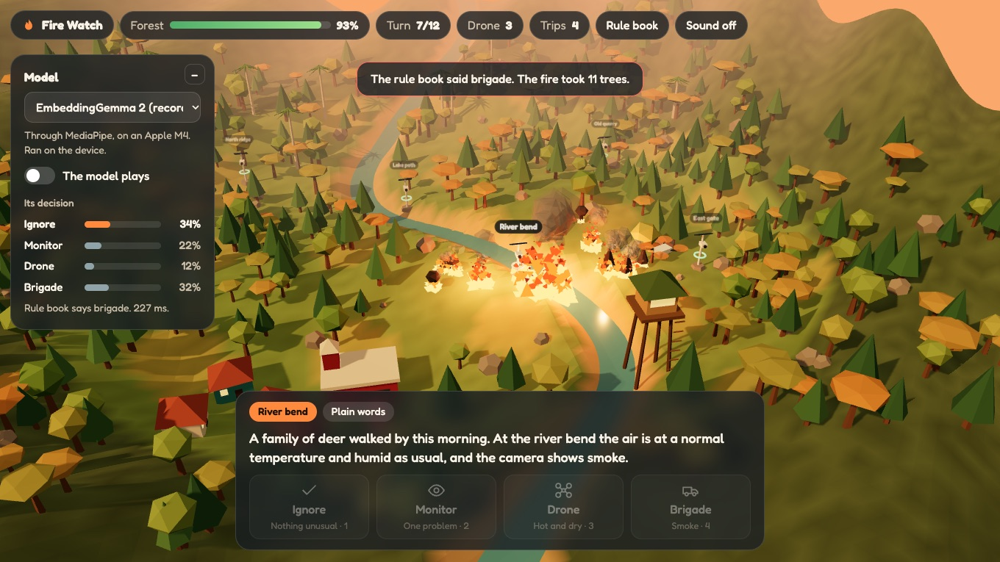

```{=html}
<div class="biz pg">
<header class="top solo"><div class="w"><h1>Cosas que <em>pruebo</em></h1><div><p>Cosas que pruebo porque me dio curiosidad, en un evento, con un modelo nuevo o en medio de otra cosa. Algunas se pueden jugar.</p></div></div></header>
<section class="w found"><div class="feat"><a class="pic" href="posts/fire-watch/"></a><div class="tx"><small>Modelos de decisión</small><h3 class="no-anchor"><a href="posts/fire-watch/">Fire Watch: hice un juego para ver cómo falla un modelo de decisión</a></h3><p>Un bosque en 3D, seis sensores y cuatro botones. Los modelos locales no supieron leer un termómetro.</p><p class="go"><a href="../lab/fire-watch/index.html?lang=es">Jugar Fire Watch</a><a class="alt" href="posts/fire-watch/">Leer la nota</a></p></div></div></section>
</div>
```
