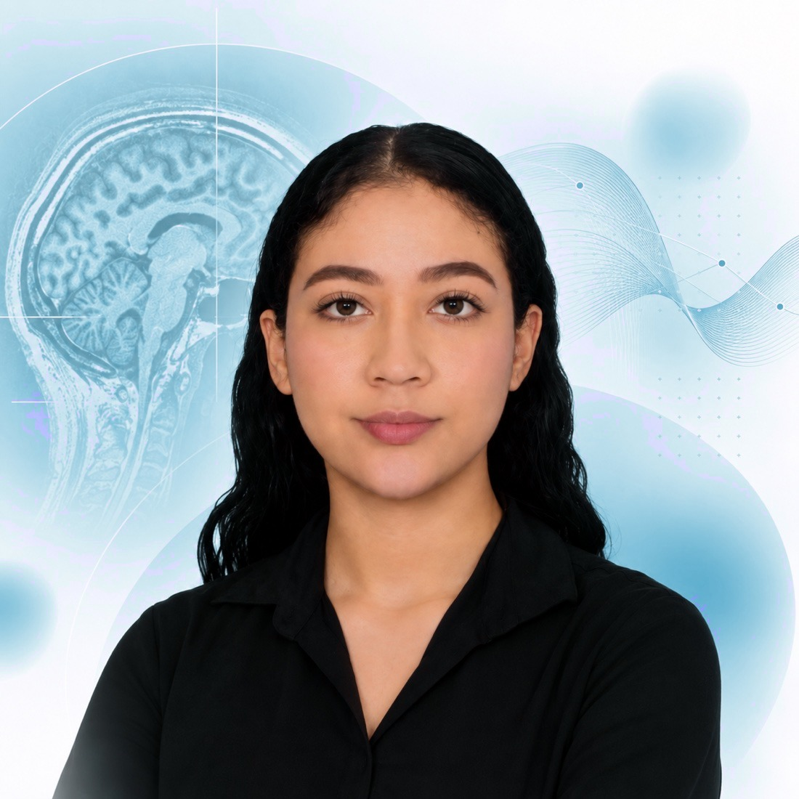
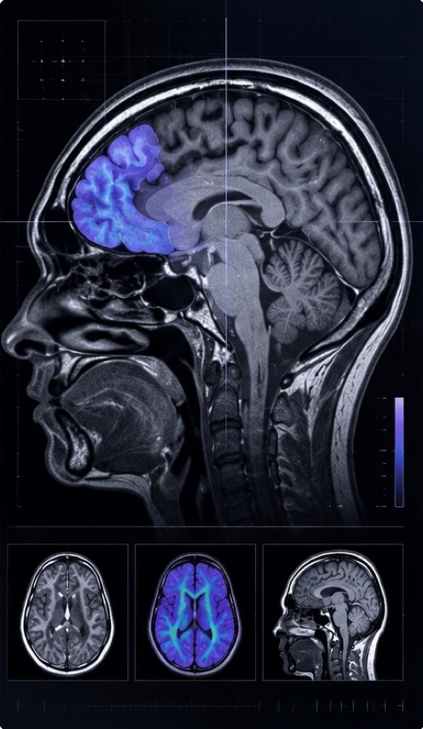
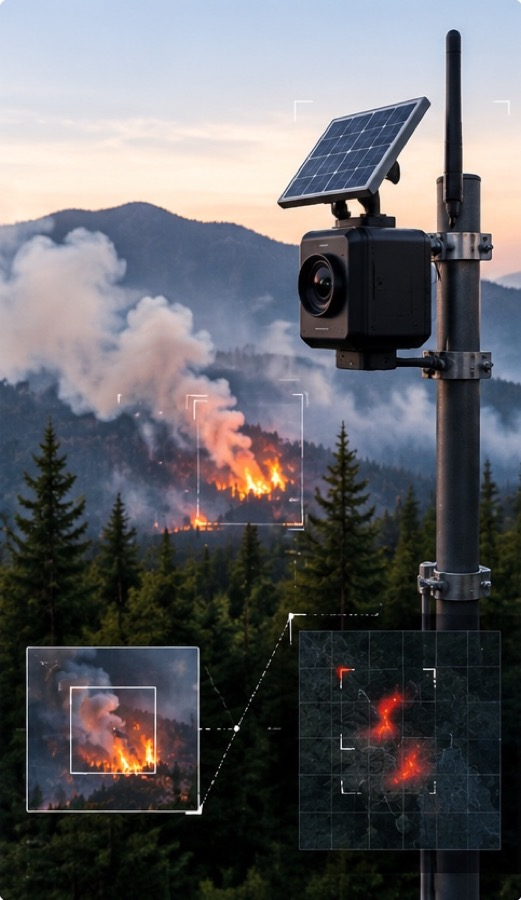
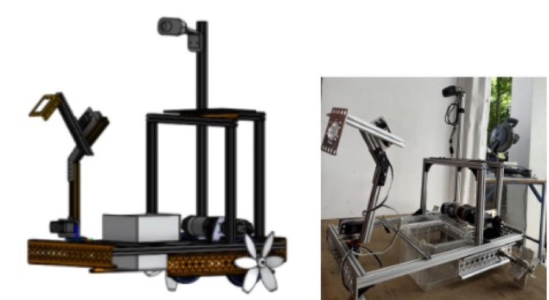

```{=html}
<section class="hero"><div>
<p class="name" role="heading" aria-level="1">Carolain <em>Jiménez Bedoya</em></p>
<p>Soy ingeniera de sistemas, de Colombia. Trabajo con imágenes médicas en el grupo MMV de la Universidad del Valle y lidero la ingeniería de IA en S&amp;S IP S.A.S. También soy mentora del Team Colombia en FIRST Global.</p>
<p>Aquí escribo lo que pruebo: experimentos tan pequeños que se pueden ver por dentro, sistemas del trabajo y resultados que no salieron como quería.</p>
<div class="links"><a href="https://github.com/carolain3472">GitHub</a><a href="https://www.linkedin.com/in/carolain-jimenez-bedoya">LinkedIn</a><a href="https://orcid.org/0009-0006-0077-7890">ORCID</a><a href="https://carolain-jimenez.netlify.app/">Portafolio</a></div>
</div></section>

<div class="doors">
<a href="research.html"><h2>Investigación</h2><p>Imágenes médicas, lenguaje de hospital y modelos que aciertan por la razón equivocada.</p></a>
<a href="business.html"><h2>IA para empresas</h2><p>Procesos, personas y dónde cabe la IA. Con una herramienta pequeña para ordenar tus propios pasos.</p></a>
<a href="explorations.html"><h2>Exploraciones</h2><p>Juegos y modelos pequeños que pruebo por curiosidad.</p></a>
</div>


<h2>Notas</h2>
<div class="cards">
<a class="big" href="posts/fire-watch/"><div class="pic" style="background-image:url(../posts/fire-watch/bad.jpg)"></div><div class="tx"><small>Modelos de decisión</small><h3>Fire Watch: hice un juego para ver cómo falla un modelo de decisión</h3><p>Un bosque en 3D, seis sensores y cuatro botones. Los modelos locales no supieron leer un termómetro.</p></div></a>
<a class="big" href="posts/scanner-shortcut/"><div class="pic fit" style="background-image:url(posts/scanner-shortcut/sc-weights.png)"></div><div class="tx"><small>Imágenes médicas</small><h3>Cuando un modelo aprende el escáner</h3><p>El mismo modelo saca 0,97 o 0,69, y se puede ver por dentro qué estaba mirando.</p></div></a>
<a href="posts/negative-result/"><div class="pic fit" style="background-image:url(posts/negative-result/cw-grid.png)"></div><div class="tx"><small>PLN clínico</small><h3>Más preentrenamiento no mejoró la predicción de palabras en notas clínicas: reanálisis pareado de 101 casos</h3><p>101 notas, un error en mi propio evaluador y un modelo que cambió de vocabulario.</p></div></a>
<a href="posts/chatbot-i-dont-know/"><div class="pic fit" style="background-image:url(posts/chatbot-i-dont-know/chat1.png)"></div><div class="tx"><small>IA responsable</small><h3>Un asistente universitario con y sin reglamento: 270 respuestas revisadas una por una</h3><p>270 respuestas con y sin el reglamento, y los errores que quedaron.</p></div></a>
<a href="posts/who-does-the-math/"><div class="pic fit" style="background-image:url(posts/who-does-the-math/exact.png)"></div><div class="tx"><small>Transformación digital</small><h3>Que el modelo lea y que un programa sume: 40 documentos con tres modelos</h3><p>Quién lee, quién calcula y quién firma.</p></div></a>
<a href="posts/same-quote/"><div class="pic fit" style="background-image:url(posts/same-quote/discounts.png)"></div><div class="tx"><small>Reglas</small><h3>Una regla de descuentos vaga y 1.200 cotizaciones: lo que decidieron tres modelos</h3><p>1.200 cotizaciones de una tostadora inventada. La cuenta estaba bien.</p></div></a>
<a href="posts/asks-first/"><div class="pic fit" style="background-image:url(posts/asks-first/facts.png)"></div><div class="tx"><small>Asesoría</small><h3>Un prompt que pregunta antes de aconsejar: 144 conversaciones con seis negocios inventados</h3><p>Seis negocios, 144 conversaciones y tres preguntas que faltaban.</p></div></a>
<a href="posts/before-you-paste/"><div class="pic fit" style="background-image:url(posts/before-you-paste/paste-test.png)"></div><div class="tx"><small>Datos y una herramienta</small><h3>Antes de pegar tu lista de clientes en un chat</h3><p>Cambia los datos personales por códigos en tu navegador, y mira qué se escapa.</p></div></a>
</div>

<h2>Publicación</h2>
<p><strong>Identification of Traumatic Brain Injury on Magnetic Resonance Imaging.</strong> Jiménez, C., Chaves, D., Trujillo, M., Herrera, A., Ledesma, M. <em>CIARP 2025</em>, Lecture Notes in Computer Science, vol. 16529. Springer, Cham. Presentación oral, Bogotá. <a href="https://doi.org/10.1007/978-3-032-23176-5_14">10.1007/978-3-032-23176-5_14</a></p>

<h2>Proyectos</h2>
<div class="four">
<a href="https://carolain-jimenez.netlify.app/tbi.html">Trauma craneoencefálico en resonancia<span>Radiómica en imágenes T1</span></a>
<a href="https://carolain-jimenez.netlify.app/nte.html">Kawsay<span>Detección de incendios, FIRST Global 2026</span></a>
<a href="https://carolain-jimenez.netlify.app/renova.html">RENOVA<span>Plantas acuáticas en una Raspberry Pi</span></a>
<a href="https://carolain-jimenez.netlify.app/nlp-clinico.html">Notas clínicas en español<span>Modelos de lenguaje, TecNM Morelia</span></a>
</div>
```
