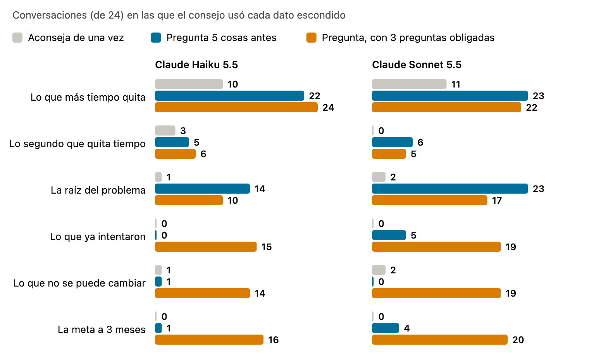
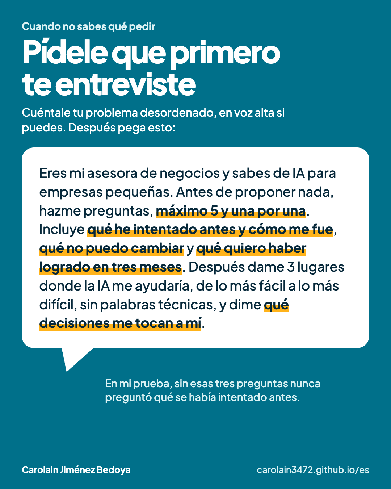

Hay un consejo que se repite en las charlas de IA para empresas pequeñas, para quien no sabe qué pedir: no busques el prompt perfecto. Cuéntale tu problema, desordenado como está, y pídele que te entreviste antes de opinar. Una buena consultora hace eso.

Nunca había medido si funciona. Lo medí, y funciona, con un hueco en la mitad.

## Seis negocios con secretos

Inventé seis negocios pequeños: una panadería, un consultorio odontológico, una ferretería, una empresa de avistamiento de aves, una academia de música y un taller de uniformes. Cada uno tenía una presentación corta, de las que se escriben con cansancio, y una ficha con seis datos que la asesora no podía ver:

| Dato | En el consultorio |
|:--|:--|
| Lo que más tiempo quita | Dos horas diarias llamando a confirmar citas |
| Lo segundo que quita tiempo | Doce informes para aseguradoras cada viernes, a mano |
| La raíz del problema | La agenda está en un solo computador y nadie anota por qué cancelan |
| Lo que ya intentaron | Recordatorios automáticos. Muchos pacientes mayores no los leían |
| Lo que no se puede cambiar | Las historias clínicas no pueden ir a una herramienta externa |
| La meta | De diez sillas vacías por semana a tres |

Después pedí los tres lugares donde la IA más ayudaría, de tres maneras. De una vez. Después de cinco preguntas, una por una, que respondía otro modelo que tenía la ficha y solo podía contestar lo que le preguntaran. Y después de cinco preguntas en las que obligué tres: qué he intentado antes, qué no puedo cambiar y qué quiero lograr en tres meses.

Dos modelos dieron el consejo, cuatro veces por negocio y por manera. Sonnet 5.5 leyó cada consejo y marcó qué datos había usado.

{fig-alt="Barras con cuántas conversaciones usaron cada dato escondido, para dos modelos y tres maneras"}

## Preguntar sirve

Compara el gris y el azul. Aconsejando de una vez, casi ninguna conversación encontró la raíz del problema. Con cinco preguntas, Haiku la encontró en 14 de 24 y Sonnet en 23. Lo que más tiempo quita también sube.

(La barra gris de lo que más tiempo quita es generosa. Si alguien tiene una ferretería, «cotizaciones más rápidas para constructoras» acierta por casualidad, y a veces el calificador le dio el punto.)

## El hueco

Ahora mira las tres últimas filas en azul. Preguntaron muchas cosas, y casi ninguna sobre lo que ya se había intentado, lo que no se puede cambiar o a dónde quiere llegar la dueña.

Busqué en las 240 preguntas una como «¿qué has intentado antes?». No hay ninguna. Más o menos la mitad de las de Haiku llevaban alguna forma de *cuánto*, cuántos pedidos, cuántas citas, y la dueña casi nunca sabía.

Eso tiene una consecuencia que se ve. El consultorio ya había probado los recordatorios automáticos y no le habían servido. En las 16 conversaciones sin mis preguntas adicionales, **le recomendaron recordatorios automáticos 16 veces**. El taller había firmado acuerdos de confidencialidad por los logos de sus clientes, y después de preguntar, los dos modelos propusieron recoger los logos en un formulario las ocho veces.

Ninguno de esos consejos es malo. Es lo que cualquiera diría desde afuera, y es lo que hace que una dueña cierre el computador y diga «eso ya lo intenté».

## Tres preguntas

Con las tres preguntas obligadas, lo que ya se intentó pasa de 0 a 15 con Haiku y de 5 a 19 con Sonnet. Los límites pasan de 1 a 14 y de 0 a 19. Así empezó Sonnet con el consultorio:

> **Pregunta 1 de 5:** ¿Qué has intentado antes para frenar esa fuga de dinero en el consultorio, y cómo te fue?
>
> **Dueña:** Lo que he probado hasta ahora son recordatorios automáticos por mensaje para las citas, pero muchos pacientes mayores no los leían y la cantidad de inasistencias no bajó.

Y la primera recomendación fue una llamada automática en lugar de un mensaje, con nombre, teléfono y hora, y sin historias clínicas.

Tiene un precio. Con cinco preguntas y tres ya ocupadas quedan menos para escarbar, y la raíz del problema se encontró menos: de 14 a 10 y de 23 a 17. Yo probablemente permitiría siete. Eso no lo probé. Y no siempre escucha. Aun con la respuesta al frente, los recordatorios volvieron en 4 de 8 conversaciones del consultorio, a veces con un cambio pequeño.

Este es el prompt que usaría:

{fig-alt="Infografía con el prompt de la entrevista"}

La última parte, la de qué decisiones me tocan a mí, la agregué yo y no la medí.

## Límites

La dueña también era un modelo, y a veces se inventaba un detalle que no estaba en la ficha, como un número de pedidos. Las fichas las escribí yo, así que las preguntas que encontré que faltaban son las que se me habían ocurrido. Un modelo calificó las respuestas. Una parte se revisó a mano y casi siempre coincidió, con la excepción de arriba. Seis negocios son pocos, y una persona de verdad contesta mucho mejor que una ficha.

Todo está en [lab/asks-first](https://github.com/carolain3472/carolain3472.github.io/tree/main/lab/asks-first), con las conversaciones completas. Corrí las pruebas con ayuda de Claude Code.
