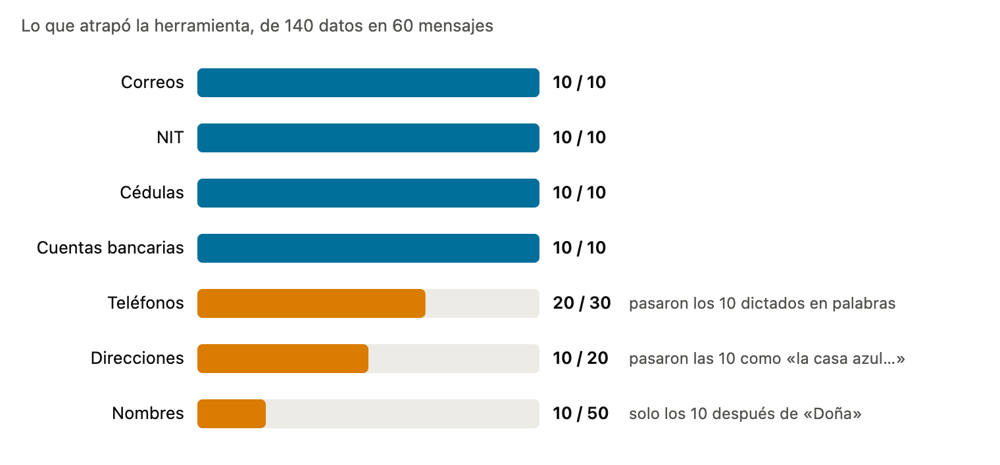
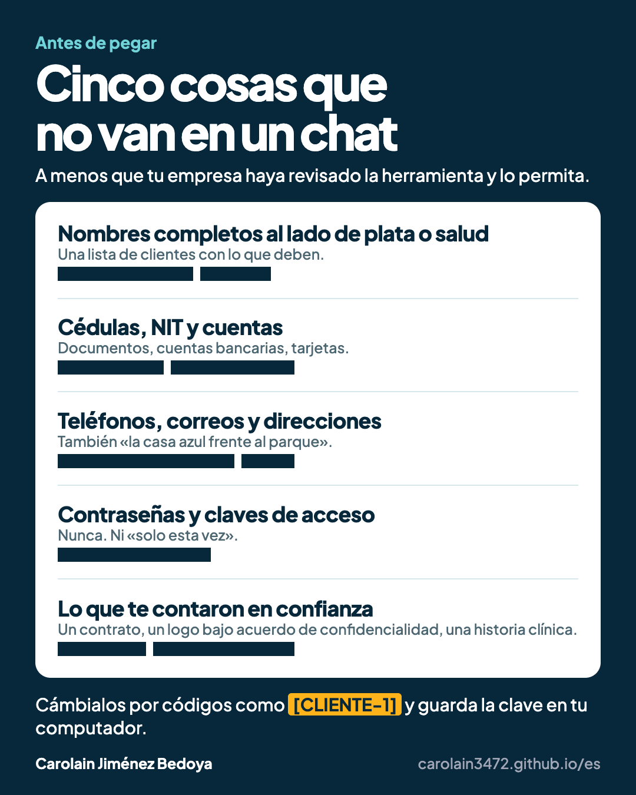

Las guías prácticas que escribo para los talleres de IA que doy traen un recuadro con una regla de seguridad: usa datos ficticios o anonimizados. Nada de cédulas, teléfonos, direcciones ni cuentas de clientes reales, salvo que la política de la empresa lo autorice. No es una regla fácil de cumplir, porque lo útil es pegar la lista real de clientes y pedir un resumen.

No todas las herramientas guardan de la misma manera lo que pegas, y muchas empresas tienen reglas sobre eso. Mientras lo averiguas, lo más sencillo es cambiar los datos por códigos antes de pegar: *Doña Yuliana Grisales* pasa a ser [NOMBRE-1], su teléfono [TEL-1], y guardas la clave en tu computador para devolver todo después. El resumen sale igual, porque para agrupar deudas por mes el modelo no necesita saber quién es ella.

Así que escribí una herramienta pequeña que lo hace dentro del navegador. No se envía nada a ninguna parte.

```{=html}
<div class="maskw" data-lang="es">
<label for="mw-in">Pega aquí un texto</label>
<textarea id="mw-in" rows="5">Cliente: Luz Marina Ocampo - Tel 321 474 1950 - Dirección Diagonal 28 # 5-12. Su cédula es 29.504.766 y consignó a la cuenta de ahorros 160-967017-82. Doña Yuliana Grisales pide que se lo dejen en la casa azul frente al parque.</textarea>
<div class="mw-b"><button type="button" id="mw-go">Cambiar por códigos</button><button type="button" id="mw-copy">Copiar el resultado</button></div>
<label for="mw-out">Lo que pegarías</label><textarea id="mw-out" rows="5" readonly></textarea>
<details><summary>La clave, para devolver los datos después</summary><div id="mw-key"></div></details>
<p class="tiny">Nada sale de esta página. Es una búsqueda de patrones, así que lee el resultado antes de pegarlo.</p></div>
<script src="../../../lab/paste-check/mask.js"></script>
<script>(()=>{const $=i=>document.getElementById(i);let K={};function go(){const r=mask($("mw-in").value);K=r.key;$("mw-out").value=r.out;const d=$("mw-key");d.textContent="";for(const[c,v]of Object.entries(K)){const p=document.createElement("div");p.textContent=c+"  →  "+v;d.append(p)}}$("mw-go").onclick=go;$("mw-copy").onclick=async()=>{try{await navigator.clipboard.writeText($("mw-out").value);$("mw-copy").textContent="✓"}catch{}};go()})();</script>

```

## Lo que deja pasar

Una herramienta así puede dar una falsa sensación de seguridad, entonces la probé. Escribí 60 mensajes cortos de negocio, como los que llegan por WhatsApp, con 140 datos personales marcados a mano.

{fig-alt="Barras con la proporción de cada tipo de dato que atrapó la herramienta"}

Todo lo que tiene una forma fija lo atrapó: correos, NIT, cédulas, cuentas bancarias, teléfonos escritos con números y direcciones escritas a la colombiana, como *Calle 28 # 5-12*. Yo escribí los mensajes y también las reglas, así que esos 100 % dicen más de mis patrones que del mundo real.

Lo interesante es lo demás. Atrapó 10 de 50 nombres, y solo los que venían después de *Doña*. «Soy Hernán Darío Pava» pasó intacto. «Bodega 4 de la zona franca» y «la casa azul frente al parque» pasaron, y así es como mucha gente en Colombia da una dirección. Y un teléfono dictado en palabras, «tres uno cinco…», también pasó.

Los nombres son lo difícil porque no tienen forma. Un patrón no distingue un nombre del comienzo de una frase. Un modelo de lenguaje sí, pero entonces le estás mandando el texto a un modelo para protegerlo de un modelo, y eso solo tiene sentido si ese modelo corre en tu propio computador.

## Cómo la usaría

Usaría la herramienta como una primera pasada y después leería el resultado buscando nombres y lugares. En una lista de clientes es rápido, porque los nombres están en una columna, y lo más fácil es reemplazar esa columna por números antes de cualquier otra cosa.

Y hay algo que preguntar antes de escoger cualquiera de estas opciones: si tu empresa ya tiene una herramienta aprobada para este tipo de datos. Si la tiene, usa esa.

La herramienta, los 60 mensajes y la prueba están en [lab/paste-check](https://github.com/carolain3472/carolain3472.github.io/tree/main/lab/paste-check).

{fig-alt="Infografía: cinco cosas que no van en un chat"}
