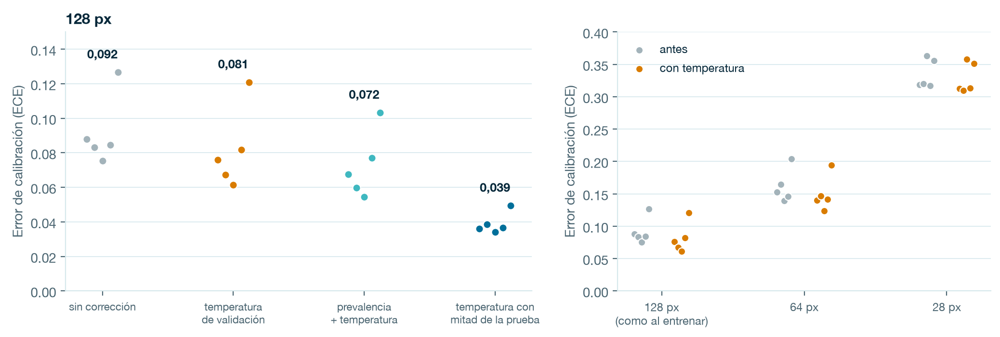
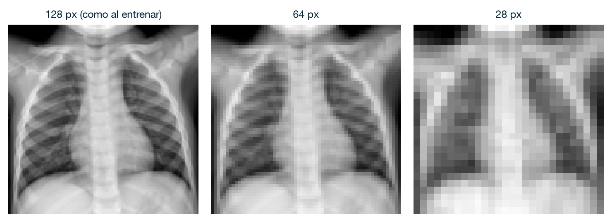
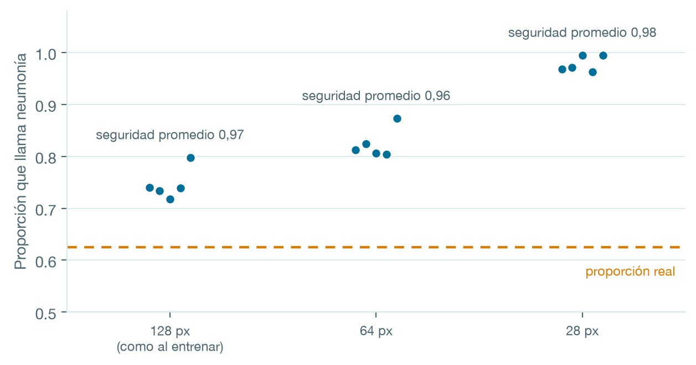

Los neurólogos con los que trabajé en mi tesis me preguntaban si podían confiar en las predicciones de un modelo. Una parte de esa pregunta es de **calibración**: un modelo que dice 90 % debería acertar unas 90 de cada 100 veces que lo dice.

Las redes modernas tienden a estar demasiado seguras, y la corrección estándar es **temperature scaling** [@guo]. Se dividen las puntuaciones de la red por un solo número, la temperatura, que se elige con un conjunto de validación. No cambia ninguna predicción, solo qué tan seguro dice estar el modelo. Es una línea de código y muchas veces funciona muy bien.

Quería ver dónde deja de funcionar, con algo lo bastante pequeño para revisar cada número.

## El montaje

Los datos son PneumoniaMNIST [@medmnist], radiografías de tórax pediátricas [@kermany] a 128 × 128 píxeles, normales o con neumonía. Usé las mismas cinco ResNet-18 que entrené para la [nota sobre los mapas de calor](../saliency-checks/), cada una con una semilla distinta, todas con un AUC en prueba entre 0,970 y 0,984.

Medí la calibración con el error de calibración esperado (ECE, 15 intervalos): la diferencia promedio entre qué tan seguro dice estar el modelo y qué tan seguido acierta. 0 es perfecto. Cada modelo tiene su propio intervalo de 95 % por bootstrap, y en el texto doy el rango de los cinco modelos.

La temperatura se ajusta con las 524 imágenes de validación y después se usa en las 624 de prueba.

## Con el mismo tipo de imágenes

| | Sin corrección | Temperatura de validación |
|---|---|---|
| ECE, rango de los 5 modelos | 0,075 a 0,127 | 0,061 a 0,121 |
| ECE, promedio | 0,092 | 0,081 |
| Seguridad promedio | 0,97 | 0,96 |
| Proporción de aciertos | 0,88 | 0,88 |
: Conjunto de prueba a 128 px, la misma resolución con la que se entrenaron los modelos. {.striped}

Los modelos dicen 97 % en promedio y aciertan 88 %. Temperature scaling mejora a los cinco, pero en más o menos un punto, menos que el ancho del intervalo de cada uno (cerca de ±0,02).

Mirar los errores explicó por qué. Casi todos van en una sola dirección: entre 61 y 108 de las 234 radiografías normales salieron como neumonía, cerca de la mitad de ellas con más de 95 % de seguridad. De las 390 con neumonía, los modelos dejaron pasar entre 0 y 3.

Y después un número que no había mirado antes de entrenar: la neumonía es el 74 % de los conjuntos de entrenamiento y validación y el 62,5 % del de prueba. La temperatura aprendió a corregir para pacientes que no son los de prueba.

## Tres comprobaciones

Para saber si el problema era el método o los datos con los que se ajustaba, probé tres cosas en el conjunto de prueba a 128 px:

1. **Temperatura de validación**, la forma usual.
2. **Una corrección por prevalencia** [@saerens]: antes de la temperatura, moví la puntuación de cada radiografía según la diferencia entre las dos proporciones de neumonía, en log-odds. Solo usa dos números, 74 % y 62,5 %, y ninguna etiqueta de prueba.
3. **Un oráculo**: la temperatura ajustada con la mitad del conjunto de prueba y medida en la otra mitad, en 100 particiones al azar. En la práctica no se puede hacer, necesita etiquetas de los datos nuevos, pero muestra lo que el método logra cuando ve los datos correctos.

{.column-page fig-alt="Gráfico de puntos. ECE promedio 0,092 sin corrección, 0,081 con la temperatura de validación, 0,072 con prevalencia y temperatura, 0,039 con la temperatura de la mitad de la prueba. Panel derecho: ECE por resolución antes y después de la temperatura."}

El oráculo baja el error a 0,034–0,049. La temperatura que elige está entre 3,1 y 3,9, contra 1,2–1,4 con validación. O sea que el método funciona. Lo que falla es ajustarlo con datos que no se parecen a los de prueba.

La corrección por prevalencia ayuda a medias, baja a un promedio de 0,072, y además sube un poco la exactitud (de 0,876 a 0,887 en promedio). La diferencia en la proporción de neumonía explica una parte de la brecha, no toda. No sé qué más cambia entre validación y prueba, y no quiero adivinarlo.

## Cuando la radiografía empeora

La segunda prueba es un cambio de adquisición. MedMNIST tiene las mismas radiografías de prueba guardadas a 64 y a 28 píxeles. Las agrandé otra vez a 128 para que el modelo las pudiera leer y las pasé por los mismos modelos, con la misma temperatura.

{fig-alt="Tres versiones de la misma radiografía de tórax, nítida a 128 píxeles, más suave a 64 y en bloques a 28."}

| | 128 px | 64 px | 28 px |
|---|---|---|---|
| ECE sin corrección | 0,092 | 0,161 | 0,335 |
| ECE con temperatura | 0,081 | 0,149 | 0,329 |
| Proporción de aciertos | 0,88 | 0,80 | 0,65 |
| Seguridad promedio | 0,97 | 0,96 | 0,98 |
: Promedio de los cinco modelos. {.striped}

A 28 píxeles los modelos acertaban el 65 % de las veces y decían 98 %. Ya no estaban leyendo las radiografías: llamaban neumonía a entre el 96 % y el 99,5 % de ellas.

{fig-alt="Puntos de cinco modelos. A 128 px llaman neumonía al 72 a 80 por ciento, a 64 px al 80 a 87 por ciento, a 28 px al 96 a 99,5 por ciento. La proporción real es 62,5 por ciento."}

Como el 62,5 % de las radiografías de prueba tiene neumonía, decir "neumonía" a todo da más o menos 62,5 % de aciertos. La exactitud a 28 px está apenas por encima de eso, y la seguridad subió. Una temperatura ajustada con las imágenes originales no puede saber que las imágenes cambiaron. Es el patrón que @ovadia describen en imágenes naturales con cambio de distribución, y es el que más me preocupa en un hospital: cuando las imágenes cambian, el modelo no dice "no sé", dice "estoy seguro".

## Lo que me llevo

- Temperature scaling corrige lo que el conjunto de validación alcanza a ver. Si la validación no se parece al lugar donde se va a usar el modelo, la corrección es pequeña, y no se puede medir sin etiquetas de ese lugar.
- Antes de calibrar, hay que comparar la proporción de cada clase en validación y en prueba. Es una línea de código y aquí explicó una parte del problema.
- Un cambio de adquisición puede destruir el modelo y dejar la seguridad alta. Hay que revisar la seguridad en los datos nuevos, no solo la exactitud.

## Límites

- Un conjunto de datos, una arquitectura entrenada desde cero, cinco semillas. Con 624 imágenes de prueba, el intervalo de cada ECE es de más o menos ±0,02.
- El ECE depende del número de intervalos. Usé 15 intervalos iguales, como @guo.
- Agrandar una imagen de 28 px es un reemplazo burdo de un escáner peor. Un cambio real de hospital mueve el contraste, el ruido y los pacientes al mismo tiempo.
- No probé otros métodos (conjuntos de modelos, *label smoothing*, recalibrar con los datos nuevos). Eso sería la próxima nota.

## Código y datos

Todo está en [lab/saliency](https://github.com/carolain3472/carolain3472.github.io/tree/main/lab/saliency): `calibration.py` y `calibration_check.py`, y los resultados de cada modelo en `results/`, incluidas las tablas de confiabilidad que no grafiqué.

## Referencias
