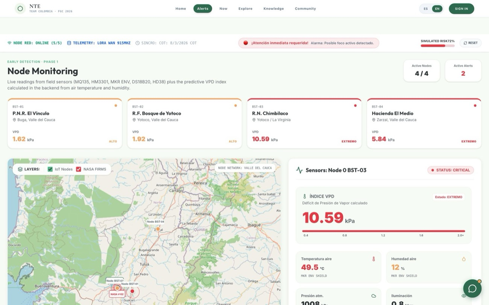
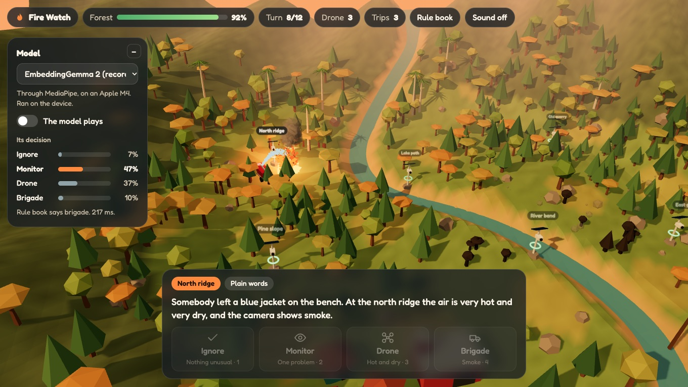
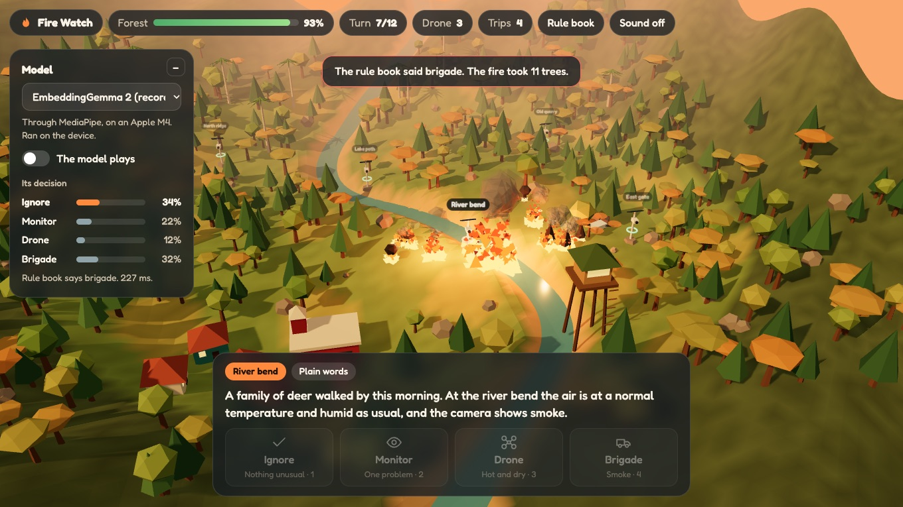
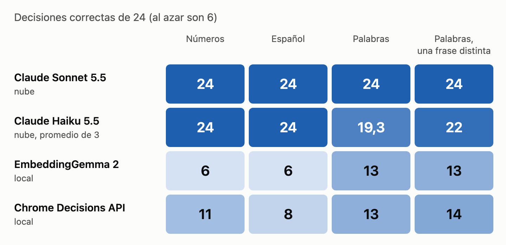
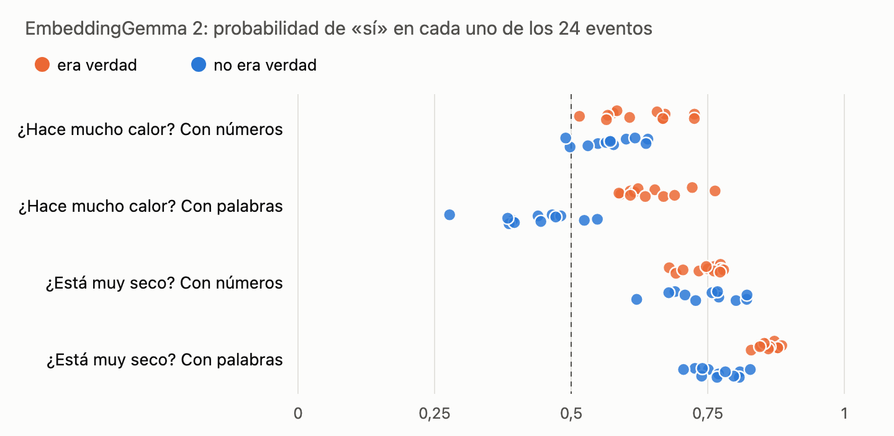
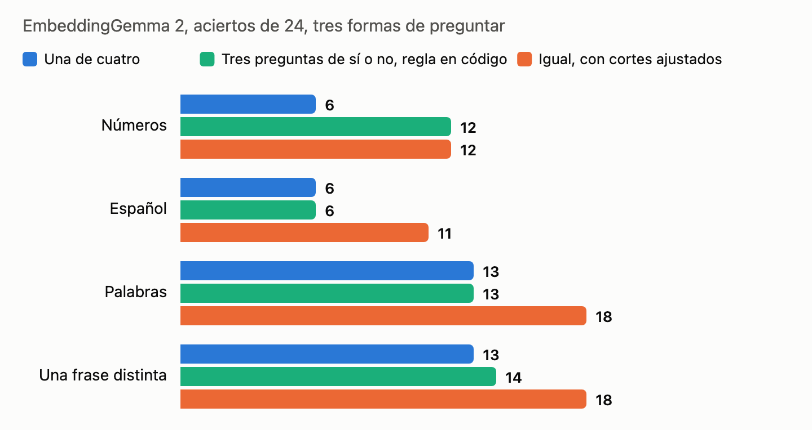
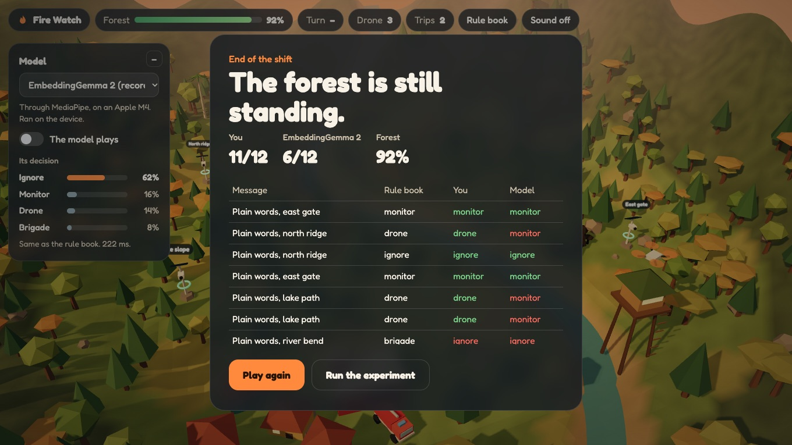

Hace unos días fui a un evento de tecnología y vi una demostración en la que me quedé pensando. Había un personaje en la pantalla, uno le hablaba, y un panel al lado mostraba la probabilidad de cada cosa que podía hacer. El modelo nunca escribía una palabra. Solo escogía de una lista.

Los llaman modelos de decisión. Uno les da una situación y una lista cerrada de opciones, y devuelven una opción con un número al lado. Chrome está probando una API para esto, la [Decisions API](https://github.com/explainers-by-googlers/decisions-api), y el modelo corre en el computador de quien abre la página. Nada sale del dispositivo, y para alguien a quien le gustan los datos médicos y los sensores en lugares sin internet esa es una muy buena frase.

Así que hice mi propio juego para ver dónde se rompe.

<video controls muted loop playsinline preload="metadata" poster="../../../posts/fire-watch/bad.jpg" style="width:100%;border-radius:12px"><source src="../../../posts/fire-watch/game.mp4" type="video/mp4"></video>

[**Jugar Fire Watch**](../../../lab/fire-watch/index.html?lang=es). También funciona en el celular y no hay que descargar ningún modelo.

## Por qué fuego

Con el Team Colombia de FIRST Global trabajo en Kawsay, un proyecto de detección de incendios forestales. Cuando hablamos con las brigadas municipales del Valle del Cauca nos dijeron algo sencillo: se enteran tarde de los incendios. Una llamada necesita a alguien que ya esté viendo humo, y los satélites pasan cada varias horas.

{fig-alt="Plataforma Kawsay con tarjetas de sensores y un mapa"}

En un sistema así, alguien tiene que leer muchos mensajes cortos y decidir qué merece cada uno. Ese es el juego. Seis sensores, doce mensajes y cuatro botones: ignorar, vigilar, mandar el dron, llamar a la brigada. Tienes seis vuelos y cuatro viajes, así que no puedes mandarle todo a todo. Si ignoras el humo, pierdes árboles.

::: {layout-ncol=2}

:::

El manual es fijo, así que cada mensaje tiene una sola respuesta correcta:

| Acción | Cuándo |
|:--|:--|
| Brigada | La cámara ve humo, pase lo que pase con lo demás |
| Dron | Sin humo, 45 °C o más y 20 % de humedad o menos |
| Vigilar | Sin humo y solo uno de esos dos problemas |
| Ignorar | Ninguno |

## Un evento, cuatro maneras de decirlo

Escribí 24 eventos, seis por acción, y cada uno en cuatro versiones. Este es el mismo evento (dejo el original y lo traduzco cuando está en inglés):

> **Números.** Sensor at the east gate. Temperature 47 °C. Humidity 65%. Camera: no smoke.
>
> **Español.** Sensor en la puerta este. Temperatura 47 °C. Humedad 65 %. Cámara: sin humo.
>
> **Palabras.** The battery was changed on Monday. At the east gate the air is very hot and humid as usual, and the camera shows nothing unusual. *(Cambiaron la batería el lunes. En la puerta este el aire está muy caliente y húmedo como siempre, y la cámara no muestra nada raro.)*
>
> **Una frase distinta.** Igual, pero termina con «the camera shows no smoke» *(la cámara no muestra humo)*.

En todas la respuesta es *vigilar*. Si un modelo cambia de opinión porque yo cambié las palabras, quiero saberlo.

Probé cuatro modelos. Claude Sonnet 5.5 y Claude Haiku 5.5 son modelos generales en la nube, y les pedí una sola palabra. Los otros dos corrieron en mi MacBook (un M4): la Decisions API de Chrome 158 con su opción experimental encendida, y EmbeddingGemma 2, que Google ofrece con MediaPipe y pesa unos 165 MB.

{fig-alt="Tabla de decisiones correctas por modelo y versión"}

La tabla me sorprendió porque los dos grupos fallan en lugares opuestos.

Los modelos de la nube leen los números perfecto y el español no cambió nada. Haiku se pierde con las palabras. Los locales van al revés: les va mejor con palabras y no pueden con los números. EmbeddingGemma 2 acertó 6 de 24 con números, que es lo que uno saca con los ojos cerrados. Cuando abrí las respuestas vi que había dicho *vigilar* 24 veces de 24.

Tiene sentido si uno piensa en lo que hace ese modelo. Convierte el mensaje y cada opción en vectores y mide cuáles están cerca. «47 °C» y «45 °C o más» están cerca como texto, y también lo están «30 °C» y «45 °C o más». En ningún lugar se compara 47 con 45.

## El error también era mío

Haiku repetía una y otra vez el mismo error: el manual decía *vigilar* y decía *ignorar*. En un sistema de incendios esa es la dirección mala.

Cuando miré mi propio texto encontré una razón posible. El mensaje decía «the camera shows **nothing unusual**» y mi descripción de *ignorar* terminaba con «**Nothing is unusual**». Había copiado mis propias palabras sin darme cuenta. En la cuarta versión cambié solo esa frase y Haiku pasó de 19 o 20 a 22. El modelo de Chrome se movió un punto y EmbeddingGemma 2 no se movió, así que es algo de Haiku, al menos aquí.

Es una frase y son 24 eventos, así que no quiero hacerlo más grande de lo que es. Pero buscaría palabras repetidas en cualquier producto en el que un modelo escoja de una lista que escribió una persona.

## Mi primer arreglo no funcionó

Mi idea era dejar de pedirle la acción. Le haría al modelo local tres preguntas de sí o no (si hay humo, si hace mucho calor, si está muy seco) y dejaría que el código normal aplicara el manual. De esta estaba segura.

Con Chrome empeoró: de 11 a 6 con números y de 14 a 9 con palabras. EmbeddingGemma 2 pasó de 6 a 12 con números, sobre todo porque encontró el humo, y con palabras casi nada cambió. Entonces grafiqué la probabilidad de cada respuesta, un punto por evento, para ver qué estaba pasando.

{fig-alt="Puntos con la probabilidad de sí, para calor y sequedad, con números y con palabras"}

Mira las dos filas con palabras. Los puntos naranjas y azules están separados, o sea que el modelo sí sabe cuáles están calientes y cuáles secos. El problema es la línea de 0,5. En *seco* todos los eventos están por encima de 0,7, así que con esa línea todo está seco. Y en las filas con números los colores están mezclados, así que ninguna línea ayudaría.

Después escribí 24 eventos nuevos, distintos de los primeros, los usé solo para escoger mejores cortes y volví a los 24 originales.

{fig-alt="Barras con tres estrategias para EmbeddingGemma 2"}

De 13 a 18 con palabras. Es mejor, sigue lejos de 24, y con números se queda en 12. Con Chrome, los cortes ajustados dieron 11 con palabras, menos que pedirle la acción directamente.

## Con qué me quedo

Si tuviera que usar un modelo local pequeño para algo así, dejaría que el código leyera el termómetro, porque `if t >= 45` nunca me ha fallado. Usaría el modelo para la parte que solo existe como lenguaje, como el mensaje de un vecino que dice que huele a hojas quemadas. Y escogería los cortes con datos, porque 0,5 es solo un número que viene por defecto.

También probaría otros modelos. EmbeddingGemma es el más rápido y el más débil de los que está considerando Chrome. [Resoneo probó más](https://think.resoneo.com/chrome-decisions-api/) con 1.365 decisiones y EmbeddingGemma también quedó de último, con 38 %, mientras que Gemma 4 sacó 85 %. No corrí Gemma 4 porque necesita más de 4 GB, y no usé modelos dedicados en la nube como Gemini Decision o Jev. Mi tiempo mediano fue de 55 ms por decisión con Chrome, y por eso a la gente le interesan.

Algunos límites: 24 eventos, textos hechos con plantillas que escribí yo, una corrida de Sonnet y una de cada modelo local, un solo portátil. La API es experimental y puede cambiar la próxima semana.

Todo está en [lab/fire-watch](https://github.com/carolain3472/carolain3472.github.io/tree/main/lab/fire-watch): los eventos, las respuestas (de Haiku, la última de las tres corridas) y el código. También hay una [página del experimento](../../../lab/fire-watch/experiment.html), en inglés, para correr los modelos locales en tu navegador. Hice el juego y corrí las pruebas con ayuda de Claude Code. El 3D usa three.js.

{fig-alt="Pantalla final que compara a la persona con el modelo"}
