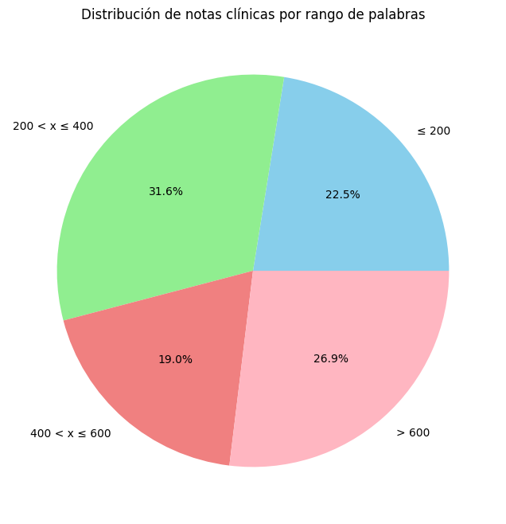
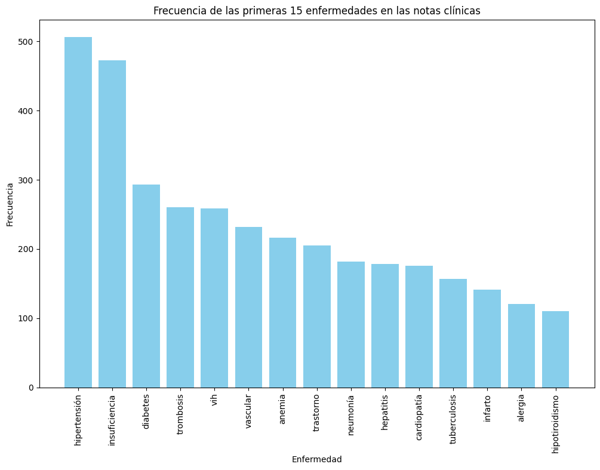
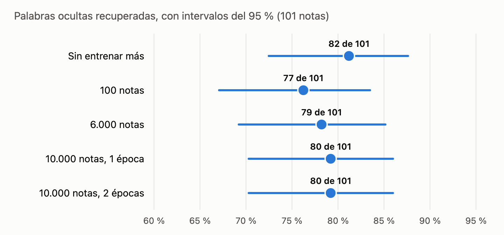
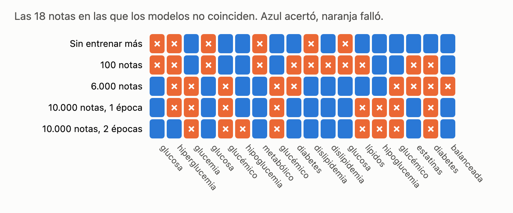
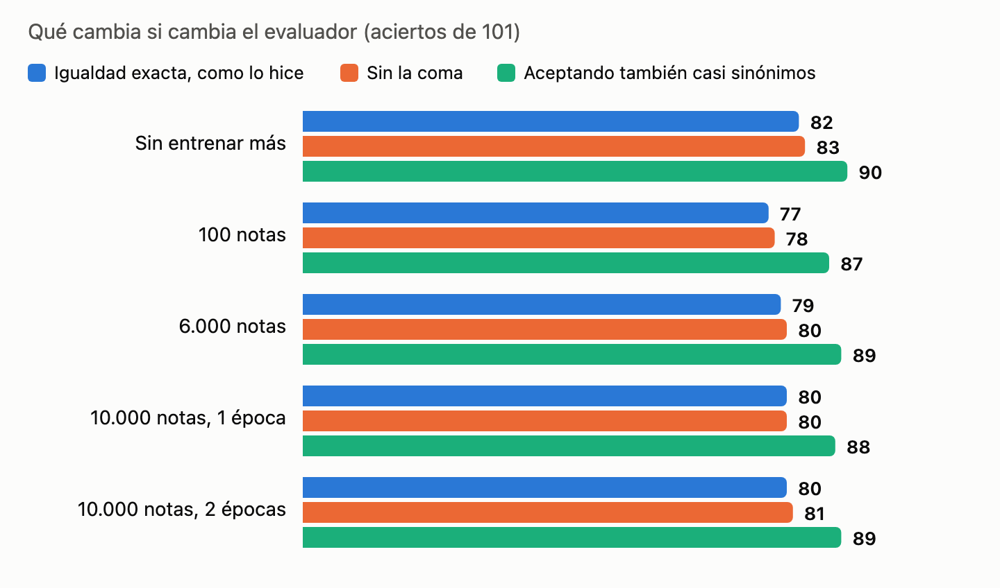
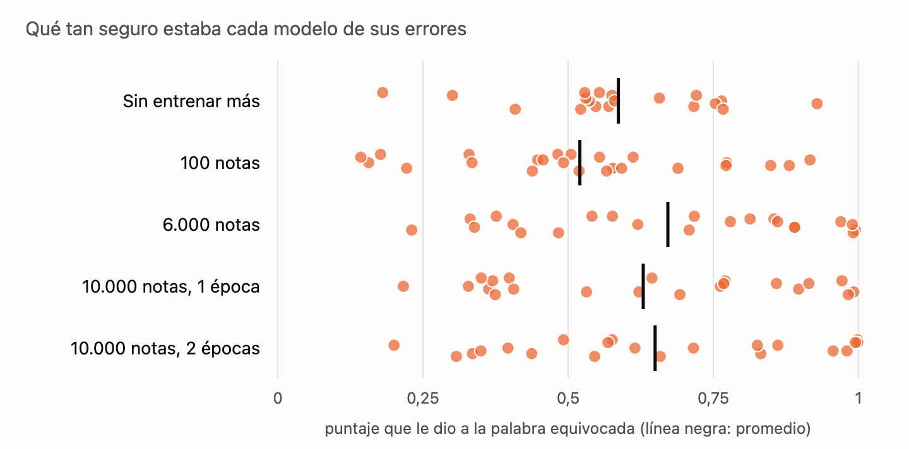

En el verano de 2024 pasé unas semanas en el TecNM de Morelia, en México, con el Programa Delfín. Trabajé con notas clínicas en español. De eso hay mucho menos que en inglés, y las notas de hospital tienen una manera de escribirse que los modelos generales no han visto.

Una parte de mi trabajo era esta: esconder una palabra de una nota y ver si un modelo de lenguaje la adivina. Es un primer paso para quitar datos personales de un texto clínico. Tomé un RoBERTa biomédico en español, lo entrené más con conjuntos de 100, 6.000 y 10.000 notas, y quería ver si cada versión salía mejor que la anterior.

Ganó la que no tenía entrenamiento adicional.

Lo escribí en mi portafolio y seguí adelante. Esta semana abrí el cuaderno otra vez, porque todavía tenía todas las respuestas de todos los modelos, 101 notas por 5 modelos, y yo solo había mirado el porcentaje final.

## Las notas

Antes de entrenar nada había mirado el corpus. Estas dos gráficas son del cuaderno original, con los colores que escogí entonces.

::: {layout-ncol=2}
{fig-alt="Gráfica circular del largo de las notas"}

{fig-alt="Barras de las 15 enfermedades más mencionadas"}
:::

La prueba era distinta: 101 notas cortas sobre diabetes, generadas con GPT-3.5 con el estilo de un caso real, en las que oculté a mano una palabra por nota. En 31 de ellas la palabra oculta era *diabetes*, así que un modelo que siempre responda «diabetes» ya saca 31 %.

## Primero, si de verdad es peor

{fig-alt="Cinco intervalos del 95 por ciento que se cruzan"}

Las líneas son intervalos del 95 %, y con 101 notas son anchas. Se cruzan casi por completo. Pero todos los modelos respondieron las mismas notas, así que hay una mejor manera de comparar: contar solo las notas en las que no coinciden, lo que uno perdió y lo que el otro ganó. Esa es la prueba de McNemar.

| Contra el que no tiene entrenamiento adicional | Perdió | Ganó | p |
|:--|--:|--:|--:|
| 100 notas | 5 | 0 | 0,06 |
| 6.000 notas | 8 | 5 | 0,58 |
| 10.000 notas, 1 época | 7 | 5 | 0,77 |
| 10.000 notas, 2 épocas | 8 | 6 | 0,79 |

: Notas que perdió y ganó cada modelo entrenado, prueba exacta {.striped}

Entonces, para los conjuntos grandes no puedo decir que empeoró. Perdieron unas y ganaron casi las mismas. El único que se ve mal es el de 100 notas, que perdió cinco y no ganó ninguna, y aun ahí p es 0,06.

La segunda columna me gustó más que los valores p, porque «perdió 8 y ganó 6» quiere decir que el modelo **cambió**. Un promedio esconde eso.

## Qué cambió

Estas son las notas en las que los cinco modelos no están de acuerdo.

{fig-alt="Cuadrícula de notas por modelo, aciertos y errores"}

De arriba hacia abajo se ven columnas que se voltean. Fui a mirar las palabras:

| Palabra oculta | Sin entrenar más | 10.000 notas, 2 épocas |
|:--|:--|:--|
| dislipidemia | dislipemia | dislipidemia ✓ |
| glucosa | glicemia | glucosa ✓ |
| glucemia | glucemia ✓ | glucosa |
| glucémico (tres notas) | glucémico ✓ | metabólico, con puntajes 0,96, 0,57 y 0,99 |
| metabólico | glucémico | metabólico ✓, con puntaje 0,997 |

El modelo base dice *dislipemia* y *glicemia*. El entrenado dice *dislipidemia* y *glucosa*. Y donde el base responde *glucémico*, el entrenado responde *metabólico*, muchas veces muy seguro, acierte o no.

No se le olvidó la medicina. Aprendió otra manera de escribirla. En la mayoría de estos casos un médico probablemente leería las dos palabras sin detenerse. (Soy ingeniera, así que me gustaría que alguno lo confirmara.)

## Un error en mi evaluador

Una nota estaba mal para los cinco modelos. La palabra oculta era *cardiovascular* y cuatro habían respondido *cardiovascular*. El problema era mío: tomé la palabra original del texto con su coma, así que estaba comparando `cardiovascular` con `cardiovascular,` y no son iguales.

Mueve un punto, y estuvo ahí dos años.

Después probé un evaluador más suave, que también acepta cinco grupos de casi sinónimos que escogí a mano, como *glucosa / glucemia / glicemia* o *glucémico / metabólico*.

{fig-alt="Barras con tres maneras de calificar cada modelo"}

Con ese evaluador los cinco modelos quedan entre 87 y 90 de 101, y las diferencias que reporté prácticamente desaparecen. Escogí los grupos después de ver las respuestas, que es justo lo que no se debe hacer para publicar un número, así que lo uso solo para entender dónde estaba la diferencia. La mayor parte estaba en mi regla de medir.

## La parte que no esperaba

{fig-alt="Puntajes de las respuestas equivocadas, por modelo"}

Cada punto es una respuesta equivocada, y qué tan a la derecha está dice qué tan seguro estaba el modelo. El modelo base le dio más de 0,9 a una respuesta equivocada. Los entrenados con 6.000 y 10.000 notas se lo dieron a cuatro, cuatro y cinco. La exactitud se ve igual y los errores se volvieron más seguros. Para algo que terminaría en un hospital, me importa más esta gráfica que la primera.

## Por qué no mejoró, probablemente

Cuando volví a leer el código de entrenamiento encontré esto:

```python
folder_path = '/content/drive/MyDrive/notas_preprocesadas_100'
```

Entrené la versión de 100 notas con las notas **después** del preprocesamiento: en minúsculas, sin puntuación, sin números y sin palabras vacías. Y después la probé con oraciones normales. A un modelo que aprende de «paciente años diabetes tipo tratamiento» le piden luego llenar un hueco en una oración completa, con comas. Fue la única versión que perdió y no ganó nada, y eso encaja. En el cuaderno solo tengo la ruta de esa, así que no puedo decirlo de las otras.

También estaba cortando cada nota en 256 tokens. Más de la cuarta parte de las notas tienen más de 600 palabras, así que el modelo nunca vio el final de las largas.

## Si lo volviera a hacer

Entrenaría con el texto como es. Decidiría antes de empezar cuántas notas de prueba necesito para ver una diferencia de, digamos, cinco puntos, y 101 no alcanzan. Le pediría a dos personas que acordaran qué palabras cuentan como iguales antes de mirar ninguna respuesta. Y graficaría desde el primer día qué tan seguros son los errores.

Las 505 respuestas están en [lab/clinical-words](https://github.com/carolain3472/carolain3472.github.io/tree/main/lab/clinical-words) (solo la palabra oculta y la predicción, no las notas). El proyecto está [aquí](https://carolain-jimenez.netlify.app/nlp-clinico.html) y el código [en su repositorio](https://github.com/carolain3472/nlp_notes_diabetes).
