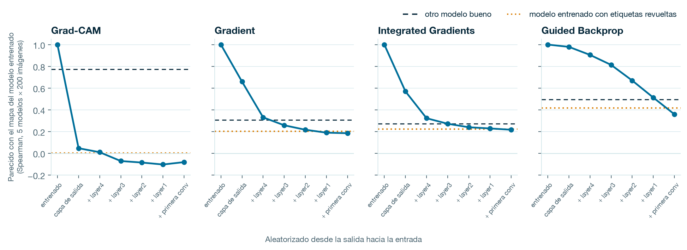
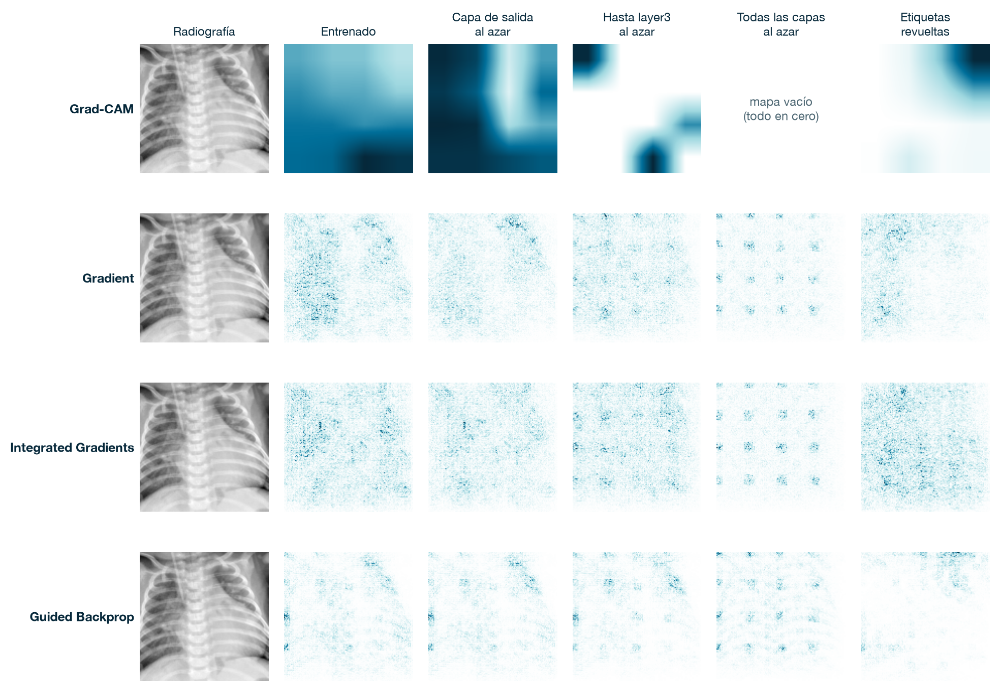

Cuando un artículo de imágenes médicas quiere mostrar que su modelo mira el lugar correcto, casi siempre pone un mapa de calor al lado de la imagen: el pulmón se ilumina, así que el modelo debe estar mirando el pulmón. Son los mapas que muestran qué píxeles pesaron en la decisión del modelo, y en la literatura se llaman *mapas de saliencia* o *de atribución*.

Hay una forma sencilla de comprobar si un mapa dice algo del modelo. Se daña el modelo y se vuelve a dibujar el mapa. Si el mapa casi no cambia, nunca estuvo describiendo lo que el modelo aprendió. @adebayo propusieron esta prueba en 2018 y encontraron métodos que no la pasan en imágenes naturales. Yo quería verlo con mis propias manos en radiografías, con algo lo bastante pequeño para correrlo en mi computador.

## El montaje

Los datos son PneumoniaMNIST [@medmnist], una versión de las radiografías de tórax pediátricas de @kermany a 128 × 128 píxeles: 4.708 imágenes para entrenar, 524 para validar y 624 para probar, marcadas como normales o con neumonía.

Entrené una ResNet-18 desde cero cinco veces, con cinco semillas distintas, 15 épocas cada una, y me quedé con la época de mejor AUC en validación. En el conjunto de prueba sacan un AUC entre 0,970 y 0,984.

También entrené tres modelos de la misma arquitectura con **etiquetas revueltas**: mezclé una vez las etiquetas del conjunto de entrenamiento y dejé que la red se las aprendiera de memoria durante 60 épocas. Terminan acertando el 99,9 % de las imágenes de entrenamiento y con un AUC entre 0,46 y 0,49 en prueba, que es azar. No aprendieron nada sobre neumonía, y por eso sirven aquí.

Comparé cuatro métodos, todos sobre la clase que predice el modelo entrenado:

- **Gradiente** [@simonyan]: cuánto cambia la puntuación cuando cambia cada píxel.
- **Integrated Gradients** [@ig]: el gradiente sumado a lo largo de un camino que va de una imagen negra a la real, en 32 pasos.
- **Guided Backprop** [@guided]: el gradiente, dejando pasar hacia atrás solo las señales positivas en cada ReLU.
- **Grad-CAM** [@gradcam]: el último bloque convolucional ponderado por su gradiente. En esta red ese bloque es una cuadrícula de 4 × 4 celdas, así que el mapa se agranda a partir de 16 números.

Tomé 200 radiografías de prueba, 100 de cada clase, y comparé cada mapa con el original usando la correlación de Spearman sobre sus 16.384 píxeles (en valor absoluto). 1 significa el mismo orden de píxeles y 0 que no hay relación. Los intervalos son de 95 %, por bootstrap sobre las imágenes.

## Dañar el modelo capa por capa

La prueba consiste en reiniciar la red desde la salida hacia la entrada: primero la capa de salida, después también el último bloque, y así hasta que no queda ningún peso entrenado. En cada paso dibujo otra vez el mapa y lo comparo con el del modelo entrenado.

Dos líneas horizontales le dan escala a cada número. La de rayas es cuánto se parecen los mapas de **dos modelos buenos** entrenados con semillas distintas. La de puntos es cuánto se parece el mapa de un modelo bueno al de un **modelo entrenado con etiquetas revueltas**.

{.column-page fig-alt="Cuatro gráficos de líneas, uno por método. Grad-CAM cae a cero en el primer paso, Gradient e Integrated Gradients caen a cerca de 0,2, Guided Backprop se queda en 0,98 después del primer paso y baja despacio."}

| Método | Capa de salida al azar | Todas las capas al azar | Etiquetas revueltas | Otro modelo bueno |
|---|---|---|---|---|
| Grad-CAM | 0,05 [0,03; 0,06] | −0,08 | 0,00 [−0,03; 0,03] | **0,77** [0,76; 0,79] |
| Gradiente | 0,66 [0,64; 0,67] | 0,18 | 0,20 [0,19; 0,21] | 0,31 [0,29; 0,32] |
| Integrated Gradients | 0,57 [0,56; 0,58] | 0,22 | 0,22 [0,21; 0,24] | 0,27 [0,26; 0,29] |
| Guided Backprop | **0,98** [0,98; 0,98] | 0,36 | 0,42 [0,41; 0,42] | 0,49 [0,48; 0,51] |
: Correlación de Spearman con el mapa del modelo entrenado, promedio de 5 modelos (3 en etiquetas revueltas) y 200 imágenes. {.striped}

## Qué hizo cada método

**Guided Backprop** es el caso más claro. Reemplacé los 1.026 pesos de la capa de salida por números al azar y el mapa se quedó en 0,98. Después de ese cambio la red responde al azar, y la imagen se ve igual. Además, el mapa de un modelo que no aprendió nada (0,42) se parece al original casi tanto como el de otro modelo bueno (0,49). Es lo que @adebayo encontraron en imágenes naturales, y aquí se sostiene.

**Grad-CAM** pasa la prueba sin duda. Cambias la capa de salida y el mapa ya no tiene nada que ver con el original (0,05). Dos modelos buenos coinciden mucho (0,77), y el modelo de etiquetas revueltas da otro mapa (0,00). Una cosa que conté aparte: con pesos al azar el mapa muchas veces sale vacío, todo en cero, porque Grad-CAM se queda solo con la parte positiva. Pasó en 597 de 1.000 mapas con toda la red al azar. Esos los conté como 0, y lo digo porque bajan los promedios.

**Gradiente e Integrated Gradients** cambian cuando se daña la red, así que en ese sentido pasan. Pero para mí el número más útil estaba en la última columna. Dos modelos igual de buenos coinciden apenas 0,31 y 0,27, y un modelo que no aprendió nada saca 0,20 y 0,22. El mapa de un modelo dice mucho de ese modelo en particular, de la semilla, del orden de los lotes, y poco de la tarea.

{.column-page fig-alt="Una cuadrícula de mapas. Las filas son los cuatro métodos y las columnas el modelo entrenado, capa de salida al azar, hasta layer3 al azar, todo al azar y etiquetas revueltas."}

En la figura también se ve una cuadrícula regular de puntos en los mapas de gradiente de las redes al azar. Creo que viene de los saltos (*strides*) de las convoluciones, que dejan ese patrón cuando no hay nada aprendido encima, pero no lo probé.

También esperaba que los mapas que sobreviven a la aleatorización se parecieran a los bordes de la imagen, que es la explicación que se suele dar para Guided Backprop. Comparé cada mapa con los bordes (un filtro de Sobel) y las correlaciones fueron bajas en todos los métodos, 0,28 como mucho. En estos datos no tengo evidencia de esa idea.

## Qué significa y qué no

Pasar esta prueba es necesario y está lejos de ser suficiente. Dice que el mapa depende de lo que aprendió el modelo. No dice que el mapa señale la lesión. PneumoniaMNIST no trae recuadros alrededor de las lesiones, así que aquí no lo puedo medir. @arun lo hicieron con recuadros en radiografías de tórax y encontraron que la mayoría de los métodos no localizaba bien.

Y Grad-CAM, el que pasa, trabaja sobre 16 celdas. Puede decir qué cuarto del tórax pesó más en la decisión. No puede señalar una opacidad pequeña.

Si con este montaje tuviera que elegir un mapa para un artículo clínico, elegiría Grad-CAM y diría qué resolución tiene. No mostraría Guided Backprop como evidencia de nada. Y no mostraría el gradiente de un solo modelo: lo promediaría sobre varios modelos, o por lo menos mostraría cuánto discrepan dos de ellos.

## Límites

- Un conjunto de datos, una resolución y una arquitectura entrenada desde cero. Una red preentrenada en ImageNet podría comportarse distinto.
- Spearman sobre valores absolutos ignora el signo del mapa. También calculé SSIM y el patrón es el mismo; está en el archivo de resultados.
- Reiniciar las capas de normalización por lotes también borra sus estadísticas, lo que cambia la escala de las activaciones. Es parte de dañar el modelo, pero es una decisión.
- Los mapas explican la clase que predice el modelo entrenado, también cuando el modelo se equivoca.

## Código y datos

El código, la tabla resumen y cada parecido por imagen están en [lab/saliency](https://github.com/carolain3472/carolain3472.github.io/tree/main/lab/saliency). Los pesos entrenados no están por su tamaño. Con las mismas semillas, `train.py` y `sanity.py` deberían dar números cercanos, aunque no idénticos, porque las operaciones en la GPU que usé (Apple M4) no son del todo deterministas.

## Referencias
