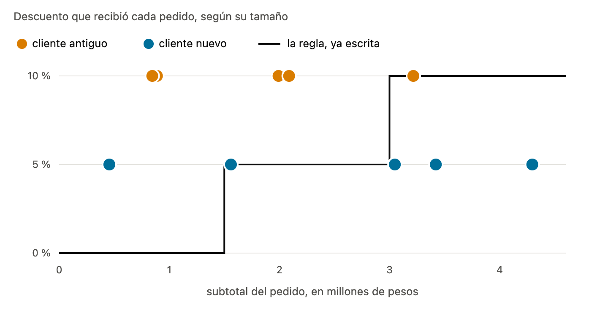
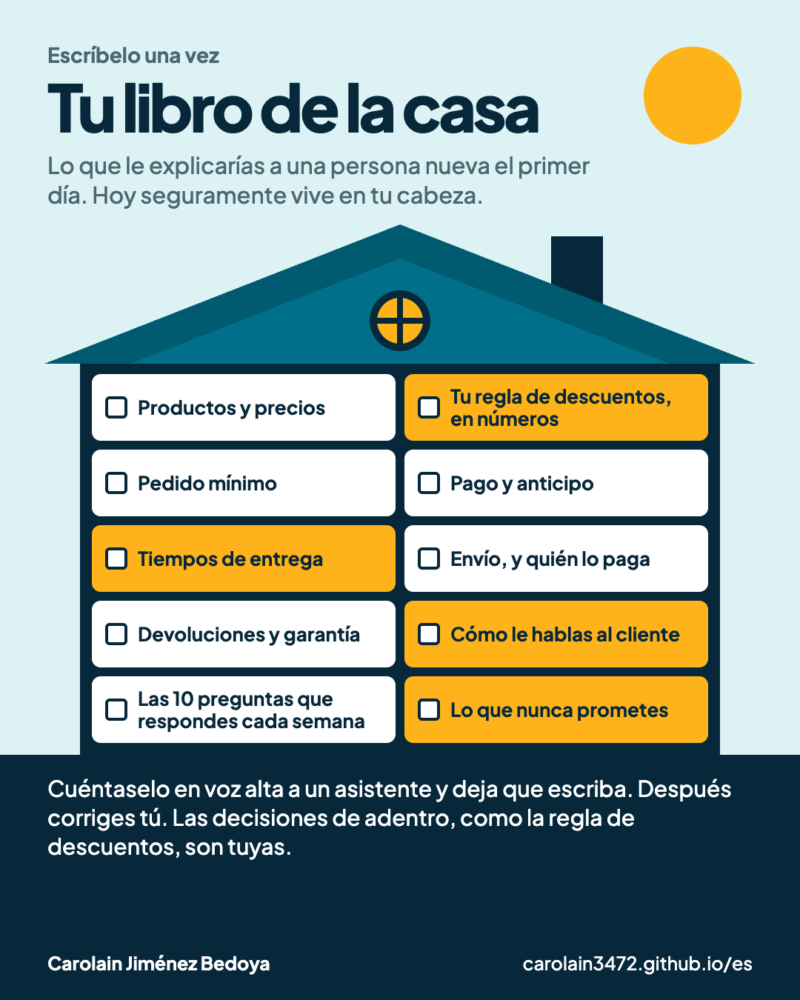

En las empresas pequeñas muchas reglas viven en la cabeza de alguien. Cuánto descuento, a quién, quién paga el envío. Funciona mientras esa persona responda todos los mensajes, y deja de funcionar el día que le pides las cotizaciones a un asistente.

Quería ver qué hace un modelo con una regla a medio escribir. Esperaba un desorden, con un precio distinto cada vez. No fue lo que pasó.

## La prueba

Inventé una tostadora de café con cuatro productos y diez pedidos, cinco de clientes antiguos y cinco de nuevos. Esta era la política vaga:

> Manejamos descuentos para pedidos grandes, normalmente entre el 5 y el 10 %, según el cliente. A las tiendas que llevan tiempo con nosotros se les trata de ayudar un poco más. El envío lo cobramos según el caso. Si el pedido es bueno, a veces lo asumimos nosotros. Un envío normal cuesta más o menos $25.000.

Y esta era la escrita: 0 % por debajo de $1.500.000, 5 % desde ahí, 10 % desde $3.000.000 y nada más. El envío vale $25.000 por debajo de $1.000.000 y es gratis por encima.

Le pedí a tres modelos cada cotización diez veces, de cuatro maneras:

1. Con la política vaga y permiso de preguntarle a la dueña.
2. Con la política vaga y el cliente esperando un total.
3. Con la regla escrita.
4. El modelo solo lee el pedido y un programa aplica la regla.

Son 1.200 respuestas.

## Con permiso, preguntan

| Modelo | Vaga, le preguntó a la dueña | Regla escrita, total exacto | El programa hace la cuenta, total exacto |
|:--|--:|--:|--:|
| Claude Haiku 4.5 | 98 de 100 | 99 de 100 | 100 de 100 |
| Claude Haiku 5.5 | 92 de 100 | 100 de 100 | 100 de 100 |
| Claude Sonnet 5.5 | 100 de 100 | 100 de 100 | 100 de 100 |

La primera columna me gustó. Casi siempre el modelo paró y preguntó algo como esto, que es una respuesta de Sonnet:

> ¿Qué porcentaje de descuento (entre 5 y 10 %) se le aplica a Tienda Azafrán por este pedido (subtotal $1.992.000) y se le cobra el envío (aprox. $25.000) o lo asumimos nosotros?

Esas preguntas son la lista de decisiones que la dueña no había tomado. Uno podría copiarlas, responder cada una una sola vez y ya tendría la política.

## Sin permiso, deciden

Lo único que cambié fue el final. «El cliente está esperando. ¿Cuál es el total que le enviamos?»

{fig-alt="Descuento de cada pedido según su tamaño, con la regla escrita como una línea escalonada"}

Todos respondieron, 300 veces de 300. Y no respondieron al azar. Los clientes antiguos recibieron 10 % y los nuevos 5 %, en **298 de las 300 cotizaciones**, con tres modelos distintos.

Nadie escribió esa regla. Es una lectura posible de mi texto, porque sí dije que a los antiguos se les ayuda un poco más. Pero la política hablaba de pedidos grandes, y el tamaño no importó. Un pedido de $456.000, el más pequeño, recibió 5 %. El más grande, de $4.296.000, recibió el mismo 5 %. Un cliente antiguo con $846.000 recibió 10 %.

Lo que sí cambió fue el envío. Para el mismo pedido, unas respuestas lo cobraban y otras lo regalaban.

Revisé la aritmética y estaba bien las 300 veces. Eso me preocupa más que si estuviera mal, porque si uno revisa esas cotizaciones no encuentra nada. Los totales cuadran y hasta se ven consistentes.

## Lo que yo haría con esto

Escribiría la regla antes de escoger la herramienta. Si cabe en una línea, como «5 % desde millón y medio», no necesita IA y puede vivir en una hoja de cálculo.

Siempre le dejaría al modelo una salida, con un campo para su pregunta. Cuesta una línea, y fue la diferencia entre preguntar 290 veces de 300 y no preguntar nunca.

Y guardaría las preguntas que haga la primera semana. Son un buen borrador de lo que llamo el libro de la casa, todo lo que le explicarías a una persona nueva el primer día.

{fig-alt="Infografía: lista para tu libro de la casa"}

## Límites

La empresa es inventada y los pedidos son limpios. El cliente antiguo siempre decía «cliente desde 2022», y eso seguramente empujó a los modelos a usarlo. Probé tres modelos de la misma familia. Y la política vaga menciona 5 y 10, así que otro texto daría otra regla inventada. Lo que esperaría volver a encontrar es que haya una.

El código y las 1.200 respuestas están en [lab/same-quote](https://github.com/carolain3472/carolain3472.github.io/tree/main/lab/same-quote). Corrí las pruebas con ayuda de Claude Code.
