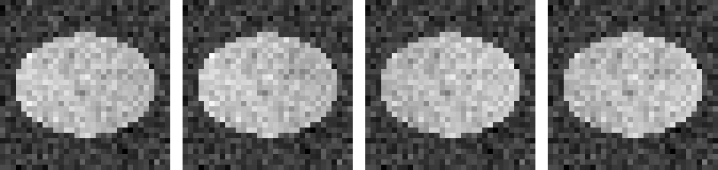
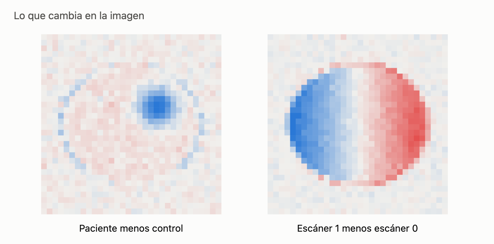
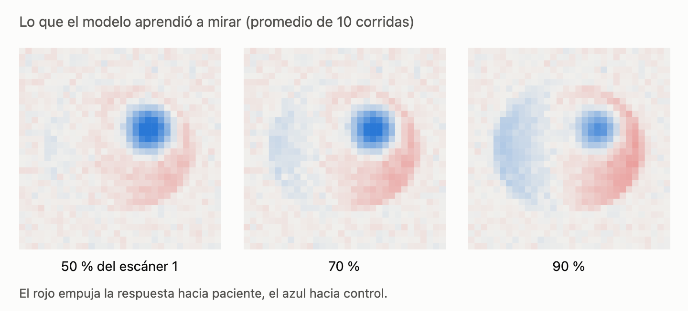
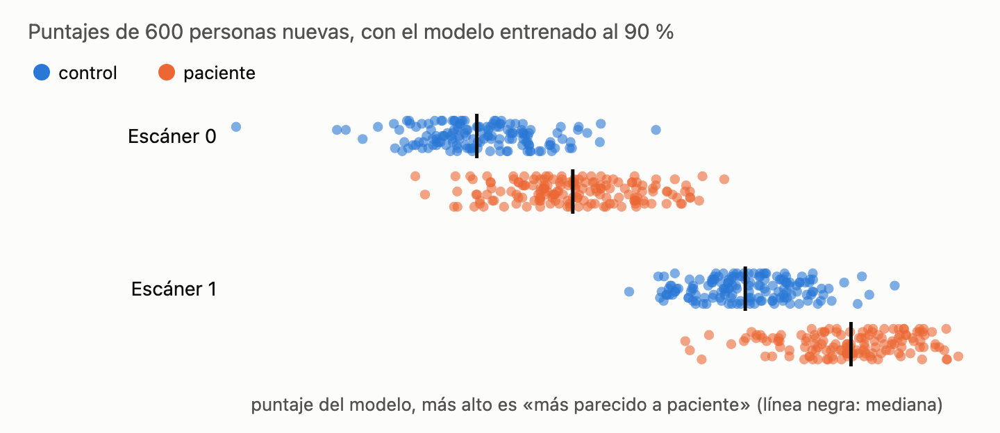

Trabajo con resonancias del cerebro y hay una pregunta que no puedo soltar: cuando un modelo separa dos grupos de personas, qué está mirando.

Los datos de imágenes médicas suelen juntarse de varios hospitales, y cada hospital tiene su propio escáner. Si casi todos los pacientes vienen de uno y casi todas las personas sanas de otro, hay dos formas de llegar a la respuesta correcta. Una es ver la enfermedad. La otra es reconocer la máquina, que es mucho más fácil.

Eso se lee en muchos artículos. Yo quería tenerlo en las manos, con algo tan pequeño que pudiera ver cada parte, así que construí un cerebro falso.

## Un cerebro muy malo

Es una elipse gris de 32 × 32 píxeles. Las personas varían un poco de tamaño, como en la vida. Los pacientes tienen una mancha oscura y tenue que se mueve un poco de una persona a otra. Y el escáner agrega una sombra suave: una máquina deja más claro el lado derecho de la imagen y la otra el izquierdo. Cada imagen se normaliza por separado, que es un paso común, y la sombra sobrevive.

{fig-alt="Cuatro imágenes simuladas de cerebro"}

Mirándolas una por una, no sé decir cuál es cuál. Si promedio 800 de cada una y resto, aparece todo:

{fig-alt="Dos mapas, una mancha azul para la enfermedad y un degradado de izquierda a derecha para el escáner"}

La enfermedad es una mancha pequeña. El escáner toca todo el cerebro. Guarda esas dos imágenes en la cabeza.

## Cambiar un solo número

Entrené una regresión logística con 600 de estas imágenes, mitad pacientes y mitad controles. Dejé todo fijo menos cuántos pacientes venían del escáner 1. En 50 % el escáner no dice nada. En 90 %, nueve de cada diez pacientes vienen del escáner 1 y nueve de cada diez controles del escáner 0.

Después probé cada modelo con 1.000 personas nuevas, dos veces. En la primera prueba tenían la misma mezcla de escáneres del entrenamiento, que es lo que pasa cuando uno divide al azar un solo conjunto de datos. En la segunda, el escáner no tenía nada que ver con la enfermedad. Todos los números son el promedio de 10 corridas.

```{=html}

<div style="height:1rem"></div>
```

La línea azul casi no se mueve, entre 0,96 y 0,97. Si esa fuera la única prueba que tuviera, me habría sentido bien en todos los puntos. La naranja termina en 0,69.

| Pacientes del escáner 1 | Igual mezcla | Cada escáner por separado | Escáner sin relación con la enfermedad | Solo la etiqueta del escáner |
|:--|--:|--:|--:|--:|
| 50 % | 0,97 | 0,98 | 0,97 | 0,50 |
| 60 % | 0,97 | 0,97 | 0,96 | 0,60 |
| 70 % | 0,96 | 0,96 | 0,92 | 0,69 |
| 80 % | 0,96 | 0,95 | 0,81 | 0,79 |
| 90 % | 0,97 | 0,88 | 0,69 | 0,90 |

: AUC, promedio de 10 corridas {.striped}

La última columna es un «modelo» que nunca abre la imagen. Solo sabe qué máquina se usó, y en 90 % saca 0,90.

También repetí todo sin la mancha, o sea sin enfermedad que encontrar. Con la mezcla del 90 % el modelo igual sacó 0,90 en la primera prueba y 0,50 en la segunda. Estaba reportando un resultado excelente sobre nada.

## Mirar adentro

Una regresión logística tiene un peso por píxel, así que se pueden dibujar como una imagen. Esta es mi parte favorita.

{fig-alt="Mapas de pesos del modelo al 50, 70 y 90 por ciento"}

En 50 % el modelo encontró la mancha. En 90 % la mancha sigue ahí, más débil, y alrededor se ve la sombra del escáner de izquierda a derecha. Compárala con la imagen de lo que hace el escáner. Nadie le habló al modelo de escáneres. Tomó las dos cosas que le servían y las mezcló.

Y esto es lo que eso les hace a los puntajes:

{fig-alt="Puntajes de controles y pacientes, separados por escáner"}

Dentro de cada escáner los pacientes tienen puntajes más altos que los controles, así que algo aprendió. Pero las personas sanas del escáner 1 tienen puntajes más altos que los pacientes del escáner 0. Cualquier corte que uno escoja va a ser injusto con uno de los dos hospitales.

Eso explica un número de la tabla que me confundía. En 90 %, cada escáner por separado da 0,88 y todos juntos dan 0,69. Revisar cada sitio por separado está bien, y me habría mostrado solo una parte del problema, porque los puntajes de dos personas escaneadas en máquinas distintas ya no se pueden comparar.

## Lo que ahora le pediría a un resultado

1. Una tabla de cuántos pacientes y controles vinieron de cada escáner, y el AUC de esa sola etiqueta. Toma cinco minutos. Si está lejos de 0,5, hay algo que explicar.
2. El AUC dentro de cada escáner y la distribución de puntajes de cada uno, no solo el número.
3. Una prueba con personas cuyo escáner no tenga relación con el diagnóstico, o en un sitio que el modelo nunca vio.
4. Si el modelo lo permite, una imagen de lo que mira. Por sí sola no prueba nada, pero te puede hacer sospechar a tiempo.

## Pasa con imágenes de verdad

Zech y colegas entrenaron una red para encontrar neumonía en radiografías de tórax. Sacó un AUC de 0,931 en imágenes nuevas de los hospitales del entrenamiento y 0,815 en otro hospital. Ordenar las imágenes solo por hospital ya daba 0,861 [@zech]. Glocker y colegas tomaron resonancias de dos estudios, emparejaron a las personas por edad y sexo, preprocesaron todo con cuidado, y un clasificador todavía podía decir de qué estudio venía cada una [@glocker].

Mi versión es un juguete. Un escáner de verdad se diferencia en mucho más que una sombra, las lesiones reales no son redondas y una red profunda no es una regresión logística, así que mis números no significan nada fuera de esta página. Lo que me quedó es que ahora, cuando veo un AUC muy bueno, tengo en la cabeza una imagen de lo que podría haber adentro.

Solo necesita NumPy y corre en menos de 15 segundos. Cambia `lesion` y `bias` y mira cómo cae la segunda prueba: [experiment.py](https://github.com/carolain3472/carolain3472.github.io/blob/main/posts/scanner-shortcut/experiment.py), y [figures2.py](https://github.com/carolain3472/carolain3472.github.io/blob/main/posts/scanner-shortcut/figures2.py) para los mapas.

## Referencias

::: {#refs}
:::
