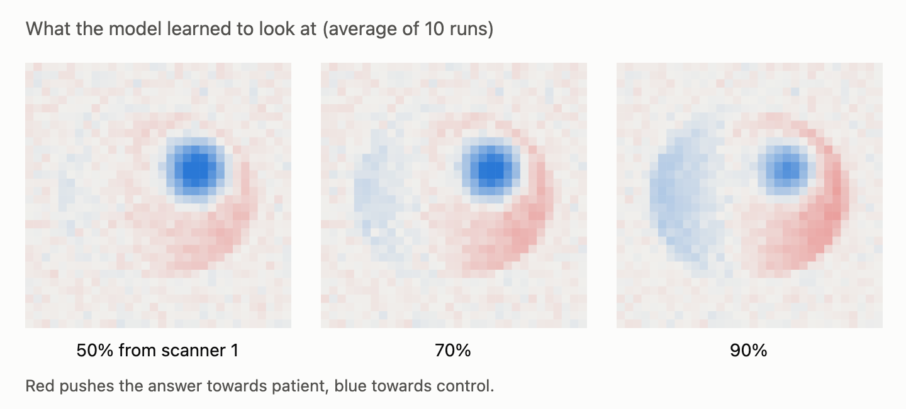
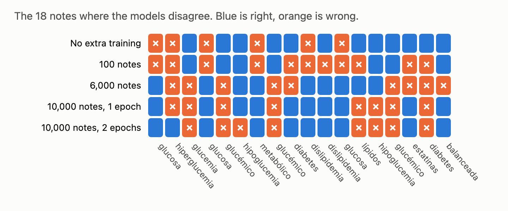
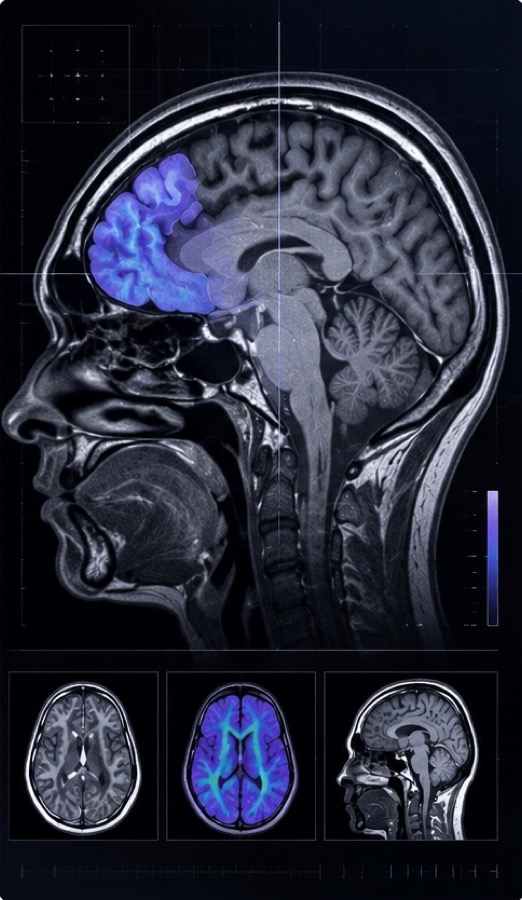
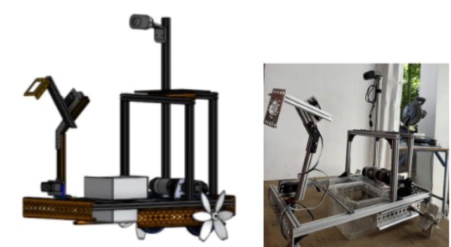
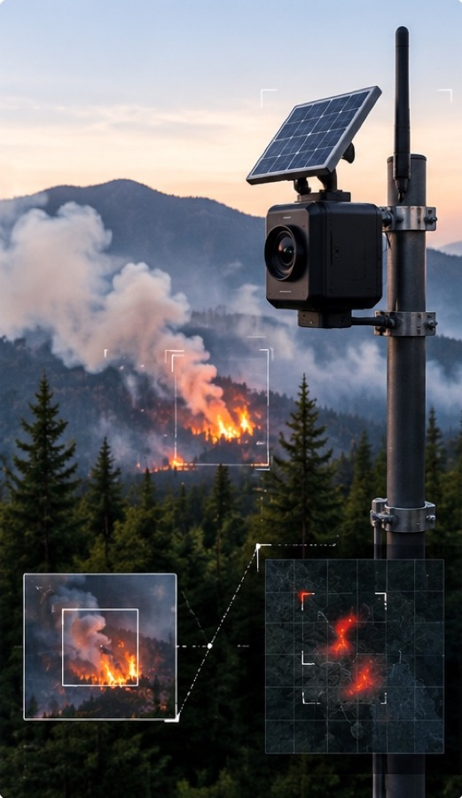

```{=html}
<div class="biz pg">
<header class="top"><div class="w"><h1>Investigación en <em>IA confiable</em></h1><div><p>Estudio imágenes médicas, y sobre todo si podemos creer lo que un modelo dice de ellas. Lo hago con el grupo MMV de la Universidad del Valle.</p><p>En estas notas hago el problema tan pequeño que se puede mirar adentro. Cada una viene con su código o sus datos.</p></div></div></header>
<nav class="jump"><div class="w"><a href="#notes">Notas</a><a href="#publication">Publicación</a><a href="#projects">Proyectos</a></div></nav>
<section class="w found" id="notes"><h2 class="no-anchor">Notas</h2><div class="nts"><a class="n1" href="posts/scanner-shortcut/"><div class="pic"></div><div class="tx"><small>Imágenes médicas</small><h3 class="no-anchor">Cuando un modelo aprende el escáner</h3><p>El mismo modelo saca 0,97 o 0,69, y se puede ver por dentro qué estaba mirando.</p><span class="more">Leer la nota →</span></div></a><a class="n4" href="posts/negative-result/"><div class="pic"></div><div class="tx"><small>PLN clínico</small><h3 class="no-anchor">Más preentrenamiento no mejoró la predicción de palabras en notas clínicas: reanálisis pareado de 101 casos</h3><p>101 notas, un error en mi propio evaluador y un modelo que cambió de vocabulario.</p><span class="more">Leer la nota →</span></div></a></div></section>
<section class="sand" id="publication"><div class="w"><h2 class="no-anchor">Publicación</h2><div class="pub"><span class="tag">CIARP 2025 · Presentación oral, Bogotá</span><h3 class="no-anchor">Identification of Traumatic Brain Injury on Magnetic Resonance Imaging</h3><p>Jiménez, C., Chaves, D., Trujillo, M., Herrera, A., Ledesma, M.</p><p class="ven"><em>CIARP 2025</em>, Lecture Notes in Computer Science, vol. 16529. Springer, Cham.</p><p class="go"><a href="https://doi.org/10.1007/978-3-032-23176-5_14">DOI 10.1007/978-3-032-23176-5_14</a></p></div></div></section>
<section class="w found" id="projects"><h2 class="no-anchor">Proyectos</h2><p class="lead">Proyectos más largos, explicados en mi portafolio.</p><div class="prj"><a href="https://carolain-jimenez.netlify.app/tbi.html"><b>Trauma craneoencefálico en resonancia</b><span>Radiómica en imágenes T1</span></a><a href="https://carolain-jimenez.netlify.app/nlp-clinico.html"><b>Notas clínicas en español</b><span>Modelos de lenguaje, TecNM Morelia</span></a><a href="https://carolain-jimenez.netlify.app/renova.html"><b>RENOVA</b><span>Plantas acuáticas en una Raspberry Pi</span></a><a href="https://carolain-jimenez.netlify.app/nte.html"><b>Kawsay</b><span>Detección de incendios, FIRST Global 2026</span></a></div></section>
<section class="end"><div class="w"><h2 class="no-anchor">Revisa los números</h2><div><p>Cada nota trae su código o sus datos. Si encuentras un error, cuéntame.</p><p class="go"><a href="https://carolain-jimenez.netlify.app/contact.html">Escríbeme</a><a class="alt" href="blog.html">Todas las notas</a></p></div></div></section>
</div>
```
