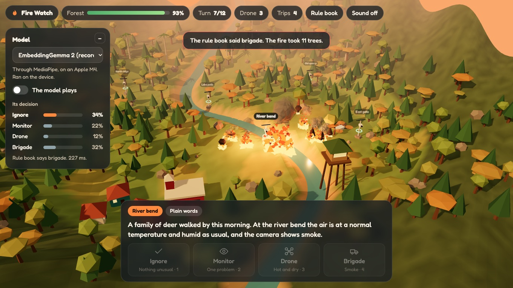

```{=html}
<div class="biz pg">
<header class="top solo"><div class="w"><h1>Things I <em>try</em></h1><div><p>Things I try because I got curious, at an event, with a new model or in the middle of something else. Some of them you can play.</p></div></div></header>
<section class="w found"><div class="feat"><a class="pic" href="posts/fire-watch/"></a><div class="tx"><small>Decision models</small><h3 class="no-anchor"><a href="posts/fire-watch/">Fire Watch: I made a game to see how a decision model fails</a></h3><p>A 3D forest, six sensors and four buttons. The local models could not read a thermometer.</p><p class="go"><a href="lab/fire-watch/index.html">Play Fire Watch</a><a class="alt" href="posts/fire-watch/">Read the note</a></p></div></div></section>
</div>
```
