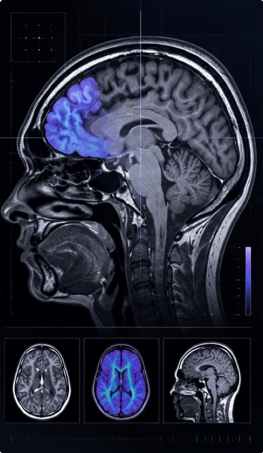
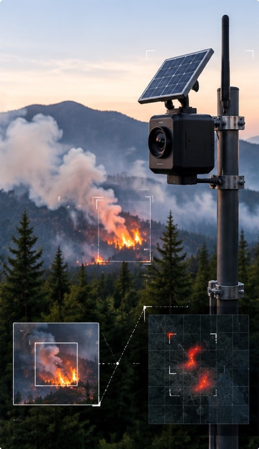
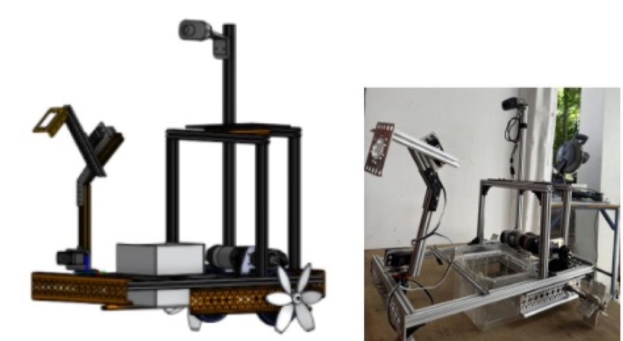

```{=html}
<section class="hero"><div>
<p class="name" role="heading" aria-level="1">Carolain <em>Jiménez Bedoya</em></p>
<p>I'm a systems engineer from Colombia. I work on medical images with the MMV group at Universidad del Valle, and I lead AI engineering at S&amp;S IP S.A.S. I also mentor Team Colombia in FIRST Global.</p>
<p>This is where I write down what I try: experiments small enough to see inside, systems from work, and results that did not come out the way I wanted.</p>
<div class="links"><a href="https://github.com/carolain3472">GitHub</a><a href="https://www.linkedin.com/in/carolain-jimenez-bedoya">LinkedIn</a><a href="https://orcid.org/0009-0006-0077-7890">ORCID</a><a href="https://carolain-jimenez.netlify.app/">Portfolio</a></div>
</div></section>

<div class="doors">
<a href="research.html"><h2>Research</h2><p>Medical images, language in hospitals, and models that are right for the wrong reason.</p></a>
<a href="business.html"><h2>AI for business</h2><p>Processes, people and where AI fits. With a small tool to sort your own steps.</p></a>
<a href="explorations.html"><h2>Explorations</h2><p>Games and small models that I try because I got curious.</p></a>
</div>


<h2>Notes</h2>
<div class="cards">
<a class="big" href="posts/saliency-checks/"><div class="pic fit" style="background-image:url(posts/saliency-checks/cascade.png)"></div><div class="tx"><small>Medical imaging</small><h3>Do saliency maps explain anything? Randomization tests on chest X-rays</h3><p>Five models, 200 X-rays and one method that barely changed with a random output layer.</p></div></a>
<a class="big" href="posts/calibration-shift/"><div class="pic fit" style="background-image:url(posts/calibration-shift/called.png)"></div><div class="tx"><small>Medical imaging</small><h3>Calibrating a CNN on chest X-rays: how much temperature scaling fixes, and where it stops</h3><p>They said 97% and got 88% right. At lower resolution, they called almost everything pneumonia.</p></div></a>
<a href="posts/negative-result/"><div class="pic fit" style="background-image:url(posts/negative-result/cw-grid.png)"></div><div class="tx"><small>Clinical NLP</small><h3>Further pretraining did not improve masked-word prediction in clinical notes: a paired re-analysis of 101 cases</h3><p>101 notes, a bug in my own evaluator, and a model that changed its vocabulary.</p></div></a>
<a href="posts/chatbot-i-dont-know/"><div class="pic fit" style="background-image:url(posts/chatbot-i-dont-know/chat1.png)"></div><div class="tx"><small>Responsible AI</small><h3>A university assistant with and without the handbook: 270 answers checked one by one</h3><p>270 answers with and without the handbook, and the mistakes that were left.</p></div></a>
<a href="posts/who-does-the-math/"><div class="pic fit" style="background-image:url(posts/who-does-the-math/exact.png)"></div><div class="tx"><small>Digital transformation</small><h3>Let the model read and a program add: 40 documents with three models</h3><p>Who reads, who calculates and who signs.</p></div></a>
<a href="posts/scanner-shortcut/"><div class="pic fit" style="background-image:url(posts/scanner-shortcut/sc-weights.png)"></div><div class="tx"><small>Medical imaging</small><h3>When a model learns the scanner</h3><p>The same model scores 0.97 or 0.69, and you can see inside it what it was looking at.</p></div></a>
<a href="posts/fire-watch/"><div class="pic" style="background-image:url(posts/fire-watch/bad.jpg)"></div><div class="tx"><small>Decision models</small><h3>Fire Watch: I made a game to see how a decision model fails</h3><p>A 3D forest, six sensors and four buttons. The local models could not read a thermometer.</p></div></a>
<a href="posts/before-you-paste/"><div class="pic fit" style="background-image:url(posts/before-you-paste/paste-test.png)"></div><div class="tx"><small>Data and a tool</small><h3>Before you paste your client list into a chat</h3><p>Swap personal data for codes in your browser, and see what gets through.</p></div></a>
</div>

<h2>Publication</h2>
<p><strong>Identification of Traumatic Brain Injury on Magnetic Resonance Imaging.</strong> Jiménez, C., Chaves, D., Trujillo, M., Herrera, A., Ledesma, M. <em>CIARP 2025</em>, Lecture Notes in Computer Science, vol. 16529. Springer, Cham. Oral presentation, Bogotá. <a href="https://doi.org/10.1007/978-3-032-23176-5_14">10.1007/978-3-032-23176-5_14</a></p>

<h2>Projects</h2>
<div class="four">
<a href="https://carolain-jimenez.netlify.app/tbi.html">Traumatic brain injury on MRI<span>Radiomics on T1-weighted images</span></a>
<a href="https://carolain-jimenez.netlify.app/nte.html">Kawsay<span>Wildfire detection, FIRST Global 2026</span></a>
<a href="https://carolain-jimenez.netlify.app/renova.html">RENOVA<span>Aquatic plants on a Raspberry Pi</span></a>
<a href="https://carolain-jimenez.netlify.app/nlp-clinico.html">Spanish clinical notes<span>Language models, TecNM Morelia</span></a>
</div>
```
