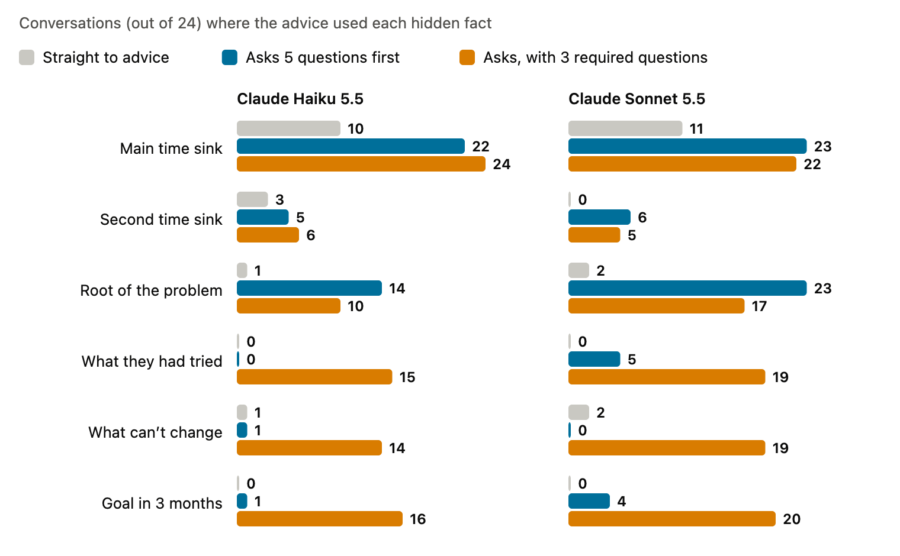
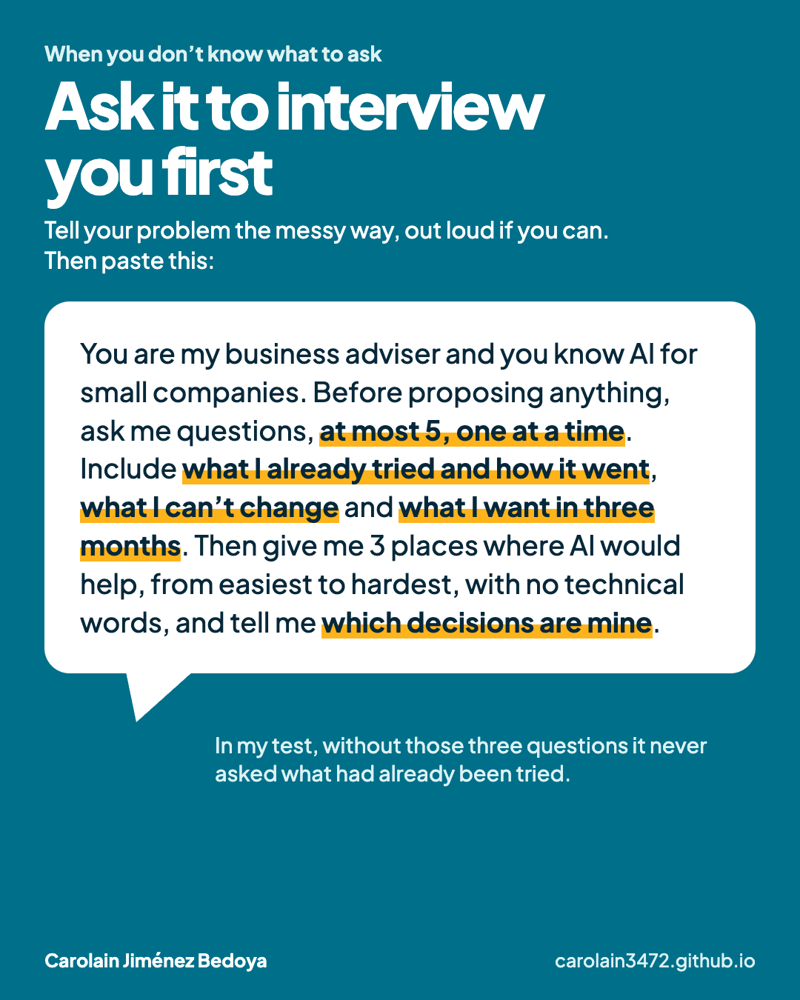

There is a piece of advice that often comes up in AI talks for small companies, for people who don't know what to ask: don't look for the perfect prompt. Tell it your problem, messy as it is, and ask it to interview you before giving an opinion. A good consultant does that.

I had never measured if it works. So I did, and it does, with a hole in the middle.

## Six businesses with secrets

I invented six small businesses: a bakery, a dental clinic, a hardware store, a birdwatching company, a music school and a uniform workshop. Each one had a short introduction, the kind you write when you are tired, and a sheet with six facts that the adviser could not see:

| Fact | In the dental clinic |
|:--|:--|
| Main time sink | Two hours a day calling to confirm appointments |
| Second time sink | Twelve reports for insurers every Friday, by hand |
| Root of the problem | The schedule is in one computer and nobody writes why patients cancel |
| What they had tried | Automatic reminders. Many older patients did not read them |
| What can't change | Medical records can't go into an external tool |
| Goal | From ten empty chairs a week to three |

Then I asked for the three places where AI would help most, in three ways. Straight away. After five questions, one at a time, answered by another model that had the sheet and could only answer what it was asked. And after five questions where I required three of them: what I already tried, what I can't change and what I want in three months.

Two models gave the advice, four times per business and per way. Sonnet 5.5 read each advice and marked which facts it used.

{fig-alt="Bars with how many conversations used each hidden fact, for two models and three ways"}

## Asking works

Compare gray and blue. Going straight to the advice, almost no conversation found the root of the problem. With five questions, Haiku found it in 14 of 24 and Sonnet in 23. The main time sink also jumps.

(The gray bar of the main time sink is generous. If someone has a hardware store, "faster quotes for builders" is right by chance, and the judge sometimes gave it the point.)

## The hole

Now look at the last three rows in blue. They asked a lot of things, and almost none of them about what had been tried, what can't change or where the owner wants to go.

I searched the 240 questions for one like "what have you tried before". There isn't any. About half of Haiku's had some form of *how much* or *how many*, how many orders, how many appointments, and the owner usually didn't know.

This has a consequence you can see. The clinic had already tried automatic reminders and they had not worked. In the 16 conversations without my extra questions, **automatic reminders were recommended 16 times**. The workshop had signed confidentiality agreements over its clients' logos, and after asking, both models proposed to collect the logos in a form all eight times.

None of that advice is bad. It is what anyone would say from outside, and it is what makes an owner close the laptop and say "I tried that already".

## Three questions

With the three required questions, what had been tried goes from 0 to 15 with Haiku and from 5 to 19 with Sonnet. The limits go from 1 to 14 and from 0 to 19. This is how Sonnet started with the clinic, translated:

> **Question 1 of 5:** What have you tried before to stop that leak of money, and how did it go?
>
> **Owner:** Automatic message reminders for the appointments, but many older patients didn't read them and the no-shows did not go down.

And the first recommendation was an automatic phone call instead of a message, with name, phone and time, and no medical records.

It has a price. With five questions and three already taken, there are fewer left to dig, and the root of the problem was found less: 14 to 10 and 23 to 17. I would probably allow seven. I didn't test that. And it doesn't always listen. Even with the answer in front of it, reminders came back in 4 of 8 conversations of the clinic, sometimes with a small change.

This is the prompt I would use:

{fig-alt="Infographic with the interview prompt"}

The last part, about which decisions are mine, is my addition and I did not measure it.

## Limits

The owner was also a model, and sometimes it made up a detail that was not on the sheet, like a number of orders. The sheets are mine, so the questions that I found missing are the ones I had thought of. A model graded the answers. A part of them was checked by hand and mostly held, with the exception above. Six businesses are few, and a real person answers much better than a sheet.

Everything is in [lab/asks-first](https://github.com/carolain3472/carolain3472.github.io/tree/main/lab/asks-first), in Spanish, with the conversations complete. I ran the tests with help from Claude Code.
