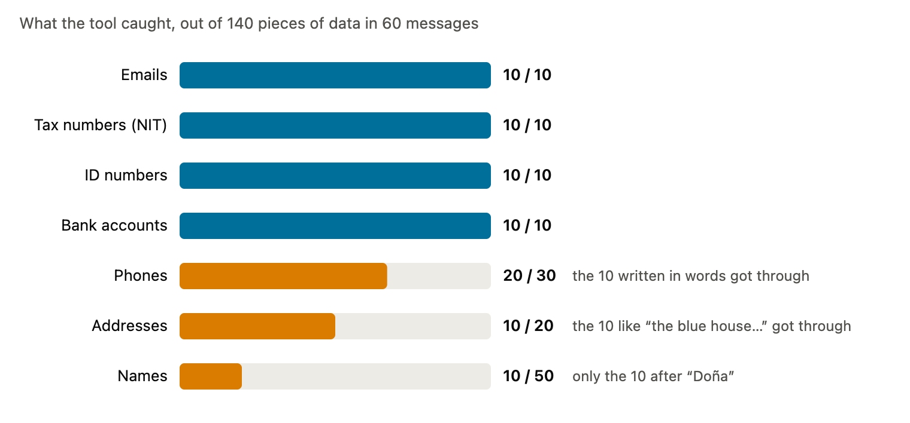
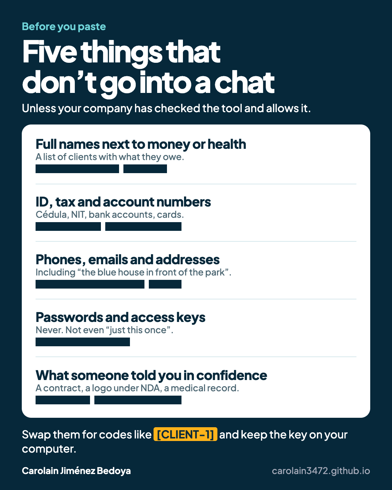

The practical guides I write for the AI workshops I give carry a box with a safety rule: use invented or anonymized data. No ID numbers, phones, addresses or real client accounts, unless the company policy allows it. It is not an easy rule to follow, because the useful thing is to paste the real list of clients and ask for a summary.

Not every tool keeps what you paste in the same way, and many companies have rules about it. While you find out, the simplest thing is to change the data for codes before pasting: *Doña Yuliana Grisales* becomes [NOMBRE-1], her phone becomes [TEL-1], and you keep the key on your computer to put everything back afterwards. The summary works the same, because to group debts by month the model doesn't need to know who she is.

So I wrote a small tool that does it inside the browser. Nothing is sent anywhere.

```{=html}
<div class="maskw" data-lang="en">
<label for="mw-in">Paste a text here</label>
<textarea id="mw-in" rows="5">Cliente: Luz Marina Ocampo - Tel 321 474 1950 - Dirección Diagonal 28 # 5-12. Su cédula es 29.504.766 y consignó a la cuenta de ahorros 160-967017-82. Doña Yuliana Grisales pide que se lo dejen en la casa azul frente al parque.</textarea>
<div class="mw-b"><button type="button" id="mw-go">Swap for codes</button><button type="button" id="mw-copy">Copy the result</button></div>
<label for="mw-out">What you would paste</label><textarea id="mw-out" rows="5" readonly></textarea>
<details><summary>The key, to put the data back later</summary><div id="mw-key"></div></details>
<p class="tiny">Nothing leaves this page. It is a pattern search, so read the result before you paste it.</p></div>
<script src="../../lab/paste-check/mask.js"></script>
<script>(()=>{const $=i=>document.getElementById(i);let K={};function go(){const r=mask($("mw-in").value);K=r.key;$("mw-out").value=r.out;const d=$("mw-key");d.textContent="";for(const[c,v]of Object.entries(K)){const p=document.createElement("div");p.textContent=c+"  →  "+v;d.append(p)}}$("mw-go").onclick=go;$("mw-copy").onclick=async()=>{try{await navigator.clipboard.writeText($("mw-out").value);$("mw-copy").textContent="✓"}catch{}};go()})();</script>

```

The codes are in Spanish because my tests were in Spanish: NOMBRE is name, TEL phone, CC the national ID, NIT the tax number, CUENTA a bank account and DIR an address.

## What it lets through

A tool like this can give you a false feeling of safety, so I tested it. I wrote 60 short business messages in Spanish, like the ones that arrive by WhatsApp, with 140 pieces of personal data marked by hand.

{fig-alt="Bars with the share of each kind of data that the tool caught"}

Everything with a fixed shape was caught: emails, tax and ID numbers, bank accounts, phones written with digits and addresses written the Colombian way, like *Calle 28 # 5-12*. I wrote both the messages and the rules, so those 100% say more about my patterns than about the real world.

The interesting part is the rest. It caught 10 of 50 names, and only the ones that came after *Doña*. "Soy Hernán Darío Pava" went through untouched. "Bodega 4 de la zona franca" and "la casa azul frente al parque" went through, and that is how a lot of people in Colombia give an address. And a phone dictated in words, "tres uno cinco…", went through too.

Names are the hard part because they don't have a shape. A pattern can't tell a name from the start of a sentence. A language model can, but then you are sending the text to a model to protect it from a model, which only makes sense if that model runs on your own computer.

## How I would use it

I would use the tool as a first pass and then read the result, looking for names and places. In a list of clients it is fast, because the names are in one column, and the easiest option is to replace that column with numbers before anything else.

And there is something to ask before choosing any of this: whether your company already has a tool approved for this kind of data. If it does, use that one.

The tool, the 60 messages and the test are in [lab/paste-check](https://github.com/carolain3472/carolain3472.github.io/tree/main/lab/paste-check).

{fig-alt="Infographic: five things that don't go into a chat"}
