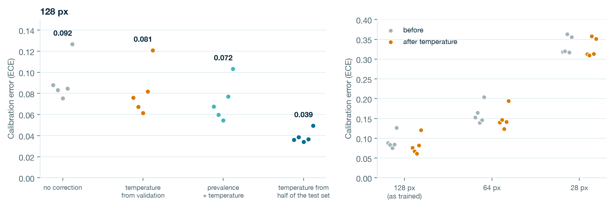
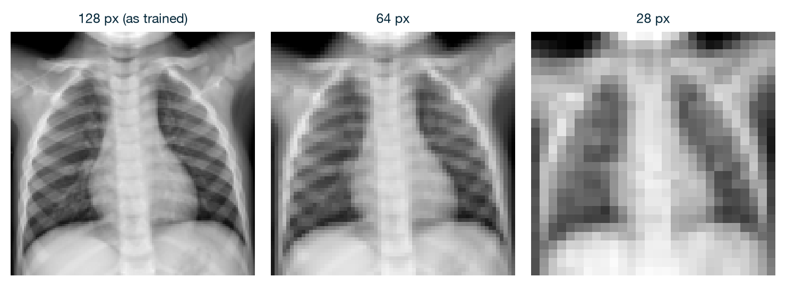
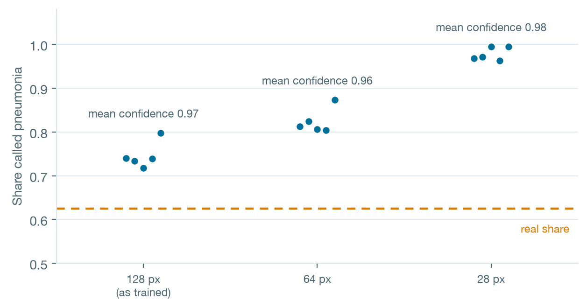

The neurologists I worked with during my thesis asked me whether they could trust the predictions of a model. Part of that question is about **calibration**: a model that says 90% should be right about 90 times out of 100 when it says so.

Modern networks tend to be overconfident, and the standard fix is **temperature scaling** [@guo]. You divide the scores of the network by a single number, the temperature, chosen on a validation set. It does not change any prediction, only how sure the model says it is. It is one line of code and it often works very well.

I wanted to see where it stops working, with something small enough to check every number.

## The setup

The data is PneumoniaMNIST [@medmnist], pediatric chest X-rays [@kermany] at 128 × 128 pixels, normal or pneumonia. I used the same five ResNet-18 I trained for the [note on saliency maps](../saliency-checks/), each with a different seed, all with a test AUC between 0.970 and 0.984.

I measured calibration with the expected calibration error (ECE, 15 bins): the average gap between how sure the model says it is and how often it is right. 0 is perfect. Each model has its own 95% bootstrap interval, and in the text I give the range over the five models.

The temperature is fitted on the 524 validation images and then used on the 624 test images.

## On the same kind of images

| | Without correction | Temperature from validation |
|---|---|---|
| ECE, range over 5 models | 0.075 to 0.127 | 0.061 to 0.121 |
| ECE, mean | 0.092 | 0.081 |
| Mean confidence | 0.97 | 0.96 |
| Share correct | 0.88 | 0.88 |
: Test set at 128 px, the same resolution the models were trained on. {.striped}

The models say 97% on average and get 88% right. Temperature scaling improves all five models, but by about one point, less than the width of the interval of each one (around ±0.02).

Looking at the errors explained why. Almost all of them go in one direction: between 61 and 108 of the 234 normal X-rays were called pneumonia, about half of those with more than 95% confidence. Of the 390 pneumonia X-rays, the models missed between 0 and 3.

And then a number I had not looked at before training: pneumonia is 74% of the training and validation sets and 62.5% of the test set. The temperature learned to correct for patients who are not the test patients.

## Three checks

To see whether the problem was the method or the data it was fitted on, I tried three things on the 128 px test set:

1. **Temperature from validation**, the usual way.
2. **A prevalence correction** [@saerens]: before the temperature, I moved the score of every X-ray by the difference between the two shares of pneumonia, in log-odds. It only uses two numbers, 74% and 62.5%, and no test labels.
3. **An oracle**: the temperature fitted on half of the test set and measured on the other half, 100 random splits. In practice you can't do this, it needs labels from the new data, but it shows what the method can do when it sees the right data.

{.column-page fig-alt="Dot chart. Mean ECE 0.092 without correction, 0.081 with the validation temperature, 0.072 with prevalence and temperature, 0.039 with the temperature from half of the test set. Right panel: ECE by resolution before and after temperature."}

The oracle brings the error down to 0.034–0.049. The temperature it chooses is between 3.1 and 3.9, against 1.2–1.4 from validation. So the method works. What fails is fitting it on data that does not look like the test.

The prevalence correction helps half the way, down to a mean of 0.072, and also raises accuracy a little (from 0.876 to 0.887 on average). The difference in the share of pneumonia explains part of the gap, not all of it. I don't know what else differs between the validation and test sets, and I don't want to guess.

## When the X-ray gets worse

The second test is a change of acquisition. MedMNIST has the same test X-rays stored at 64 and 28 pixels. I enlarged them back to 128 so that the model could read them, and passed them through the same models with the same temperature.

{fig-alt="Three versions of the same chest X-ray, sharp at 128 pixels, softer at 64 and blocky at 28."}

| | 128 px | 64 px | 28 px |
|---|---|---|---|
| ECE without correction | 0.092 | 0.161 | 0.335 |
| ECE with temperature | 0.081 | 0.149 | 0.329 |
| Share correct | 0.88 | 0.80 | 0.65 |
| Mean confidence | 0.97 | 0.96 | 0.98 |
: Mean over the five models. {.striped}

At 28 pixels the models were right 65% of the time and said 98%. They were not reading the X-rays anymore: they called pneumonia between 96% and 99.5% of them.

{fig-alt="Dots for five models. At 128 px they call 72 to 80 percent pneumonia, at 64 px 80 to 87 percent, at 28 px 96 to 99.5 percent. The real share is 62.5 percent."}

Since 62.5% of the test X-rays have pneumonia, saying "pneumonia" to everything gives about 62.5% right. The accuracy at 28 px is barely above that, and the confidence went up. A temperature fitted on the original images can't know that the images changed. This is the pattern @ovadia describe for natural images under shift, and it is the one that worries me most in a hospital: the model does not say "I don't know" when the images change, it says "I'm sure".

## What I take from it

- Temperature scaling corrects what the validation set can see. If the validation set does not look like the place where the model will be used, the correction is small, and it can't be measured without labels from that place.
- Before calibrating, compare the share of each class in validation and test. It is one line of code and here it explained part of the problem.
- A change of acquisition can destroy the model and leave the confidence high. You need to check the confidence on the new data, not only the accuracy.

## Limits

- One dataset, one architecture trained from scratch, five seeds. With 624 test images the interval of each ECE is about ±0.02.
- ECE depends on the number of bins. I used 15 equal bins, as @guo did.
- Enlarging a 28 px image is a crude stand-in for a worse scanner. A real change of hospital moves contrast, noise and patients at the same time.
- I did not try other methods (ensembles, label smoothing, recalibration on the new data). That would be the next note.

## Code and data

Everything is in [lab/saliency](https://github.com/carolain3472/carolain3472.github.io/tree/main/lab/saliency): `calibration.py` and `calibration_check.py`, and the results of every model in `results/`, including the reliability tables I did not plot.

## References
