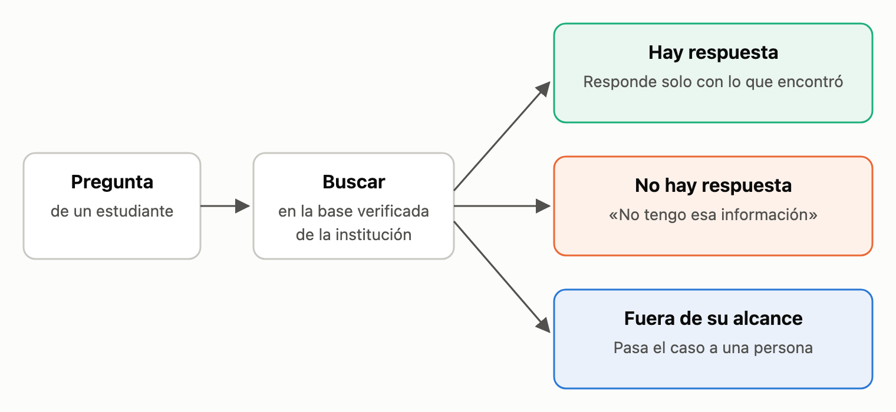

Trabajé en un chatbot para estudiantes de primer semestre. Preguntan por el reglamento, la matrícula, los calendarios y los servicios de bienestar, y las oficinas responden lo mismo cientos de veces. Un asistente puede ayudar mucho ahí, siempre que no invente. Si le dice a alguien un plazo que no existe, esa persona puede quedarse por fuera de un trámite.

Por eso casi todo el trabajo de diseño estuvo en lo que el bot no hace.

La primera decisión fue tener una sola base de conocimiento, verificada por la institución. El modelo responde con lo que encuentra ahí, y el prompt le prohíbe completar con lo que aprendió en su entrenamiento. Un modelo de lenguaje sabe muchas cosas sobre universidades en general, y en este caso eso es un problema, porque suena correcto y puede ser de otra universidad.

La segunda fue darle una salida. Cuando la base no tiene la respuesta, el bot dice «no tengo esa información». Cuando la pregunta se sale de su alcance, pasa el caso a una persona. Parece un detalle, pero un sistema sin esa opción queda obligado a responder algo.

{fig-alt="Diagrama: la pregunta pasa por la búsqueda en la base verificada y sale como respuesta, como no tengo esa información o hacia una persona"}

La tercera fue probar con preguntas reales de estudiantes y corregir hasta que dejaron de aparecer respuestas inventadas en esas pruebas. Eso no garantiza que nunca vaya a pasar, y por eso la salida hacia una persona sigue ahí.

Usé la misma idea en otro sistema, uno que compara los documentos de un área de recursos humanos con un marco internacional. Si la búsqueda no encuentra un fragmento suficientemente relevante, el resultado es «no hay información suficiente», y al final se revisa que cada afirmación tenga un fragmento que la respalde. En un diagnóstico, un hallazgo inventado hace más daño que uno que falta.

Si estás montando un asistente en tu empresa o en tu universidad, yo empezaría por escribir la lista de preguntas que no debe responder y quién las recibe. Con esa lista lista, lo demás es más fácil.
