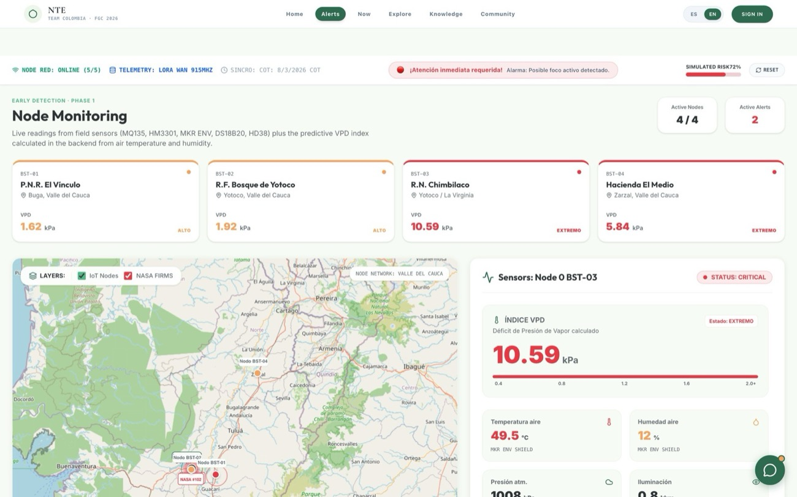
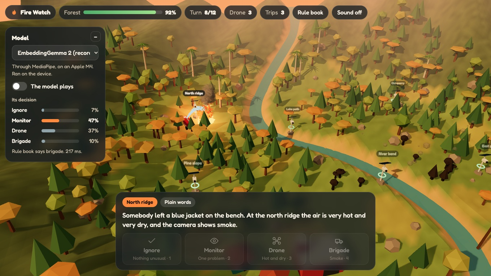
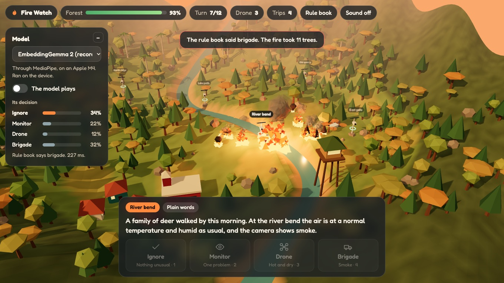
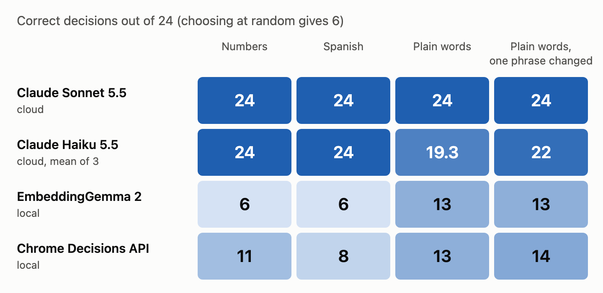
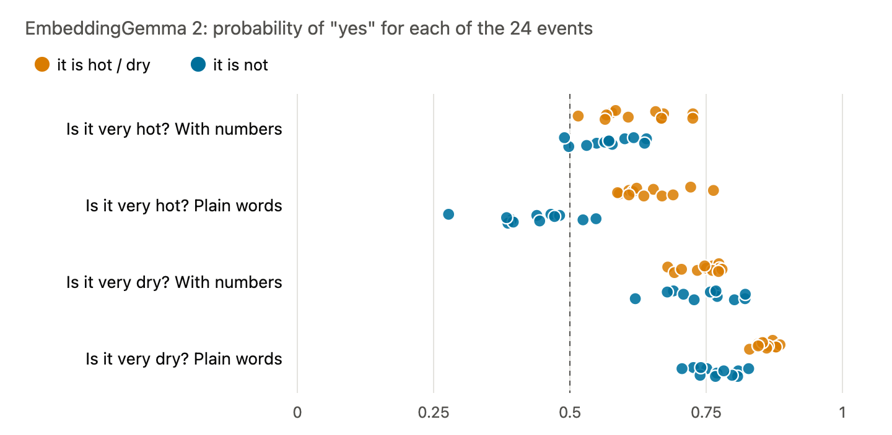
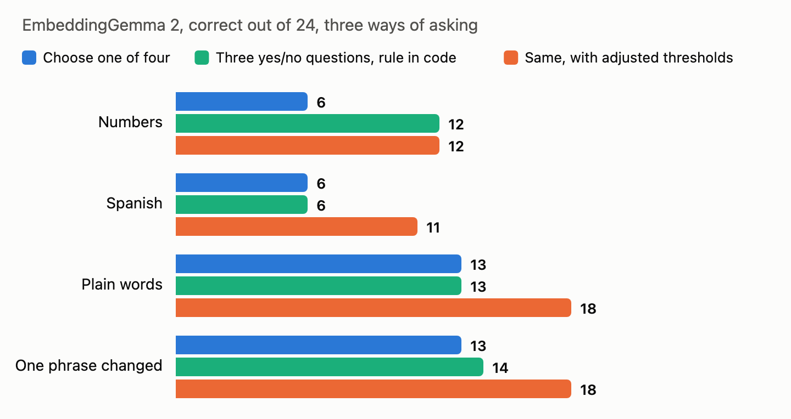
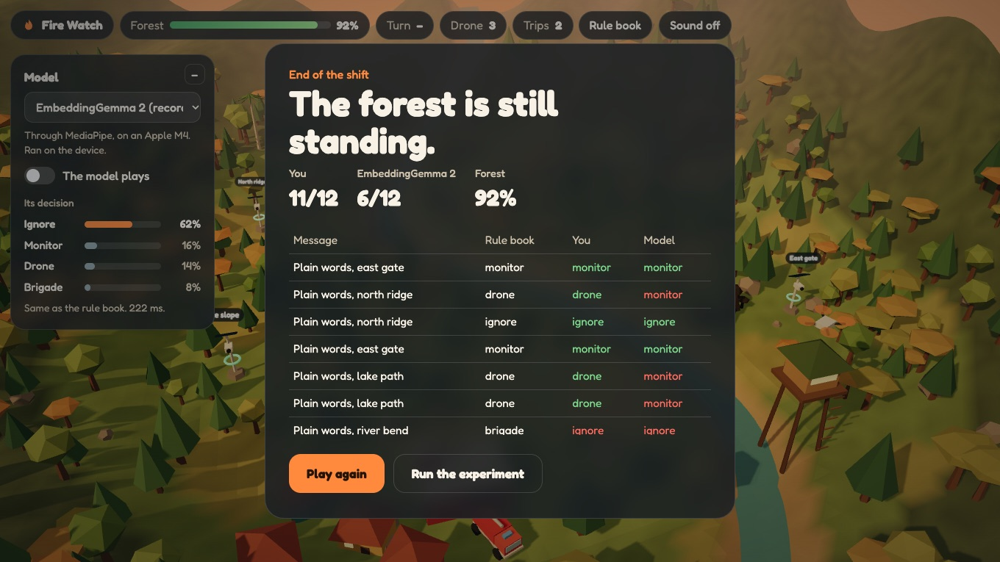

A few days ago I went to a tech event and saw a demo I kept thinking about. There was a character on the screen, you talked to it, and a panel on the side showed the probability of each thing it could do. The model never wrote a word. It only picked from a list.

They call these decision models. You give them a situation and a closed list of options, and they return one option with a number next to it. Chrome is testing an API for this, the [Decisions API](https://github.com/explainers-by-googlers/decisions-api), and the model runs on the computer of whoever opens the page. Nothing leaves the device, which for someone who likes medical data and sensors in places without internet is a very good sentence to hear.

So I made my own game to see where it breaks.

<video controls muted loop playsinline preload="metadata" poster="bad.jpg" style="width:100%;border-radius:12px"><source src="game.mp4" type="video/mp4"></video>

[**Play Fire Watch**](../../lab/fire-watch/index.html). It works on a phone too, and you don't need to download any model.

## Why fire

With FIRST Global Team Colombia I work on Kawsay, a wildfire detection project. When we talked to the municipal brigades in Valle del Cauca they told us something simple: they hear about the fires too late. A phone call needs a person who already sees smoke, and the satellites pass every few hours.

{fig-alt="Kawsay platform with sensor cards and a map"}

In a system like that, somebody has to read many short messages and decide what each one deserves. That is the game. Six sensors, twelve messages, and four buttons: ignore, monitor, send the drone, call the brigade. You have six flights and four trips, so you can't send everything to everything. If you ignore smoke, you lose trees.

::: {layout-ncol=2}

:::

The rule book is fixed, so every message has one right answer:

| Action | When |
|:--|:--|
| Brigade | The camera sees smoke, whatever else happens |
| Drone | No smoke, 45 °C or more, and 20% humidity or less |
| Monitor | No smoke, and only one of those two problems |
| Ignore | None of them |

## One event, four ways of saying it

I wrote 24 events, six per action, and each one in four versions. This is the same event:

> **Numbers.** Sensor at the east gate. Temperature 47 °C. Humidity 65%. Camera: no smoke.
>
> **Spanish.** Sensor en la puerta este. Temperatura 47 °C. Humedad 65 %. Cámara: sin humo.
>
> **Plain words.** The battery was changed on Monday. At the east gate the air is very hot and humid as usual, and the camera shows nothing unusual.
>
> **One phrase changed.** The same, but it ends with "the camera shows no smoke".

The answer is *monitor* in all of them. If a model changes its mind because I changed the words, I want to know.

I tested four models. Claude Sonnet 5.5 and Claude Haiku 5.5 are general models in the cloud, and I asked them for one word. The other two ran on my MacBook (an M4): the Decisions API of Chrome 158 with its experimental flag on, and EmbeddingGemma 2, which Google offers through MediaPipe and weighs about 165 MB.

{fig-alt="Table of correct decisions per model and version"}

The table surprised me because the two groups fail in opposite places.

The cloud models read the numbers perfectly and Spanish made no difference. Haiku gets lost in plain words. The local models are the other way around: they do better with words and they can't do numbers. EmbeddingGemma 2 got 6 of 24 with numbers, which is what you get with your eyes closed. When I opened the answers I saw that it had said *monitor* 24 times out of 24.

It makes sense once you think about what that model does. It turns the message and each option into vectors and measures which ones are close. "47 °C" and "45 °C or more" are close as text, and so are "30 °C" and "45 °C or more". There is no place where 47 gets compared with 45.

## The mistake was also mine

Haiku made the same error again and again: the rule book said *monitor* and it said *ignore*. In a fire system that is the bad direction.

When I looked at my own text I found a possible reason. The message said "the camera shows **nothing unusual**", and my description of *ignore* ended with "**Nothing is unusual**". I had copied my own words without noticing. In the fourth version I changed only that phrase and Haiku went from 19 or 20 to 22. The Chrome model moved one point and EmbeddingGemma 2 did not move at all, so this is a Haiku thing, at least here.

It is one phrase and 24 events, so I don't want to make it bigger than it is. But I would look for repeated words in any product where a model chooses from a list that a person wrote.

## My first fix did not work

My idea was to stop asking for the action. I would ask the local model three yes or no questions (is there smoke, is it very hot, is it very dry) and let normal code apply the rule book. I was sure about this one.

With Chrome it got worse: from 11 to 6 with numbers and from 14 to 9 with words. EmbeddingGemma 2 went from 6 to 12 with numbers, mostly because it found the smoke, and with words almost nothing changed. So I plotted the probability of each answer, one dot per event, to see what was going on.

{fig-alt="Dots with the probability of yes, for hot and dry, with numbers and with words"}

Look at the two rows with plain words. The orange and blue dots are separated, the model does know which ones are hot and which ones are dry. The problem is the line at 0.5. For *dry*, every single event is above 0.7, so with that line everything is dry. And in the rows with numbers the colors are mixed, so no line would help.

Then I wrote 24 new events, different from the first ones, used them only to choose better cut points, and went back to the original 24.

{fig-alt="Bars with three strategies for EmbeddingGemma 2"}

From 13 to 18 with words. It is better, it is still far from 24, and with numbers it stays at 12. With Chrome, the adjusted cut points gave 11 with words, less than just asking for the action.

## What I take from this

If I had to use a small local model for something like this, I would let the code read the thermometer, because `if t >= 45` has never failed me. I would use the model for the part that only exists as language, like a neighbor's message that says it smells like burnt leaves. And I would choose the cut points with data, since 0.5 is only a number that comes by default.

I would also try other models. EmbeddingGemma is the fastest and the weakest of the options that Chrome is considering. [Resoneo tested more of them](https://think.resoneo.com/chrome-decisions-api/) on 1,365 decisions and EmbeddingGemma also came last, at 38%, while Gemma 4 got 85%. I did not run Gemma 4 because it needs more than 4 GB, and I did not use dedicated cloud models like Gemini Decision or Jev. My median time was 55 ms per decision with Chrome, and that is the reason people care about them.

A few limits: 24 events, texts made from templates that I wrote, one run of Sonnet and one of each local model, one laptop. The API is experimental and can change next week.

Everything is in [lab/fire-watch](https://github.com/carolain3472/carolain3472.github.io/tree/main/lab/fire-watch): the events, the answers (for Haiku, the last of the three runs) and the code. There is also an [experiment page](../../lab/fire-watch/experiment.html) to run the local models in your own browser. I built the game and ran the tests with help from Claude Code. The 3D uses three.js.

{fig-alt="End screen of the game comparing the player and the model"}
