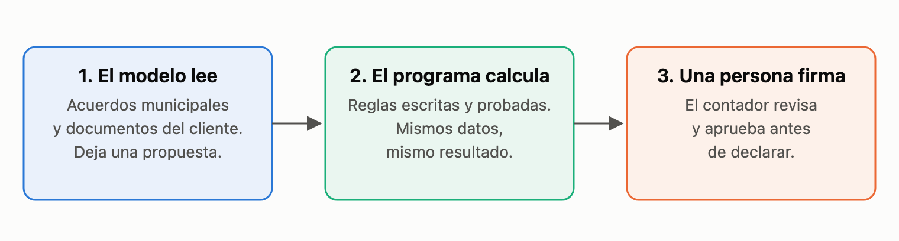

Cuando una empresa quiere usar IA en un proceso, la conversación suele empezar por la herramienta. A mí me sirve más empezar por otra cosa: qué parte del proceso acepta un error y cuál no.

Un ejemplo de mi trabajo es una plataforma para contadores que ayuda a liquidar el impuesto de industria y comercio en Colombia. Cada municipio tiene sus tarifas, sus sanciones y su calendario, y todo eso cambia. El contador lee el acuerdo, depura la contabilidad del cliente, clasifica las actividades y llena un formulario renglón por renglón. Es lento, y una cifra mal puesta significa una multa. (Yo soy ingeniera, no contadora, y por eso la firma en este sistema nunca es mía ni del modelo.)

El trabajo está repartido en tres:

1. **El modelo lee.** Extrae tarifas, códigos y fechas de los acuerdos municipales y de los documentos del cliente, y los deja como propuesta.
2. **Un programa calcula.** Las cuentas las hace un motor con reglas escritas y probadas, con aritmética decimal exacta y el redondeo que pide la norma. Si lo corres dos veces con los mismos datos, da lo mismo.
3. **Una persona aprueba.** Nada llega a una declaración oficial sin que un contador lo revise y lo confirme.

{fig-alt="Diagrama: el modelo lee, el programa calcula y una persona firma"}

Los modelos de lenguaje leen muy bien documentos desordenados, que era la parte lenta. Pero pueden leer un 5 donde hay un 6, y lo hacen con la misma seguridad con la que aciertan. Con este reparto, ese error aparece en una propuesta que alguien va a revisar antes de que exista un formulario.

También ayuda a saber quién responde. Si la cifra está mal, se puede ver si el documento se leyó mal, si la regla estaba mal escrita o si se aprobó sin revisar. Cuando un modelo hace los tres pasos, nadie puede contestar eso.

Si fuera a hacer lo mismo con otro proceso, marcaría cada paso con una letra: L si es leer o resumir, C si es calcular o aplicar una regla y D si es decidir. Los pasos L son buenos para empezar con IA, los C casi siempre necesitan un programa, y los D se quedan con una persona que tenga nombre. Se puede hacer con papel, y sirve para hablar de riesgos antes de comprar nada.
