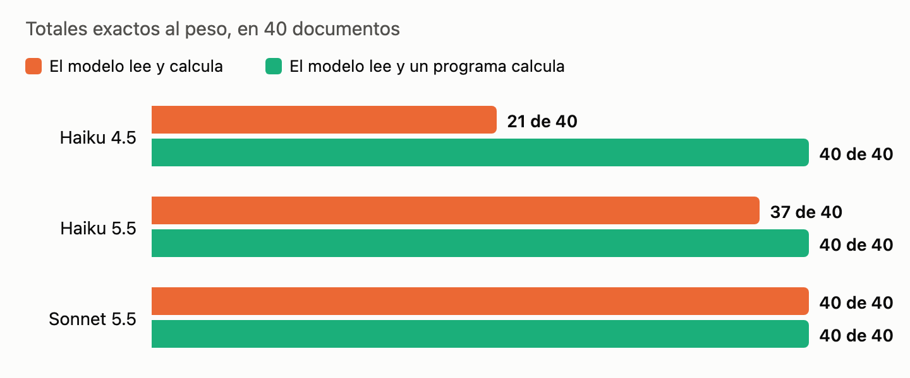
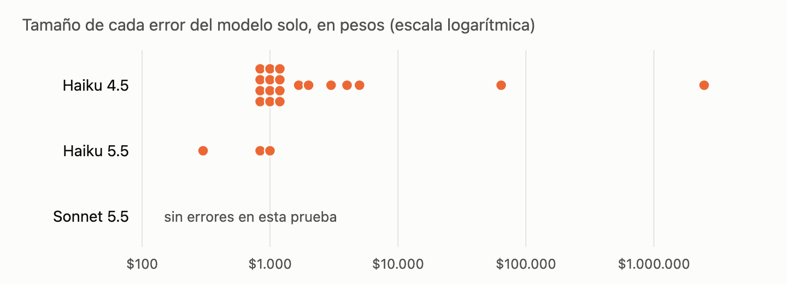

En el trabajo construimos una plataforma para contadores que ayuda a liquidar el impuesto de industria y comercio. Cada municipio de Colombia escribe sus propias reglas, con sus tarifas, sus sanciones y su calendario, y las cambia. El contador tiene que leer el acuerdo, revisar los documentos del cliente y llenar un formulario renglón por renglón. Una cifra mal puesta es una multa. (Soy ingeniera, no contadora, y de ahí sale todo lo que sigue.)

La regla que tenemos es que la IA lee y propone, un programa calcula, y un contador aprueba. Nada sale sin esa aprobación.

{fig-alt="Diagrama: el modelo lee, el programa calcula y una persona firma"}

Se puede pensar que es mucha vuelta, si el modelo puede leer el documento y dar el total de una vez. Es una duda justa, porque los modelos han mejorado mucho desde que se escribió esa regla. Entonces la puse a prueba.

## El municipio que no existe

Inventé un municipio con cinco actividades y sus tarifas, un impuesto de avisos del 15 %, una sobretasa bomberil del 3 %, retenciones y un descuento por pronto pago. No corresponde a ningún lugar real y no sirve para liquidar nada. Con eso generé 40 documentos como este:

> La actividad 412, consultoría, cerró con ingresos de $436.996.994, sin devoluciones. Comercio al por menor, código 203: $343.928.131, de los que se devolvieron $6.010.663. La nómina del último trimestre fue de $41.780.000. Los clientes le practicaron retenciones por $346.559. Va a pagar dentro del plazo de pronto pago.

Cada uno trae una trampa: una cifra que no hace falta, como esa nómina.

Probé dos caminos con tres modelos de distinto tamaño. En el primero, el modelo recibe el documento y las reglas y responde el total. En el segundo, el modelo solo saca los datos en un JSON y un programa de diez líneas hace la cuenta:

```python
tax    = miles(sum((ingreso - devoluciones) * tarifa / 1000))
avisos = miles(tax * 0.15)
bomb   = miles(tax * 0.03)
total  = tax + avisos + bomb - miles(retenciones)
if pronto_pago:
    total = total - miles(total * 0.10)
```

## Lo que pasó

{fig-alt="Barras con totales exactos por modelo y por camino"}

Los tres modelos leyeron los 40 documentos sin un solo error. Ni una cifra cambiada, ni uno cayó en la trampa. Con el programa haciendo la cuenta, los tres llegaron a 40 de 40.

Cuando el modelo hace todo, el más pequeño acierta 21 de 40, el del medio 37 y el grande 40.

Ese último 40 lo dejo aquí porque va en contra de mi regla y sería fácil esconderlo. Sonnet 5.5 hizo la cuenta 40 veces seguidas sin fallar. Así que «los modelos no saben sumar» ya no es una buena razón para la regla.

## Cómo son los errores

{fig-alt="Tamaño de los errores por modelo en escala logarítmica"}

La mayoría son de mil pesos: un redondeo hecho antes o después de tiempo. Son los más difíciles de ver, porque el total se parece mucho al correcto. Pero un formulario que redondea mal por mil pesos está mal.

Y hay uno que es otra cosa. El documento que puse arriba da $6.647.000. El modelo pequeño respondió **$4.174.000**. Son casi dos millones y medio menos, en uno de los documentos más cortos, dicho con la misma tranquilidad que los demás. Si uno revisa una muestra de diez, es muy probable que ese no salga.

## Entonces para qué el programa

Si el modelo grande acierta siempre, me quedan tres razones.

La primera es que el programa se puede revisar. Son diez líneas, un contador las puede leer conmigo y decirme «aquí no se redondea así». A un modelo que acertó 40 veces no le puedo preguntar qué va a hacer en la 41.

La segunda es que cuando algo sale mal se sabe dónde. Si el dato está mal, leyó mal el modelo. Si el dato está bien y el total no, está mal la regla. Si ambos están bien y se presentó otra cosa, alguien aprobó sin mirar. Cuando un modelo hace los tres pasos, esa conversación no se puede tener.

La tercera es que con el programa el modelo pequeño alcanza. Sacar los datos es más fácil que hacer la cuenta, y en mi prueba también fue más rápido: con Haiku 4.5, unos 4 segundos para leer contra 14 para leer y calcular. Para muchas empresas eso decide si el proyecto se paga o no.

## Para llevarlo a otro proceso

Una manera de repetir esto en otra empresa es tomar el proceso y marcar cada paso con una letra. **L** si es leer, resumir o clasificar. **C** si es calcular o aplicar una regla que está escrita. **D** si es decidir algo por lo que alguien responde.

Con este caso queda así: leer el acuerdo municipal es L, sacar las cifras del cliente es L, liquidar es C, aprobar es D. Las L son buenas para empezar con IA. Las C casi siempre piden un programa, y a veces ya existe y está en un Excel. Las D se quedan con una persona que tenga nombre y cargo.

Se puede hacer con papel y en una reunión, y así la conversación no empieza por la herramienta.

## Lo que esta prueba no dice

Los documentos los generó un programa, así que son limpios. Uno de verdad viene escaneado, torcido, con una nota a mano al lado, y ahí sí se va a leer mal. Las reglas caben en un párrafo, y un acuerdo municipal tiene decenas de páginas. Corrí cada modelo una sola vez. Leer perfecto 40 documentos míos no quiere decir que se lea perfecto el del cliente, y por eso el contador sigue al final.

El código, los 40 documentos y todas las respuestas están en [lab/ia-propone](https://github.com/carolain3472/carolain3472.github.io/tree/main/lab/ia-propone).
