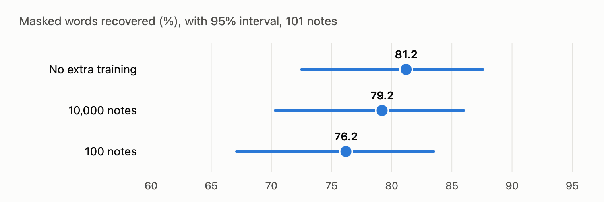

In the summer of 2024 I did a research internship at TecNM Morelia, in Mexico, with Programa Delfín. I worked with Spanish clinical text, and one part of the project was to see if a language model could recover clinical words hidden in a note. It is a first step towards removing personal details from clinical text.

I compared a biomedical RoBERTa for Spanish with versions of the same model that I trained further on diabetes notes, using 100, 6,000 and 10,000 of them. The test had 101 notes, each with one clinical word masked by hand.

| Extra training | Words recovered | 95% interval |
|:--|--:|:--:|
| None | 81.2% | 72.5 to 87.6 |
| 10,000 notes | 79.2% | 70.3 to 86.0 |
| 100 notes | 76.2% | 67.1 to 83.5 |

: Exact recovery of the masked word, 101 notes. Wilson intervals, computed for this note. {.striped}

{fig-alt="Three overlapping intervals: 81.2, 79.2 and 76.2 percent"}

The model without extra training had the highest score. In my portfolio I wrote that extra training lowered the score, and it is true for these notes. Looking at the intervals now, they overlap almost completely, and the difference between the first two rows is two notes out of 101. The same notes were used for every model, so a paired test on each answer would be more precise than these intervals, and I would need the individual answers to do it.

What I can say is that extra training showed no improvement on this test. I cannot say that it hurts.

There are three more limits I would fix before repeating it. The test notes were synthetic, written by GPT-3.5 in the style of a real case report, and real hospital notes have more abbreviations. Each note tested a single word. And exact match counts "enfermedad" as wrong when the hidden word was "diabetes", although both fit the sentence.

If I repeated it, I would choose the size of the test before training and write down which difference is big enough to matter.

More about the project: [Language models for Spanish clinical notes](https://carolain-jimenez.netlify.app/nlp-clinico.html) and [the repository](https://github.com/carolain3472/nlp_notes_diabetes).
