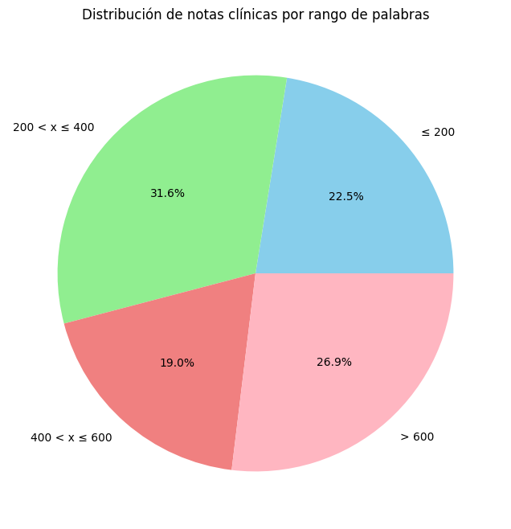
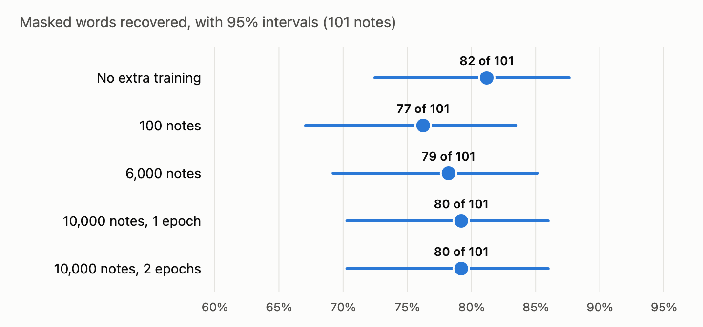
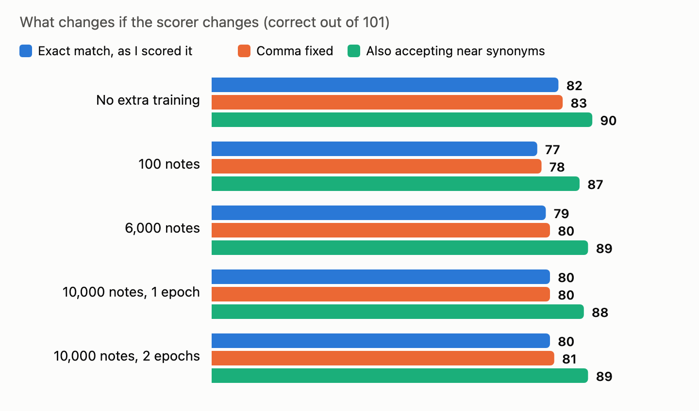
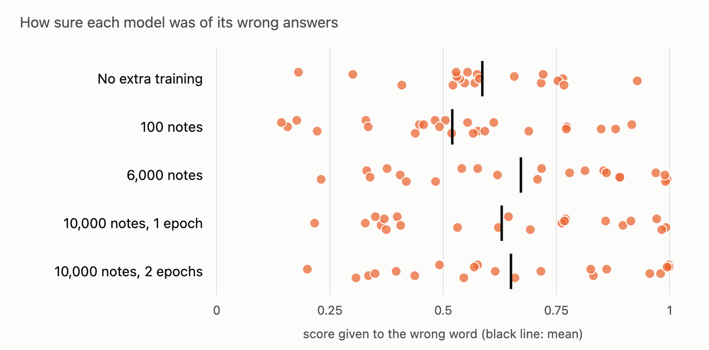

In the summer of 2024 I spent some weeks at TecNM Morelia, in Mexico, with Programa Delfín. I worked with clinical notes in Spanish. There is much less of that than in English, and hospital notes have a way of writing that general models have not seen.

One part of my work was this: hide one word of a note and see if a language model can guess it. It is a first step towards removing personal details from clinical text. I took a biomedical RoBERTa for Spanish, trained it further on sets of 100, 6,000 and 10,000 notes, and wanted to see if each version got better than the one before.

The one with no extra training won.

I wrote that in my portfolio and moved on. This week I opened the notebook again, because it still had every answer of every model, 101 notes by 5 models, and I had only ever looked at the final percentage.

## The notes

Before training anything I had looked at the corpus. These two plots are from the original notebook, with the colors I chose back then.

::: {layout-ncol=2}
{fig-alt="Pie chart of note length"}

{fig-alt="Bar chart of the 15 most mentioned diseases"}
:::

The test was different: 101 short notes about diabetes, generated with GPT-3.5 in the style of a real case, where I masked one word by hand in each one. In 31 of them the hidden word was *diabetes*, so a model that always answers "diabetes" already gets 31%.

## First, is it really worse

{fig-alt="Five overlapping 95 percent intervals"}

The lines are 95% intervals, and with 101 notes they are wide. They overlap almost completely. But all the models answered the same notes, so there is a better way to compare: count only the notes where they disagree, what one lost and what the other won. That is McNemar's test.

| Against no extra training | Lost | Won | p |
|:--|--:|--:|--:|
| 100 notes | 5 | 0 | 0.06 |
| 6,000 notes | 8 | 5 | 0.58 |
| 10,000 notes, 1 epoch | 7 | 5 | 0.77 |
| 10,000 notes, 2 epochs | 8 | 6 | 0.79 |

: Notes that each trained model lost and won, exact test {.striped}

So for the big training sets I can't say that it got worse. They lost some and won almost as many. The only one that looks bad is the small set of 100 notes, which lost five and won none, and even there p is 0.06.

I liked the second column more than the p values, because "lost 8 and won 6" means the model **changed**. An average hides that.

## What changed

These are the notes where the five models do not agree.

{fig-alt="Grid of notes by model, right and wrong"}

Reading from top to bottom you can see columns flip. I went to look at the words:

| Hidden word | No extra training | 10,000 notes, 2 epochs |
|:--|:--|:--|
| dislipidemia | dislipemia | dislipidemia ✓ |
| glucosa | glicemia | glucosa ✓ |
| glucemia | glucemia ✓ | glucosa |
| glucémico (three notes) | glucémico ✓ | metabólico, with scores 0.96, 0.57 and 0.99 |
| metabólico | glucémico | metabólico ✓, with score 0.997 |

The base model says *dislipemia* and *glicemia*. The trained one says *dislipidemia* and *glucosa*. And where the base model answers *glucémico*, the trained one answers *metabólico*, often very sure of itself, whether it is right or not.

It did not forget medicine. It learned another way of writing it. In most of these cases a doctor would probably read both words and not stop. (I am an engineer, so I would like one to confirm it.)

## A bug in my evaluator

One note was wrong for all five models. The hidden word was *cardiovascular* and four of them had answered *cardiovascular*. The problem was mine: I took the original word from the text with its comma, so I was comparing `cardiovascular` with `cardiovascular,` and they are not equal.

It moves one point, and it was there for two years.

Then I tried a softer scorer that also accepts five groups of near synonyms that I chose by hand, like *glucosa / glucemia / glicemia* or *glucémico / metabólico*.

{fig-alt="Bars with three ways of scoring each model"}

With that scorer the five models go from 87 to 90 out of 101, and the differences I reported are practically gone. I chose the groups after seeing the answers, which is exactly what you should not do to publish a number, so I use it only to understand where the gap was. Most of it was in my ruler.

## The part I did not expect

{fig-alt="Scores given to wrong answers, by model"}

Each dot is a wrong answer, and how far right it is tells how sure the model was. The base model gave more than 0.9 to one wrong answer. The models trained with 6,000 and 10,000 notes gave it to four, four and five. Accuracy looks the same and the mistakes got more confident. For something that would end up in a hospital I care more about this plot than about the first one.

## Why it did not improve, probably

When I read the training code again I found this:

```python
folder_path = '/content/drive/MyDrive/notas_preprocesadas_100'
```

I trained the 100-note version with the notes **after** preprocessing: lowercase, no punctuation, no numbers and no stop words. And then I tested it with normal sentences. A model that learns from "paciente años diabetes tipo tratamiento" is later asked to fill a gap in a full sentence with commas. It was the only version that lost and won nothing, which fits. I only have the path of that one in the notebook, so I can't say it for the others.

I was also cutting each note at 256 tokens. More than a quarter of the notes have over 600 words, so the model never saw the end of the long ones.

## If I did it again

I would train on the text as it is. I would decide before starting how many test notes I need to see a difference of, say, five points, and 101 is not enough. I would have two people agree on which words count as the same before looking at any answer. And I would plot the confidence of the mistakes from the first day.

The 505 answers are in [lab/clinical-words](https://github.com/carolain3472/carolain3472.github.io/tree/main/lab/clinical-words) (only the hidden word and the prediction, not the notes). The project is [here](https://carolain-jimenez.netlify.app/nlp-clinico.html) and the code is [in its repository](https://github.com/carolain3472/nlp_notes_diabetes).
