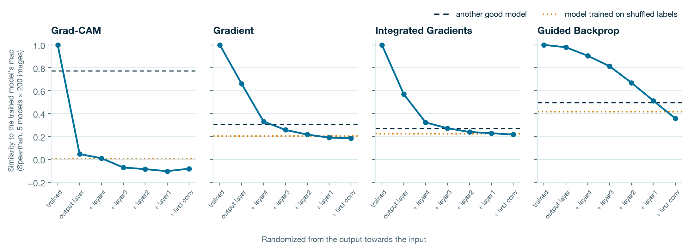
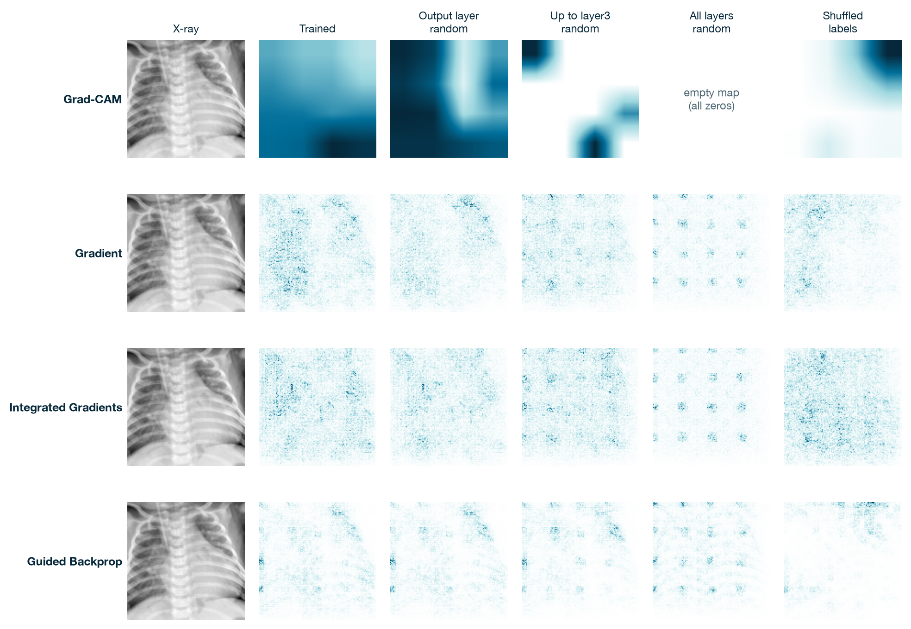

When a paper on medical images wants to show that its model looks at the right place, it usually puts a heat map next to the image: the lung lights up, so the model must be looking at the lung. The maps go by many names, saliency maps, attribution maps, and they all answer the same question, which pixels pushed the decision.

There is a simple way to check whether a map says anything about the model. You destroy the model and draw the map again. If the map hardly changes, it was never describing what the model learned. @adebayo proposed this test in 2018 and found methods that fail it on natural images. I wanted to see it with my own hands on X-rays, small enough to run on my laptop.

## The setup

The data is PneumoniaMNIST [@medmnist], a version of the pediatric chest X-rays of @kermany at 128 × 128 pixels: 4,708 images to train, 524 to validate and 624 to test, labelled normal or pneumonia.

I trained a ResNet-18 from scratch five times with five different seeds, 15 epochs each, and kept the epoch with the best validation AUC. On the test set they reach an AUC between 0.970 and 0.984.

I also trained three models of the same architecture on **shuffled labels**: I mixed the labels of the training set once and let the network memorize them for 60 epochs. They end up right on 99.9% of the training images and at an AUC between 0.46 and 0.49 on the test set, which is chance. They learned nothing about pneumonia, and that is what makes them useful here.

I compared four methods, all on the class that the trained model predicts:

- **Gradient** [@simonyan]: how much the score changes when each pixel changes.
- **Integrated Gradients** [@ig]: the gradient added up along a path from a black image to the real one, 32 steps.
- **Guided Backprop** [@guided]: the gradient, letting only positive signals pass back through each ReLU.
- **Grad-CAM** [@gradcam]: the last convolutional block weighted by its gradient. In this network that block is a grid of 4 × 4 cells, so the map is enlarged from 16 numbers.

I took 200 test X-rays, 100 of each class, and compared each map with the original one using the Spearman correlation over its 16,384 pixels (absolute values). 1 means the same ordering of pixels and 0 means no relation. The intervals are 95% bootstrap intervals over the images.

## Breaking the model one layer at a time

The test is to re-initialize the network from the output towards the input: first the output layer, then the last block too, and so on until no trained weight is left. At every step I draw the map again and compare it with the one of the trained model.

Two horizontal lines give each number a scale. The dashed one is how much the maps of **two good models**, trained with different seeds, agree with each other. The dotted one is how much the map of a good model agrees with the map of a **model trained on shuffled labels**.

{.column-page fig-alt="Four line charts, one per method. Grad-CAM falls to zero at the first step, Gradient and Integrated Gradients fall to about 0.2, Guided Backprop stays at 0.98 after the first step and goes down slowly."}

| Method | Output layer random | All layers random | Shuffled labels | Another good model |
|---|---|---|---|---|
| Grad-CAM | 0.05 [0.03, 0.06] | −0.08 | 0.00 [−0.03, 0.03] | **0.77** [0.76, 0.79] |
| Gradient | 0.66 [0.64, 0.67] | 0.18 | 0.20 [0.19, 0.21] | 0.31 [0.29, 0.32] |
| Integrated Gradients | 0.57 [0.56, 0.58] | 0.22 | 0.22 [0.21, 0.24] | 0.27 [0.26, 0.29] |
| Guided Backprop | **0.98** [0.98, 0.98] | 0.36 | 0.42 [0.41, 0.42] | 0.49 [0.48, 0.51] |
: Spearman correlation with the map of the trained model, mean over 5 models (3 for shuffled labels) and 200 images. {.striped}

## What each method did

**Guided Backprop** is the clearest case. I replaced the 1,026 weights of the output layer with random numbers and the map stayed at 0.98. The network after that change gives random answers and the picture looks the same. And the map of a model that learned nothing at all (0.42) is almost as close to the original as the map of another good model (0.49). This is what @adebayo found on natural images, and it holds here.

**Grad-CAM** passes the test without doubt. Change the output layer and the map has nothing to do with the original one (0.05). Two good models agree a lot (0.77), and the model of shuffled labels gives a different map (0.00). One thing I counted apart: with random weights the map often comes out empty, all zeros, because Grad-CAM keeps only the positive part. That happened in 597 of 1,000 maps with the whole network random. I counted those as 0, and I report it because it pulls the means down.

**Gradient and Integrated Gradients** change when the network is damaged, so in that sense they pass. But the most useful number for me was in the last column. Two models that are equally good agree only 0.31 and 0.27, and a model that learned nothing gets 0.20 and 0.22. The map of one model tells you a lot about that particular model, the seed, the order of the batches, and little about the task.

{.column-page fig-alt="A grid of maps. Rows are the four methods and columns are the trained model, output layer random, up to layer3 random, all random and shuffled labels."}

In the figure you can also see a regular grid of dots in the gradient maps of the random networks. I think it comes from the strides of the convolutions, which leave that pattern when there is nothing learned on top of it, but I did not test it.

I also expected the maps that survive the randomization to look like the edges of the image, which is the explanation people give for Guided Backprop. I compared every map with the edges (a Sobel filter) and the correlations were low for every method, 0.28 at most. I don't have evidence for that idea in this data.

## What it means and what it does not

Passing this test is necessary and nowhere near enough. It says that the map depends on what the model learned. It does not say that the map points to the lesion. PneumoniaMNIST has no boxes around the lesions, so I can't measure that here. @arun did it with boxes on chest X-rays and found that most methods did not localize well.

And Grad-CAM, the one that passes, works on 16 cells. It can tell you which quarter of the chest weighed more in the decision. It can't point to a small opacity.

If I had to choose a map for a clinical paper with this setup, I would choose Grad-CAM and say what resolution it has. I would not show Guided Backprop as evidence of anything. And I would not show the gradient of a single model: I would average it over several models, or at least show how much two of them disagree.

## Limits

- One dataset, one resolution and one architecture trained from scratch. A network pre-trained on ImageNet could behave differently.
- Spearman on absolute values ignores the sign of the map. I also computed SSIM and the pattern is the same; it is in the results file.
- Re-initializing the batch normalization layers also resets their statistics, which changes the scale of the activations. It is part of destroying the model, but it is a choice.
- The maps explain the class predicted by the trained model, also when the model is wrong.

## Code and data

The code, the summary table and every similarity per image are in [lab/saliency](https://github.com/carolain3472/carolain3472.github.io/tree/main/lab/saliency). The trained weights are not there because of their size. With the same seeds, `train.py` and `sanity.py` should give close numbers, though not identical ones, because the GPU operations I used (Apple M4) are not fully deterministic.

## References
