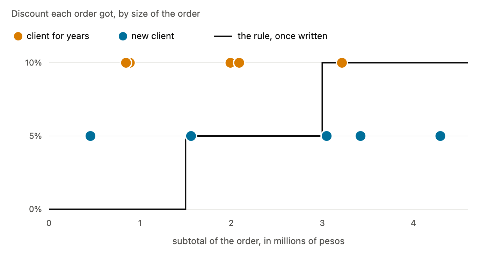
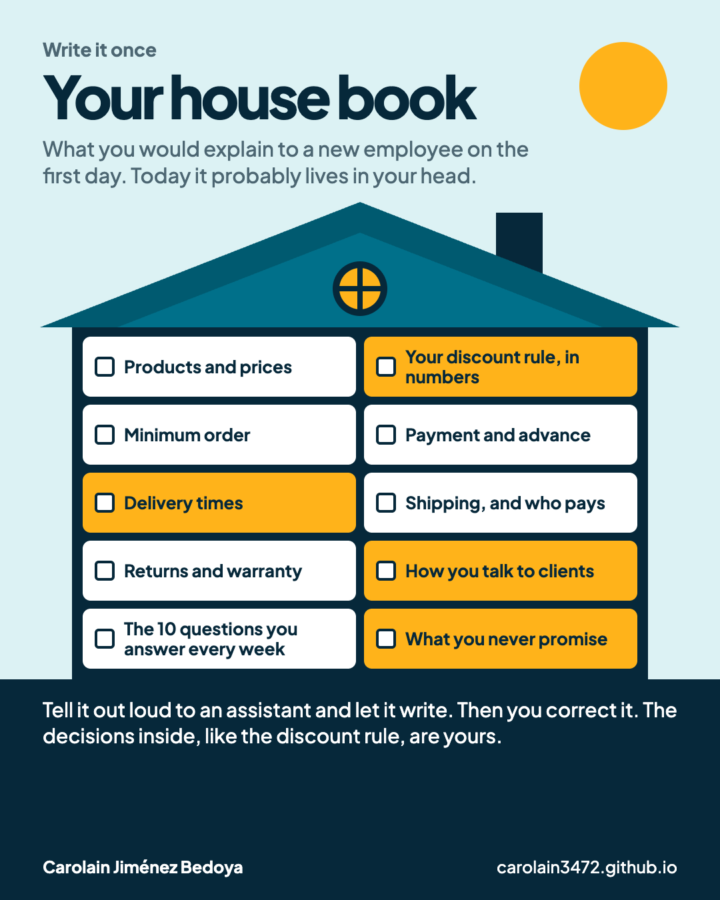

In small companies a lot of rules live in someone's head. How much discount, for whom, who pays the shipping. It works while that person answers every message, and it stops working the day you ask an assistant to make the quotes.

I wanted to see what a model does with a rule that is half written. I expected a mess, with a different price every time. That is not what happened.

## The test

I invented a coffee roaster with four products and ten orders, five from old clients and five from new ones. Everything was in Spanish. This was the vague policy, translated:

> We give discounts for large orders, normally between 5 and 10%, depending on the client. With the shops that have been with us for a while we try to help a bit more. Shipping is charged depending on the case. If the order is good, sometimes we cover it. A normal shipping is more or less $25,000.

And this was the written one: 0% below $1,500,000, 5% from there, 10% from $3,000,000, nothing else. Shipping is $25,000 below $1,000,000 and free above.

I asked three models for each quote ten times, in four ways:

1. With the vague policy, and permission to ask the owner.
2. With the vague policy, and the client waiting for a total.
3. With the written rule.
4. The model only reads the order, and a program applies the rule.

That makes 1,200 answers.

## With permission, they ask

| Model | Vague, asked the owner | Written rule, exact total | Program does the math, exact total |
|:--|--:|--:|--:|
| Claude Haiku 4.5 | 98 of 100 | 99 of 100 | 100 of 100 |
| Claude Haiku 5.5 | 92 of 100 | 100 of 100 | 100 of 100 |
| Claude Sonnet 5.5 | 100 of 100 | 100 of 100 | 100 of 100 |

I liked the first column. Almost always the model stopped and asked something like this, which is an answer of Sonnet, translated:

> What discount (between 5 and 10%) applies to Tienda Azafrán for this order (subtotal $1,992,000), and do we charge the shipping (approx. $25,000) or cover it?

Those questions are the list of decisions that the owner had not made. You could copy them, answer each one once, and you would have the policy.

## Without permission, they decide

The only thing I changed was the ending. "The client is waiting. What total do we send?"

{fig-alt="Discount of each order by size, with the written rule as a step line"}

All of them answered, 300 times out of 300. And they did not answer at random. Old clients got 10% and new clients got 5%, in **298 of the 300 quotes**, with three different models.

Nobody wrote that rule. It is a possible reading of my text, since I did say that old clients get a bit more help. But the policy talked about large orders, and the size did not matter at all. An order of $456,000, the smallest one, got 5%. The largest one, of $4,296,000, got the same 5%. An old client with $846,000 got 10%.

The shipping is the part that did change. For the same order, some answers charged it and some gave it away.

I checked the arithmetic and it was right the 300 times. That worries me more than if it was wrong, because if you review these quotes you find nothing. The totals add up, and they even look consistent.

## What I would do with this

I would write the rule before choosing the tool. If it fits in one line, like "5% from a million and a half", it does not need AI at all, and it can live in a spreadsheet.

I would always leave the model a way out, with a field for its question. It costs one line and it was the difference between asking 290 times out of 300 and never asking.

And I would keep the questions it asks in the first week. They are a good draft of what I call the house book, everything you would explain to a new person on the first day.

{fig-alt="Infographic: checklist for your house book"}

## Limits

The company is invented and the orders are clean. The old client was always written as "client since 2022", and that probably pushed the models to use it. I tested three models of the same family. And the vague policy mentions 5 and 10, so a different text would give a different invented rule. What I would expect to find again is that there is one.

The code and the 1,200 answers are in [lab/same-quote](https://github.com/carolain3472/carolain3472.github.io/tree/main/lab/same-quote). I ran the tests with help from Claude Code.
