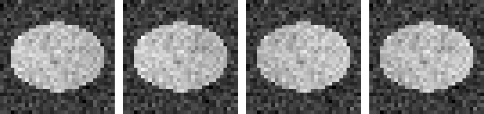
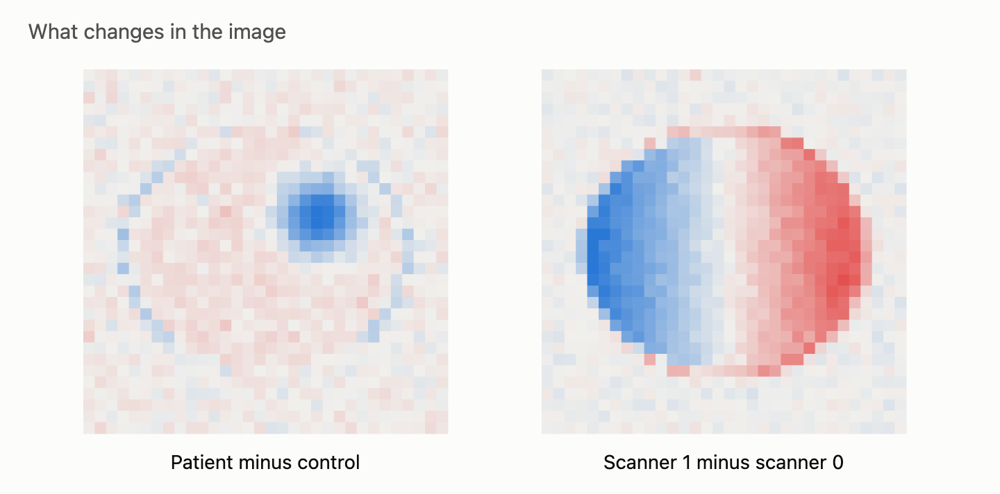
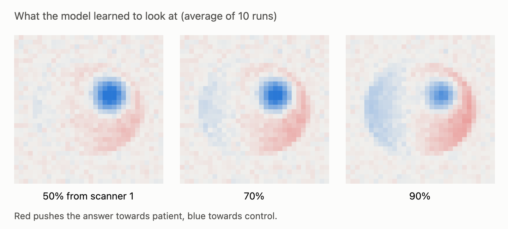
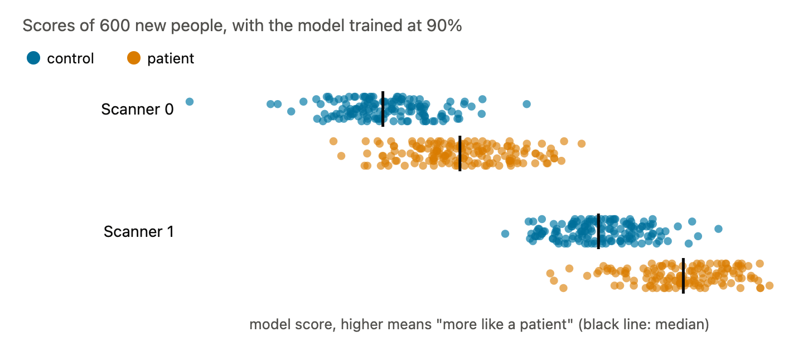

I work with brain MRI, and there is one question I can't let go of: when a model separates two groups of people, what is it looking at.

Medical imaging datasets are often put together from several hospitals, and each hospital has its own scanner. If most patients come from one and most healthy people come from another, there are two ways of getting the right answer. One is to see the disease. The other is to recognize the machine, which is much easier.

You read this in many papers. I wanted to have it in my hands, with something so small that I could see every part of it, so I built a fake brain.

## A very bad brain

It is a gray ellipse of 32 × 32 pixels. People differ a little in size, the way people do. Patients have a faint dark spot that moves a bit from one person to another. And the scanner adds a soft shadow: one machine leaves the right side of the image a bit brighter, the other one the left. Every image is normalized on its own, which is a common step, and the shadow survives it.

{fig-alt="Four simulated brain images"}

Looking at them one by one, I can't tell you which is which. If I average 800 of each and subtract, everything appears:

{fig-alt="Two maps, a blue spot for the disease and a left to right gradient for the scanner"}

The disease is a small spot. The scanner touches the whole brain. Keep those two pictures in mind.

## Changing one number

I trained a logistic regression on 600 of these images, half patients and half controls. I kept everything fixed except how many of the patients came from scanner 1. At 50% the scanner tells you nothing. At 90%, nine of every ten patients come from scanner 1 and nine of every ten controls from scanner 0.

Then I tested each model on 1,000 new people, twice. In the first test they had the same mix of scanners as the training data, which is what you get when you split one dataset at random. In the second, the scanner had nothing to do with the disease. All the numbers are the mean of 10 runs.

```{=html}

<div style="height:1rem"></div>
```

The blue line barely moves, between 0.96 and 0.97. If that were the only test I had, I would have felt good at every point of it. The orange one ends at 0.69.

| Patients from scanner 1 | Same mix | Each scanner on its own | Scanner unrelated to disease | Only the scanner label |
|:--|--:|--:|--:|--:|
| 50% | 0.97 | 0.98 | 0.97 | 0.50 |
| 60% | 0.97 | 0.97 | 0.96 | 0.60 |
| 70% | 0.96 | 0.96 | 0.92 | 0.69 |
| 80% | 0.96 | 0.95 | 0.81 | 0.79 |
| 90% | 0.97 | 0.88 | 0.69 | 0.90 |

: AUC, mean of 10 runs {.striped}

The last column is a "model" that never opens the image. It only knows which machine was used, and at 90% it gets 0.90.

I also repeated everything without the spot, so there was no disease to find. With the 90% mix the model still got 0.90 in the first test and 0.50 in the second. It was reporting an excellent result about nothing.

## Looking inside

A logistic regression has one weight per pixel, so you can draw them as an image. This is my favorite part.

{fig-alt="Weight maps of the model at 50, 70 and 90 percent"}

At 50% the model found the spot. At 90% the spot is still there, weaker, and around it you can see the left to right shadow of the scanner. Compare it with the picture of what the scanner does. Nobody told the model about scanners. It took the two things that helped and mixed them.

And this is what that does to the scores:

{fig-alt="Scores of controls and patients, separated by scanner"}

Inside each scanner, patients score higher than controls, so it did learn something. But the healthy people of scanner 1 score higher than the patients of scanner 0. Any cut point you choose is going to be unfair to one of the two hospitals.

That explains a number of the table that confused me. At 90%, each scanner on its own gives 0.88 and everyone together gives 0.69. Checking each site separately is good, and it would have shown me only a part of the problem, because the scores of two people scanned on different machines can no longer be compared.

## What I would ask of a result now

1. A table of how many patients and controls came from each scanner, and the AUC of that label alone. It takes five minutes. If it is far from 0.5, there is something to explain.
2. The AUC inside each scanner, and the distribution of scores of each one, not only the number.
3. A test on people whose scanner has no relation with the diagnosis, or on a site the model never saw.
4. If the model lets you, a picture of what it looks at. It proves nothing by itself, but it can make you suspicious in time.

## It happens with real images

Zech and colleagues trained a network to find pneumonia in chest X-rays. It got an AUC of 0.931 on new images from the hospitals of the training set and 0.815 at another hospital. Sorting the images only by hospital already gave 0.861 [@zech]. Glocker and colleagues took brain MRI from two studies, matched people by age and sex, preprocessed everything carefully, and a classifier could still say which study each scan came from [@glocker].

My version is a toy. A real scanner differs in many more ways than one shadow, real lesions are not round, and a deep network is not a logistic regression, so my numbers mean nothing outside this page. What I got from it is that now, when I see a very good AUC, I have a picture in my head of what could be inside.

It needs only NumPy and runs in less than 15 seconds. Change `lesion` and `bias` and watch the second test fall: [experiment.py](https://github.com/carolain3472/carolain3472.github.io/blob/main/posts/scanner-shortcut/experiment.py), and [figures2.py](https://github.com/carolain3472/carolain3472.github.io/blob/main/posts/scanner-shortcut/figures2.py) for the maps.

## References

::: {#refs}
:::
