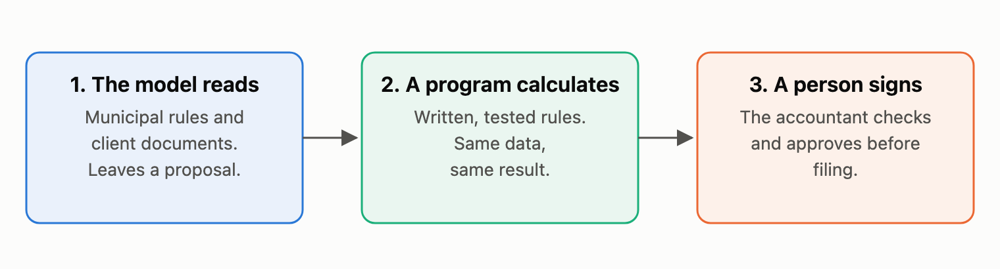
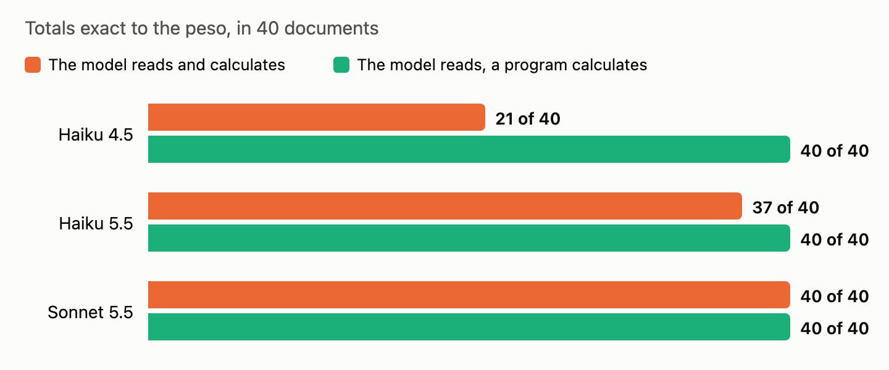
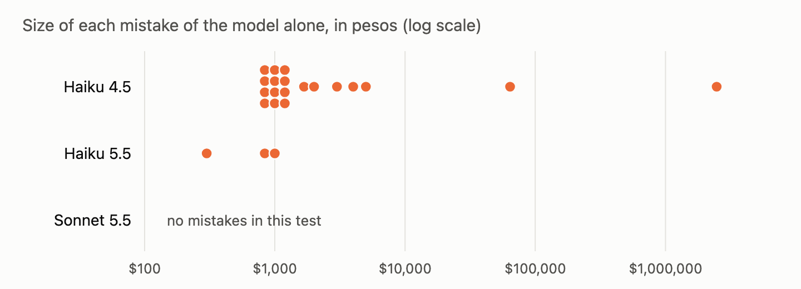

At work we built a platform for accountants that helps them file a local business tax in Colombia. Every municipality writes its own rules, with its rates, its penalties and its calendar, and they change. The accountant has to read the municipal agreement, go through the documents of the client and fill in a form line by line. One wrong figure is a fine. (I am an engineer and not an accountant, and everything below comes from that.)

The rule we follow is that AI reads and proposes, a program calculates, and an accountant approves. Nothing goes out without that approval.

{fig-alt="Diagram: the model reads, a program calculates and a person signs"}

You could think this is too much trouble, if the model can read the document and give you the total in one go. It is a fair doubt, because models have improved a lot since that rule was written. So I put it to the test.

## The town that doesn't exist

I invented a town with five activities and their rates, a signage tax of 15%, a fire brigade surcharge of 3%, withholdings and a discount for paying early. It does not match any real place and it is useless for filing anything. With that I generated 40 documents in Spanish. This is one of them, translated:

> Activity 412, consulting, closed with income of $436,996,994, no returns. Retail, code 203: $343,928,131, of which $6,010,663 were returned. Payroll for the last quarter was $41,780,000. Clients withheld $346,559. They will pay within the early payment period.

Each one has a trap, a figure that is not needed, like that payroll.

I tried two ways with three models of different sizes. In the first, the model gets the document and the rules and answers with the total. In the second, the model only pulls the data into a JSON, and a program of ten lines does the math:

```python
tax     = thousands(sum((income - returns) * rate / 1000))
signage = thousands(tax * 0.15)
fire    = thousands(tax * 0.03)
total   = tax + signage + fire - thousands(withheld)
if early_payment:
    total = total - thousands(total * 0.10)
```

## What happened

{fig-alt="Bars with exact totals per model and per way"}

The three models read the 40 documents without a single mistake. Not one figure changed, and none of them fell for the trap. With the program doing the math, the three got 40 out of 40.

When the model does everything, the smallest one gets 21 out of 40, the middle one 37 and the big one 40.

I leave that last 40 here because it goes against my rule and it would be easy to hide. Sonnet 5.5 did the math 40 times in a row and never failed. So "models can't add" is no longer a good reason for the rule.

## What the mistakes look like

{fig-alt="Size of the mistakes per model on a log scale"}

Most of them are one thousand pesos: a rounding done too early or too late. Those are the hardest to see, because the total looks a lot like the right one. But a form that is off by a thousand pesos is wrong.

And there is one that is something else. The document I showed above gives $6,647,000. The small model answered **$4,174,000**. That is almost two and a half million pesos less, in one of the shortest documents, said as calmly as all the others. If you review a sample of ten, that one will probably not be there.

## So why the program

If the big model always gets it right, I am left with three reasons.

The first one is that you can check the program. It is ten lines, and an accountant can read them with me and say "that is not how it's rounded here". I can't ask a model that got 40 right what it is going to do with number 41.

The second is that when something goes wrong you know where. If the figure is wrong, the model read it wrong. If the figure is right and the total is not, the rule is wrong. If both are right and something else was filed, someone approved without looking. When one model does the three steps, you can't have that conversation.

The third is that with the program the small model is enough. Pulling the data is easier than doing the math, and in my test it was also faster: with Haiku 4.5, about 4 seconds to read against 14 to read and calculate. For many companies that decides if the project pays for itself.

## Taking it to another process

One way of repeating this in another company is to take the process and mark each step with a letter. **R** for reading, summarizing or classifying. **C** for calculating or applying a rule that is already written. **D** for deciding something that somebody answers for.

With this case: reading the municipal agreement is R, pulling the client's figures is R, calculating the tax is C, approving is D. The R steps are good to start with AI. The C steps almost always want a program, and sometimes it already exists and lives in a spreadsheet. The D steps stay with a person who has a name and a position.

You can do it on paper in one meeting, and then the conversation does not start with the tool.

## What this test doesn't say

A program generated the documents, so they are clean. A real one comes scanned, crooked, with a handwritten note on the side, and there the reading will fail. The rules fit in one paragraph, and a municipal agreement has dozens of pages. I ran each model once. Reading 40 of my documents perfectly does not mean reading your client's perfectly, and that is why the accountant is still at the end.

The code, the 40 documents and all the answers are in [lab/ia-propone](https://github.com/carolain3472/carolain3472.github.io/tree/main/lab/ia-propone) (in Spanish).
