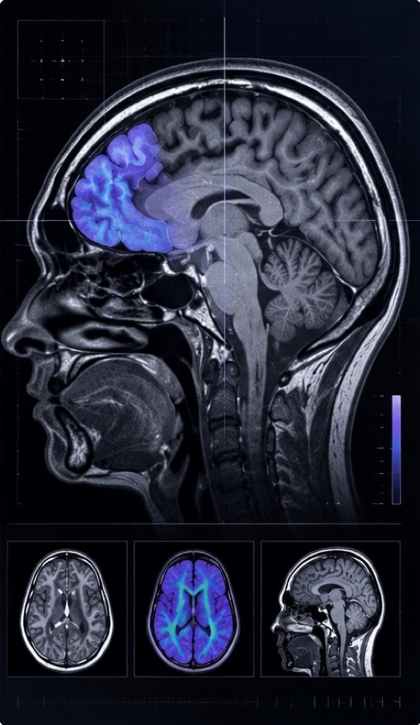
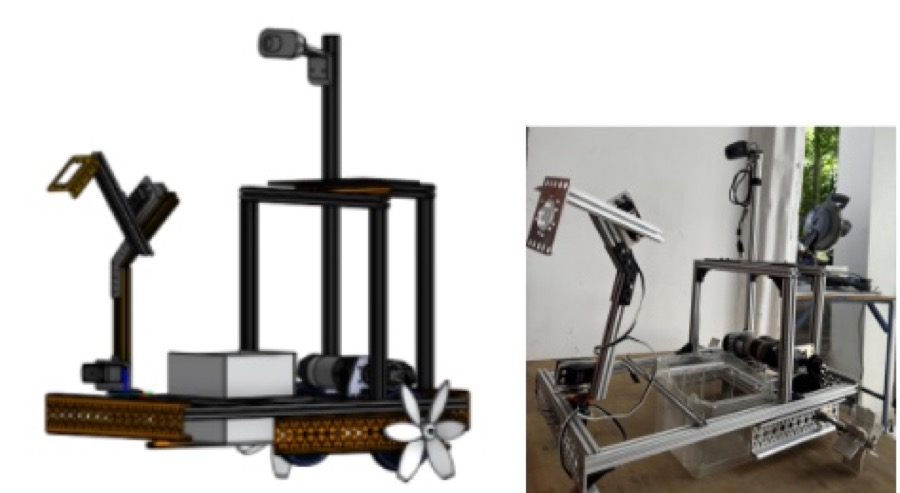
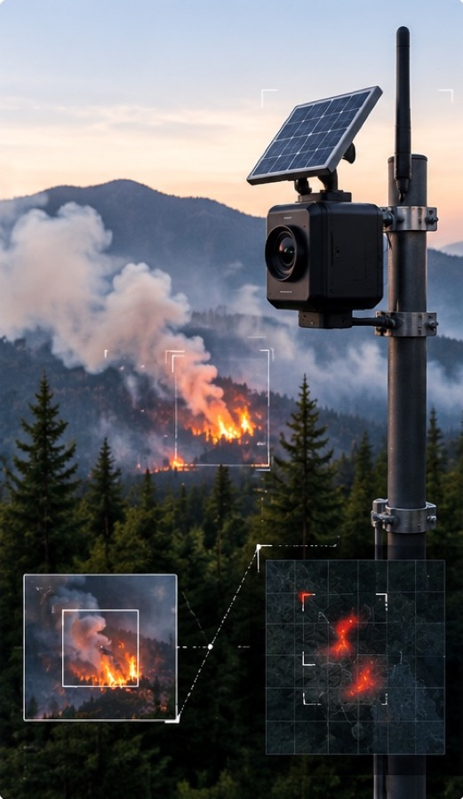

```{=html}
<div class="sec"><h1>Research</h1><p>I study medical images, and above all whether we can believe what a model says about them. I do it with the MMV group at Universidad del Valle.</p><p>In these notes I make the problem small enough to look inside. Each one comes with its code or its data.</p></div>
<h2>Notes</h2>
<div class="cards">
<a class="big" href="posts/scanner-shortcut/"><div class="pic fit" style="background-image:url(posts/scanner-shortcut/sc-weights.png)"></div><div class="tx"><small>Medical imaging</small><h3>When a model learns the scanner</h3><p>The same model scores 0.97 or 0.69, and you can see inside it what it was looking at.</p></div></a>
<a class="big" href="posts/negative-result/"><div class="pic fit" style="background-image:url(posts/negative-result/cw-grid.png)"></div><div class="tx"><small>Clinical NLP</small><h3>I trained the model more and it did not improve</h3><p>101 notes, a bug in my own evaluator, and a model that changed its vocabulary.</p></div></a>
</div>

<h2>Publication</h2>
<p><strong>Identification of Traumatic Brain Injury on Magnetic Resonance Imaging.</strong> Jiménez, C., Chaves, D., Trujillo, M., Herrera, A., Ledesma, M. <em>CIARP 2025</em>, Lecture Notes in Computer Science, vol. 16529. Springer, Cham. Oral presentation, Bogotá. <a href="https://doi.org/10.1007/978-3-032-23176-5_14">10.1007/978-3-032-23176-5_14</a></p>

<h2>Projects</h2>
<div class="four">
<a href="https://carolain-jimenez.netlify.app/tbi.html">Traumatic brain injury on MRI<span>Radiomics on T1-weighted images</span></a>
<a href="https://carolain-jimenez.netlify.app/nlp-clinico.html">Spanish clinical notes<span>Language models, TecNM Morelia</span></a>
<a href="https://carolain-jimenez.netlify.app/renova.html">RENOVA<span>Aquatic plants on a Raspberry Pi</span></a>
<a href="https://carolain-jimenez.netlify.app/nte.html">Kawsay<span>Wildfire detection, FIRST Global 2026</span></a>
</div>
```
