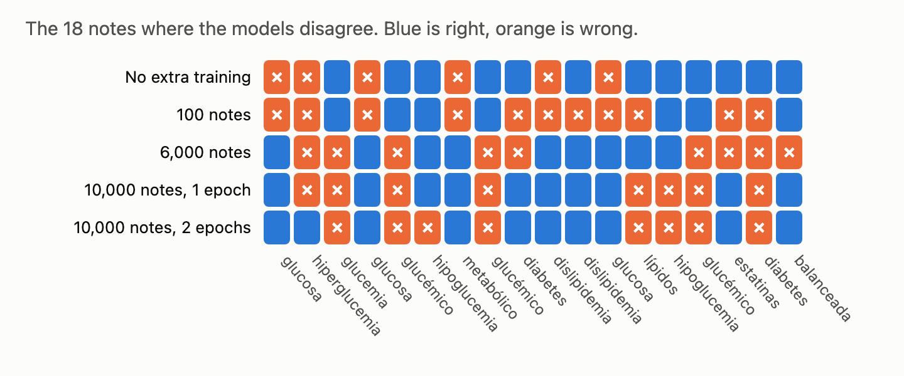

```{=html}
<div class="biz pg">
<header class="top"><div class="w"><h1>Research on <em>trustworthy AI</em></h1><div><p>I study medical images, and above all whether we can believe what a model says about them. I do it with the MMV group at Universidad del Valle.</p><p>In these notes I make the problem small enough to look inside. Each one comes with its code or its data.</p></div></div></header>
<nav class="jump"><div class="w"><a href="#notes">Notes</a><a href="#publication">Publication</a><a href="#projects">Projects</a></div></nav>
<section class="w found" id="notes"><h2 class="no-anchor">Notes</h2><div class="nts"><a class="n1" href="posts/scanner-shortcut/"><div class="pic"></div><div class="tx"><small>Medical imaging</small><h3 class="no-anchor">When a model learns the scanner</h3><p>The same model scores 0.97 or 0.69, and you can see inside it what it was looking at.</p><span class="more">Read the note →</span></div></a><a class="n4" href="posts/negative-result/"><div class="pic"></div><div class="tx"><small>Clinical NLP</small><h3 class="no-anchor">I trained the model more and it did not improve</h3><p>101 notes, a bug in my own evaluator, and a model that changed its vocabulary.</p><span class="more">Read the note →</span></div></a></div></section>
<section class="sand" id="publication"><div class="w"><h2 class="no-anchor">Publication</h2><div class="pub"><span class="tag">CIARP 2025 · Oral presentation, Bogotá</span><h3 class="no-anchor">Identification of Traumatic Brain Injury on Magnetic Resonance Imaging</h3><p>Jiménez, C., Chaves, D., Trujillo, M., Herrera, A., Ledesma, M.</p><p class="ven"><em>CIARP 2025</em>, Lecture Notes in Computer Science, vol. 16529. Springer, Cham.</p><p class="go"><a href="https://doi.org/10.1007/978-3-032-23176-5_14">DOI 10.1007/978-3-032-23176-5_14</a></p></div></div></section>
<section class="w found" id="projects"><h2 class="no-anchor">Projects</h2><p class="lead">Longer projects, explained on my portfolio.</p><div class="prj"><a href="https://carolain-jimenez.netlify.app/tbi.html"><b>Traumatic brain injury on MRI</b><span>Radiomics on T1-weighted images</span></a><a href="https://carolain-jimenez.netlify.app/nlp-clinico.html"><b>Spanish clinical notes</b><span>Language models, TecNM Morelia</span></a><a href="https://carolain-jimenez.netlify.app/renova.html"><b>RENOVA</b><span>Aquatic plants on a Raspberry Pi</span></a><a href="https://carolain-jimenez.netlify.app/nte.html"><b>Kawsay</b><span>Wildfire detection, FIRST Global 2026</span></a></div></section>
<section class="end"><div class="w"><h2 class="no-anchor">Check the numbers</h2><div><p>Every note comes with its code or its data. If you find a mistake, tell me.</p><p class="go"><a href="https://carolain-jimenez.netlify.app/contact.html">Write to me</a><a class="alt" href="blog.html">All notes</a></p></div></div></section>
</div>
```
